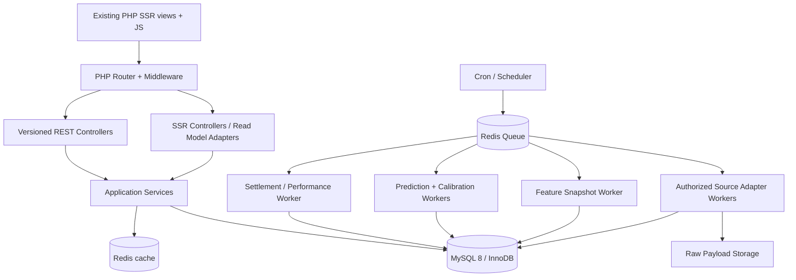
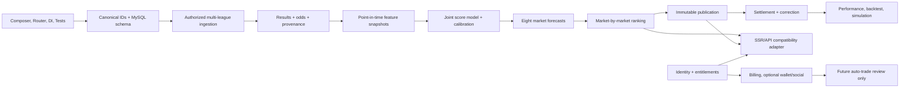

# SIMORA — BACKEND INTEGRATION & SYSTEM ARCHITECTURE BLUEPRINT

**Version:** 2.0 — reconciled audit | **Date:** 2026-11-05 | **Repository:**<https://github.com/bellrichies/simora> | **Reviewed branch:** `main` | **Reference commit:** `8c8406e726b2792c116d1bb2455c7ffad08a026e`

**Audit status:** Design-level consistency and traceability reviewed against repository commit `8c8406e726b2792c116d1bb2455c7ffad08a026e`. The current repository was inspected; this blueprint is not a substitute for executing migrations, running integration tests, or establishing external provider access.

**Purpose:** Implement the production backend and database behind the existing server-rendered Simora frontend, without rebuilding the UI. This is an implementation specification, not a claim that the backend has been coded, migrations applied, source licensing obtained, or predictions validated.

## 0. Scope and architectural constraints

- Preserve existing PHP SSR page routes, views, Tailwind CSS, progressive enhancement and JavaScript behavior. Use custom PHP 8.2+ OOP MVC, PSR-4/PSR-12, Composer, PDO MySQL 8, InnoDB, Redis queues/cache, PHPMailer where appropriate. PHP 8.1 is the current preview minimum; raising the runtime baseline is a **proposed change** to verify against deployment hosting.
- Multi-platform schema (SportyBet, BetPawa, BetKing) and multi-league ingestion; prioritize authorized SportyBet data, leave unconnected providers clearly unavailable. Never conflate bookmaker-specific identifiers, feeds, odds, or seasons.
- Eight markets: `over_15`, `under_15`, `over_25`, `under_25`, `over_35`, `under_35`, `btts_yes`, `btts_no`. Preserve the six existing IDs and labels. Add two without renaming existing IDs.
- **Independent market selection:** score all eligible upcoming fixtures for each requested market; rank market-by-market; distinct matches may win different market rankings, while the same match may legitimately win more than one. No forced picks.
- Only authorized/contractually permitted data access. Never use blocked endpoints, anti-bot bypass, unauthorized account automation or fabricated match data as source truth. Use `no_selection` when source freshness, odds, permissions, calibration or quality are inadequate.
- No actual bookmaker order execution in this release. Auto Trade remains disabled until provider authorization, security, user consent and risk release gates are independently satisfied.
- Do not treat high-hit-rate synthetic fixtures as proof of accuracy. Separate synthetic and real datasets at storage, query, cache and analytics boundaries.

## 1. Repository review — verified implementation baseline

Reviewed via connected GitHub repository browsing, current `main` files and project documents. This section is based on actual files, not assumptions.

| Existing component | Verified code / doc | Current behavior | Production integration decision |
| --- | --- | --- | --- |
| Front controller | `public/index.php` | Manual `App\\` autoload, route selection and fixture dependency assembly | Add Composer PSR-4, router, DI container, middleware; preserve page and legacy API paths |
| Server-rendered pages | `src/DashboardController.php`, `views/*.php` | Routes `/dashboard`, `/platforms`, `/predictions`, `/sportybet`, `/betpawa`, `/betking`, `/plans`, `/wallet`, `/settings`, `/support`, `/referrals`, `/reviews` | Keep templates; migrate controllers to request-specific DB-backed read models |
| Existing API | `src/PredictionsController.php` | `GET /api/platforms/{slug}/predictions`, `{data,error,meta}` | Preserve exactly via adapter, supplement with `/api/v1/*` |
| Read-model contract | `src/Contracts/PlatformDataRepository.php` | `find(platform)` returns leagues/results/upcoming/quota/picks/source | Implement `DatabasePlatformDataRepository`; do not break interface until cutover |
| Demo repository | `src/Repositories/DemoPlatformDataRepository.php` | Hydrates validated JSON and caches synthetic models | Remain for demo/test environment; never use as production default |
| Data services | `PlatformDetailsService`, `PredictionsHubService`, `DashboardDataService` | Filters/aggregate/schedule and page DTO assembly | Retain shapes, replace expensive PHP array scanning with indexed SQL read models and aggregates |
| Market settlement | `src/Domain/MarketSettlement.php` | Six markets, deterministic boolean win logic | Add `under_15`/`over_35`; version rules; support void/disputed results |
| Market config | `config/app.php` | Six canonical market IDs; default `under_25` | Extend to eight, preserve existing identifiers |
| Platform config | `config/platforms.php` | Three configured brands, illustrative intervals | Separate display config from live provider configuration and observed schedules |
| Reference SQL | `database/schema.sql` | Unapplied reference `platforms`, `leagues`, `teams`, `league_weeks`, `football_matches`, `predictions`, etc. | Convert to incremental versioned migrations, reconcile identifiers before inserting |
| Fixtures | `database/fixtures/*.json` | Six synthetic leagues/platform, 50 settled weeks and six markets; outcome-selected 85–90% histories | Never seed real performance tables from demonstration fixtures |
| Strategy lab | `views/predictions.php`, `public/assets/predictions.js` | Browser replay of flat, Martingale, recovery for up to 100 results | Introduce authoritative backend simulation endpoint; preserve JS preview as offline demo; validate money in minor units |
| Existing testing | `tests/*.php`, `tests/*.cjs` | PHP and Node browser/behavior checks | Retain as regression baseline; add PHPUnit, integration, contract, and E2E |
| Product plans | `docs/plans-billing.md` | Trial/Standard/Pro/Max prices documented; real billing gated | Do not equate demo quota/upgrade with entitlements; implement behind approved gates |
| Auto Trade | `docs/auto-trade.md`, `src/Domain/AutoTrade/RiskAssessment.php` | Preview drafts and pure risk-assessment utility; no live trading | Preserve; connect analytics only; live account connections require separately approved roadmap |
| Operational docs | `docs/data-contract.md`, `docs/platform-board.md`, `docs/predictions-page.md`, `docs/implementation-plan.md` | Detailed current UI state and proposed future boundaries | Treat as contracts, annotate superseded sections instead of wholesale replacing them |

**Critical findings:** no verified production DB connection, production authentication, payment integration, provider collector, or trained prediction model currently exists on `main`. `package.json` is a Tailwind/Bootstrap Icons build, not a React SPA. Do **not** introduce React solely to satisfy the API roadmap. Documentation and README call data synthetic. The `size=0` GitHub repository metadata is not an indication the repository is empty; its recursive Git tree contains 162 entries and substantial code.

### Current UI-to-backend transition map

| View | Existing read model | Database/service replacement |
| --- | --- | --- |
| `/dashboard` | `DashboardDataService` + account fixtures | `OverviewQueryService`, `AccountSummaryService`, `PlatformStatusProjection` |
| `/platforms` | configured platform cards and historical aggregates | `PlatformCatalogService`, `LeagueSummaryQuery`, `PlatformPerformanceProjection` |
| `/predictions` | `PredictionsHubService::getPage()` | `PredictionSelectionQuery`, `MarketRankingService`, `PredictionHistoryQuery`; retain DTO keys |
| `/{platform}` | `PlatformDetailsService::getDetails()` | `PlatformBoardQuery` + persisted predictions, odds and history; retain filtering and visual states |
| `/plans` | mock billing service | `PlanCatalogQuery`, `SubscriptionService` after business approvals |
| `/wallet` | fixture preview | ledger-backed subscription credit projection only after approval |
| `/referrals` | fixture preview | `ReferralService` after reward rules approved |
| `/reviews` | fixture preview | moderated review aggregates and CRUD |
| `/support` | fixture preview | support tickets, replies, FAQ records |
| `/settings` | fixture preview | account/settings repository and preferences |
| shared community chat | browser-only preview | moderated, persistent chat on separate optional release track |
| Auto Trade inside prediction card | session-local draft | backend draft CRUD only as first step; execution feature-flag off |

## 2. Target architecture and module boundaries



**Domain modules:** Identity & Access; Provider Catalog & Sources; Virtual Football Ingestion; Canonical Fixture & Markets; Feature Engineering; Model Registry & Probability; Market-specific Ranking; Prediction Publication & Settlement; Performance & Backtesting; Strategy Simulation; Subscriptions & Entitlements; Billing; Wallet/Credits; Referrals; Reviews; Support; Settings; Notifications; Chat (optional); Auto Trade (gated); Admin & Audit.

**Service responsibilities:** controllers validate/authorize/serialize; application use cases orchestrate; pure domain services compute rules; repositories persist; read projections feed legacy views; external adapters translate provider data; asynchronous jobs coordinate expensive work. Never query external bookmakers on a user page request.

### Suggested additive directory layout

```text
src/
  Http/{Controllers,Middleware,Requests,Responses}
  Domain/{Football,Predictions,Models,Simulation,Identity,Billing,Wallet,Referrals,Support,Reviews,Settings,AutoTrade}
  Application/{Commands,Queries,DTO,Handlers}
  Infrastructure/{Persistence/MySQL,Queue/Redis,Cache,Providers,Clock,Storage,Email}
  Repositories/{DemoPlatformDataRepository,DatabasePlatformDataRepository,...}
config/{app,platforms,billing,database,queue,services,routes}.php
routes/{web,api}.php
database/{migrations,seeders,fixtures}
workers/{scheduler,ingestion,features,forecasts,settlement,notifications}.php
storage/{logs,imports,quarantine,model-artifacts}
tests/{Unit,Integration,Contract,Feature,E2E,Fixtures}
docs/{architecture,api,operations,adr}
```

Maintain legacy `src/DashboardController.php`, `src/PredictionsController.php` during migration. Register PSR-4 and constructor-injected services using a container; do not make an abrupt all-at-once migration.

## 3. Data model and migration design

Use internal BIGINT PKs for joins, stable external keys (`VARCHAR`) scoped by source, league, season and round. Preserve current string demo IDs as `legacy_public_id` or an explicit deterministic public UUID when needed for UI links. UTC `DATETIME(6)` and source offsets. Monetary values `BIGINT` minor units; decimal odds use `DECIMAL(12,5)` or scaled integer, never binary floating point for settlement. Add `created_at`, `updated_at`, `deleted_at` only as appropriate. Maintain provider payload source hash and ingest timestamp.

### Domain entity inventory and unique constraints

| Area | Tables | Non-negotiable constraints |
| --- | --- | --- |
| Catalog | `platforms`, `data_sources`, `virtual_leagues`, `league_seasons`, `teams`, `team_aliases` | unique `(source_id,external_league_id)`, `(league_id,external_team_id)`; source authorization status |
| Schedules | `virtual_rounds`, `football_matches`, `match_result_revisions` | unique `(source_id, external_match_id)` when provided; scoped fallback identity; composite same-league FKs |
| Markets | `markets`, `market_rules`, `market_odds_snapshots`, `match_market_outcomes` | 8 canonical IDs, append-only odds; unique `(match_id,market_id,rule_version)` for derived outcomes |
| Ingestion | `raw_source_payloads`, `ingestion_observations`, `collection_jobs`, `collection_cursors`, `data_quality_issues`, `league_sync_metrics` | hash provenance, idempotency keys, monotone cursor advancement post-commit |
| Models | `prediction_models`, `model_versions`, `training_runs`, `feature_snapshots`, `calibration_artifacts`, `score_distributions` | immutable model and feature versions; `available_at` for all features |
| Scoring | `market_forecasts`, `market_ranking_runs`, `market_ranking_candidates`, `published_predictions`, `prediction_settlements` | one candidate per match/market/model/run; immutable published forecasts; exact prediction-to-odds snapshot |
| Analytics | `performance_daily`, `model_market_metrics`, `backtest_runs`, `backtest_entries`, `simulation_runs` | aggregate only settled non-synthetic records; immutable simulation inputs/outputs |
| Identity | `users`, `roles`, `permissions`, `user_roles`, `sessions`, `password_resets`, `audit_logs`, `notifications` | unique normalized email, password hashes, RBAC, session rotation |
| Billing | `plans`, `plan_versions`, `plan_prices`, `subscriptions`, `subscription_events`, `entitlements`, `usage_counters`, `invoices`, `payments`, `payment_webhooks`, `refunds` | immutable price/version, verified webhook idempotency, locked quota consumption |
| Wallet | `wallet_accounts`, `wallet_ledger_entries`, `wallet_adjustments` | balanced double-entry posting; no synthetic balances |
| Social/support | `referral_codes`, `referral_attributions`, `referral_rewards`, `reviews`, `review_moderation`, `support_tickets`, `support_messages`, `faq_articles`, `chat_messages`, `settings` | scoped ownership, moderation and audit |
| Auto Trade (future) | `provider_connections`, `auto_trade_drafts`, `auto_trade_configs`, `auto_trade_sessions`, `bet_orders`, `bet_order_events`, `risk_reservations` | execution feature flag and provider-specific approvals required |

**Relation path:** `platforms → virtual_leagues → league_seasons → virtual_rounds → football_matches`; matches FK to league-scoped teams. A match has many odds snapshots and many model forecasts; each market ranking run ranks independent match-market forecasts; one selected candidate may produce a published prediction. A single match can have published predictions for multiple markets. `prediction_settlements` refer to the immutable prediction and authoritative match result version.

### Legacy illustrative migration examples (SUPERSEDED by authoritative contract in §13)

```sql
CREATE TABLE markets (
 id VARCHAR(32) PRIMARY KEY,
 label VARCHAR(64) NOT NULL,
 line DECIMAL(4,1) NULL,
 side VARCHAR(16) NOT NULL,
 rule_version SMALLINT UNSIGNED NOT NULL DEFAULT 1,
 is_active BOOLEAN NOT NULL DEFAULT TRUE
) ENGINE=InnoDB;

CREATE TABLE market_forecasts (
 id BIGINT UNSIGNED AUTO_INCREMENT PRIMARY KEY,
 match_id BIGINT UNSIGNED NOT NULL,
 market_id VARCHAR(32) NOT NULL,
 model_version_id BIGINT UNSIGNED NOT NULL,
 feature_snapshot_id BIGINT UNSIGNED NOT NULL,
 forecast_as_of DATETIME(6) NOT NULL,
 calibrated_probability DECIMAL(9,8) NOT NULL,
 probability_lower DECIMAL(9,8) NULL,
 probability_upper DECIMAL(9,8) NULL,
 odds_snapshot_id BIGINT UNSIGNED NULL,
 estimated_ev DECIMAL(12,8) NULL,
 conservative_ev DECIMAL(12,8) NULL,
 qualification_status VARCHAR(24) NOT NULL,
 rejection_reasons JSON NULL,
 is_synthetic BOOLEAN NOT NULL DEFAULT FALSE,
 created_at DATETIME(6) NOT NULL,
 UNIQUE KEY uq_forecast (match_id, market_id, model_version_id, forecast_as_of),
 INDEX idx_market_rank (market_id, qualification_status, forecast_as_of),
 CONSTRAINT chk_probability CHECK (calibrated_probability BETWEEN 0 AND 1),
 FOREIGN KEY (market_id) REFERENCES markets(id)
) ENGINE=InnoDB;

CREATE TABLE market_ranking_runs (
 id BIGINT UNSIGNED AUTO_INCREMENT PRIMARY KEY,
 model_version_id BIGINT UNSIGNED NOT NULL,
 ranking_mode VARCHAR(32) NOT NULL,
 fixture_window_start DATETIME(6) NOT NULL,
 fixture_window_end DATETIME(6) NOT NULL,
 generated_at DATETIME(6) NOT NULL,
 status VARCHAR(24) NOT NULL,
 selection_policy_version VARCHAR(32) NOT NULL,
 parameters JSON NOT NULL,
 INDEX idx_ranking_lookup (ranking_mode, generated_at)
) ENGINE=InnoDB;

CREATE TABLE market_ranking_candidates (
 id BIGINT UNSIGNED AUTO_INCREMENT PRIMARY KEY,
 ranking_run_id BIGINT UNSIGNED NOT NULL,
 market_id VARCHAR(32) NOT NULL,
 market_forecast_id BIGINT UNSIGNED NOT NULL,
 rank_position INT UNSIGNED NULL,
 score DECIMAL(14,8) NULL,
 qualified BOOLEAN NOT NULL,
 rejection_reasons JSON NULL,
 UNIQUE KEY uq_candidate (ranking_run_id, market_id, market_forecast_id),
 INDEX idx_market_top (ranking_run_id, market_id, qualified, rank_position),
 FOREIGN KEY (ranking_run_id) REFERENCES market_ranking_runs(id),
 FOREIGN KEY (market_id) REFERENCES markets(id),
 FOREIGN KEY (market_forecast_id) REFERENCES market_forecasts(id)
) ENGINE=InnoDB;
```

**Provisional migration order (superseded by the dependency-checked order in §13.5):** 001 identity and migration ledger; 002 platform/source catalog; 003 league/team/seasons; 004 rounds/matches/results; 005 market definitions/outcomes/odds; 006 ingest/cursors/audit; 007 models/features/calibration; 008 forecasts/rankings/publications/settlement; 009 aggregate metrics/backtests/simulator; 010 subscriptions/entitlements; 011 payments/ledger; 012 settings/support/referrals/reviews/notifications; 013 optional chat; 014 gated auto-trade drafts and provider connections. Validate FK types, signedness and indexing consistently; the example is **partial**, not a runnable complete migration set.

**Compatibility:** `database/schema.sql` is a reference, not an applied migration. Do not modify it in place and assume a production database has been upgraded. Write migrations against existing installations after schema introspection, support rollback where safe, and independently preserve source IDs. Seed market definitions and platform display metadata, never fabricated live results.

## 4. Data acquisition and event lifecycle

### Source interfaces

```php
interface VirtualResultsSource {
    public function discoverLeagues(): iterable;
    public function listRounds(string $externalLeagueId, ?string $cursor): SourceBatch;
    public function listUpcomingFixtures(string $externalLeagueId): iterable;
    public function listResults(string $externalLeagueId, ?string $cursor): SourceBatch;
    public function listPreMatchOdds(string $externalLeagueId): iterable;
}
```

Use a `LicensedApiAdapter`, `AuthorizedBulkImportAdapter`, and a deterministic `SyntheticTestAdapter`. Implement provider-specific adapters only if access is permitted. Source-specific fields map to canonical DTOs. Supported run states: `pending → fetching → persisted_raw → parsed → validated → committed → completed`; errors lead to `retryable_failed`, `quarantined`, or `disabled`. Per-source and per-league cursors move **only after** transactional commit. Upserts must be idempotent. Protect against duplicate source fixture IDs and round number reuse; never infer that the same team code is the same team across platforms.

Flow: discover → backfill bounded batches → record checksum/payload version → normalize → validate chronological constraints → atomic persist → derive outcomes → schedule feature/prediction work → reconcile gaps → mark freshness. On correction: append result revision, invalidate affected derived outcomes, recompute settlement and projections, never retroactively rewrite an old prediction.

**Freshness:** Source fixture kickoff and odds are observed and stored explicitly. Never compute real kickoff using `interval_seconds` or move absolute times forward as the demo adapter currently does. Do not derive historical odds from latest quotes. Treat missing pre-match odds as unknown, not 1.00 or zero.

**Market settlements:**

```text
T = home_goals + away_goals
OVER_1.5: T >= 2 ; UNDER_1.5: T <= 1
OVER_2.5: T >= 3 ; UNDER_2.5: T <= 2
OVER_3.5: T >= 4 ; UNDER_3.5: T <= 3
GG: home_goals > 0 AND away_goals > 0
NG: home_goals = 0 OR away_goals = 0
```

No outcome for unsettled/void/disputed/unverified matches. Retain rule_version and result revision ID. Add two markets to `config/app.php`, `MarketSettlement::won()`, fixture validator, seed definitions, UI market tabs and all contract tests simultaneously.

## 5. Prediction intelligence — independent per-market ranking

**Model design:** estimate a coherent **joint home/away score probability distribution** for every eligible upcoming fixture, derive all eight market probabilities, calibrate out-of-sample separately where justified and rank separately for each requested market. This guarantees `P(over3.5) <= P(over2.5) <= P(over1.5)` and `P(GG)+P(NG)=1` within tolerance. Calibrating each market independently may break coherence; use constrained calibration or score-distribution recalibration to preserve identities.

### Model candidates

1. League-wide empirical frequency and time-aware historical distribution (baseline).
2. Bookmaker margin-adjusted implied probabilities (comparison baseline, only where pre-match odds exist).
3. Independent Poisson, optionally Dixon–Coles or alternative low-score adjustment if supported by evidence.
4. Regularized logistic regression or gradient boosting using only previously observable features.
5. Ensemble of **out-of-sample validated** models, not arbitrary confidence weights.

Do not infer prediction advantage from observed virtual team streaks without out-of-sample evidence. Sports simulations may be independently randomized. Run conditional independence, permutation, leakage and regime-shift tests. If models do not beat simple baselines, publish probabilities as descriptive estimates or no selection; do not suggest a profitable edge.

### Feature snapshot specification

`feature_snapshots`: fixture, source/league, model feature version, `feature_cutoff_at`, `features_available_at`, raw input fingerprints; recent N=5/10/20/50/100 team/league score frequencies (if enough data), H/A goal rates, outcome proportions, optional head-to-head, provider-implied probabilities, time/delay metadata. `feature_cutoff_at <= forecast_as_of < kickoff_at`; all underlying records must have `ingested_at <= feature_cutoff_at` (not just `match_at`). Prefer shrinkage to league priors and minimum sample thresholds. Retain immutable reproducible feature JSON/hash.

### Qualification gates

- Platform/league enabled and source authorized; fixture status scheduled and kickoff inside selected window.
- Match and available odds from the **same mapped provider market**, quote observed before forecast and valid before kickoff; stale/unknown odds → no value ranking.
- Model version enabled and validated, sufficient observations and reliable calibration; forecast generated before kickoff with appropriate buffer.
- Probability in [0,1]; expected value valid; uncertainty lower bound positive edge only when selected by approved policy.
- Quota/entitlement checked for user access, not to change the objectively calculated selection.
- Historical corrections, missing odds or low source quality trigger rejection, not optimistic substitution.

### Ranking algorithm

For match `i`, market `m`, calibrated probability `p`, conservative lower probability bound `p_low`, decimal odds `o`:

```code
EV(i,m) = p * o - 1
conservative_EV(i,m) = p_low * o - 1

for each market m requested:
  candidates = upcoming eligible fixtures across permitted leagues
  for each fixture i:
    estimate joint score distribution
    derive p(i,m), calibrated bounds and captured pre-match odds
    evaluate data + model + odds freshness gates
    store candidate score, rejections and input references
  sort qualified candidates by selected policy with deterministic ties
  publish top N per market, else NO_SELECTION and structured reasons
```

**Default ranking modes:** `best_value` prioritizes conservative EV with minimum calibrated probability threshold; `highest_probability` prioritizes calibrated win probability and does not claim profitability; `balanced` applies policy-approved limits to both edge and uncertainty. Tie-break by conservative EV, lower uncertainty, more recent data and stable match ID; exact priority can differ by mode and must be versioned. A fixture may rank first for multiple markets. Never force uniqueness. Evaluate each league within model's validated coverage; league models may require separate calibration.

**Time consistency:** rank all fixtures within explicit time window, not only the next fixture on the current UI. Store `ranking_run_id`, market, match, model version, odds snapshot, score and rejection reasons. Publishing a recommendation creates an immutable `published_predictions` row before kickoff. Future selections never overwrite it. If quote expired, indicate `stale`/`withdrawn`; historical performance still tracks the originally published odds and timing.

### Example return contract

```json
{
  "data": {
    "run_id":"rank_20261105_0001",
    "mode":"best_value",
    "as_of":"2026-11-05T00:00:00Z",
    "markets": {
      "over_15":{"status":"qualified","picks":[{"prediction_id":"pred_100","match_id":"m_2","rank":1,"probability":0.74,"odds":"1.55","conservative_ev":"0.021"}]},
      "over_25":{"status":"qualified","picks":[{"prediction_id":"pred_101","match_id":"m_9","rank":1,"probability":0.61,"odds":"1.81","conservative_ev":"0.008"}]},
      "btts_yes":{"status":"no_selection","picks":[],"reasons":["insufficient_calibration"]}
    }
  },
  "error":null,
  "meta":{"data_mode":"illustrative_contract","model_version":"candidate-1","expires_at":null}
}
```

**Values above are schema examples, not real odds or model results.**

## 6. Prediction evaluation and statistical release gates

- Chronological train/validation/test splits by fixture kickoff **and information availability time**; walk-forward validation with purge/embargo if feature windows/round outcomes overlap.
- Baselines: unconditional per-league rate, implied probabilities net of vig (when available), Poisson and optional ML.
- Metrics by `(platform,league,market,model_version,selection_policy)`: log loss, Brier, calibration/reliability, hit rate, coverage/no-selection rate, ROI at recorded actionable odds, drawdown, confidence interval, selection count.
- Compute settled model-prediction outcomes for **actually published** predictions only. Evaluate candidate opportunity coverage separately to avoid survivorship bias.
- Minimum sample per model/market is configurable and must be justified statistically, not arbitrary 85–90% demo target. Never use synthetic `calibration`, `history` or `preview` generated fixtures in real training, billing qualification or displayed real returns.
- Store immutable evaluation reports, dataset fingerprint, experiment seed, date boundaries, model artifact hash, parameters and code commit SHA.
- Monitor drift, probability consistency, stale forecasts, calibration deterioration and suspicious backtest/live divergence. Deploy shadow-model first, then limited public exposure if quality gates pass.

## 7. Strategy simulator architecture

The existing `/predictions` Strategy Lab uses browser calculations in `public/assets/predictions.js` and a JSON ledger embedded by `views/predictions.php`. Keep it as an immediate demo preview, then add `POST /api/v1/simulations/strategy` for authenticated production runs. Input: platform, league, market, published model version, historical window/count (`1..100` initially for UI compatibility), bankroll_minor, base_stake_minor, strategy `flat|martingale|recovery`, next_odds, configuration caps. Source observations must be **chronologically ordered oldest → newest** and limited to published settled predictions observable before their kickoff. Do not cherry-pick wins.

**Accounting:** integer minor units, decimal odds, explicit rounding, bankroll cap, max stake cap, max Martingale steps, cumulative loss cap, void refund behavior, fees if any; snapshot historic observed odds; next proposed stake uses user-supplied next odds only for *illustrative next-step calculation*. Martingale doubles after losing settlement and resets after winning settlement; recovery targets outstanding realized loss plus explicitly defined target profit using `ceil((loss + target) / (odds-1))`, subject to caps. Stop on bankruptcy or risk budget. Report net, ending bankroll, win/loss, ROI, max drawdown, stake sequence, next proposed stake, constraint warnings and model version. State prominently that progression does not change underlying win probability and can exhaust bankroll.

**Verification:** independent golden numerical cases; empty/void/missing odds, nonconsecutive losses, last-win reset, rounding, bankroll exhaustion, stale inputs, negative/zero odds, max step and overflow; compare PHP response with JS simulator for matching inputs. Never treat simulation as order execution or a guarantee.

## 8. REST API and SSR compatibility plan

**Canonical JSON envelope:** `{ "data": ..., "error": null|{code,message,details?}, "meta": {...} }`. Existing legacy endpoint retains string `error` on failure to avoid breaking `history.js`. For `/api/v1`, document object-error format and status codes; include correlation/request IDs. UTC ISO 8601. Cursor pagination for large lists and keyset history; response ETags/short TTL for immutable public records; `no-store` for account/private endpoints.

### Prediction and platform APIs

| Method | Route | Purpose | Auth |
| --- | --- | --- | --- |
| GET | `/api/v1/platforms` | platform metadata/availability | public or account |
| GET | `/api/v1/platforms/{slug}/leagues` | enabled leagues, scheduling health | public or account |
| GET | `/api/v1/leagues/{id}/rounds` | historical round list | as approved |
| GET | `/api/v1/rounds/{id}/matches` | fixtures/results | as approved |
| GET | `/api/v1/matches/{id}` | normalized score, provenance and status | as approved |
| GET | `/api/v1/matches/{id}/odds` | available authorized odds snapshots | as approved |
| GET | `/api/v1/prediction-markets` | 8 markets and rules | public |
| GET | `/api/v1/predictions/best?markets=...&mode=best_value&from=...&to=...&limit=3` | independent top N per market from stored ranking runs | entitlement if required |
| GET | `/api/v1/predictions/{id}` | immutable evidence, odds/model references | entitlement if required |
| GET | `/api/v1/predictions/history?platform=...&league=...&market=...&cursor=...` | settled historical published predictions | entitlement if required |
| GET | `/api/v1/models` | released model catalog | public/account |
| GET | `/api/v1/models/{id}/performance?market=...&window=...` | calibrated per-market results | as approved |
| GET | `/api/v1/analytics/platforms/{slug}/performance` | platform summary and market breakdown | as approved |
| POST | `/api/v1/simulations/strategy` | validated replay and next-stake scenario | authenticated, quota policy |
| GET | `/api/v1/simulations/{id}` | user's previously persisted run | owner/admin |
| GET | `/api/platforms/{slug}/predictions` | **existing** history endpoint, unchanged parameters and row fields | maintain existing |

### Identity, plan, billing and account APIs

| Method | Route | Purpose |
| --- | --- | --- |
| POST | `/api/v1/auth/register` | create account with validation and email verification flow |
| POST | `/api/v1/auth/login` | session creation + rotation; rate limited |
| POST | `/api/v1/auth/logout` | revoke session |
| GET | `/api/v1/me` | profile and entitlements |
| PATCH | `/api/v1/me` | editable account fields |
| GET/PATCH | `/api/v1/me/settings` | authorized account preferences |
| GET | `/api/v1/me/notifications` | notification inbox |
| PATCH | `/api/v1/me/notifications/{id}/read` | mark read |
| GET | `/api/v1/plans` | published plan versions/prices |
| GET | `/api/v1/subscription` | effective subscription and quota |
| POST | `/api/v1/billing/checkouts` | provider-approved checkout initiation |
| POST | `/api/v1/billing/webhooks/{provider}` | verified provider callback (not browser CSRF; signed webhook) |
| GET | `/api/v1/billing/invoices` | owned invoice history |
| GET | `/api/v1/wallet` | authorized restricted-credit balance if enabled |
| GET | `/api/v1/wallet/transactions` | owned ledger projection |
| GET | `/api/v1/referrals` | own referral summary |
| GET | `/api/v1/reviews` | approved public reviews |
| POST | `/api/v1/reviews` | moderated authenticated submission |
| GET | `/api/v1/support/articles` | FAQ search |
| POST | `/api/v1/support/tickets` | authorized support request |
| GET | `/api/v1/support/tickets` | owned tickets |
| POST | `/api/v1/auto-trade/drafts` | store inert draft only; no execution |

For billing: repository docs confirm plan names Trial/Standard/Pro/Max and indicated prices ₦2,000/day, ₦30,000/two weeks, ₦50,000/month and ₦80,000/month. These are documented proposed/confirmed price inputs but live entitlements, taxes, trial behavior, renewal rules, provider, refund and wallet policy remain release gates. Do not activate checkout until contract decisions and provider are finalized. Avoid hardcoding prices in UI or source.

### Admin / operations APIs

`GET /api/v1/admin/ingestion/sources`, `GET /api/v1/admin/ingestion/jobs`, `POST /api/v1/admin/ingestion/backfills`, `POST /api/v1/admin/ingestion/jobs/{id}/retry`, `GET /api/v1/admin/ingestion/quality`, `GET /api/v1/admin/models`, `POST /api/v1/admin/models/{id}/validate`, `POST /api/v1/admin/models/{id}/release`, `GET /api/v1/admin/rankings`, `GET /api/v1/admin/billing/events`, `GET /api/v1/admin/audit`.

All admin mutations require RBAC, CSRF/session or scoped machine credentials, idempotency keys for jobs, audit log and appropriate approval. No secret values in API responses.

### SSR adapter migration

1. Keep `/dashboard`, `/platforms`, `/predictions`, `/sportybet`, `/betpawa`, `/betking` and all current section routes.
2. Introduce `DatabasePlatformDataRepository implements PlatformDataRepository` and the other two existing catalog/overview contracts. Return **identical shaped keys** `leagues,results,upcoming,picks,quota,source` while migrating.
3. Preserve `week`, `round`, `market`, `league`, `status`, `stake`, `show`, `page` and existing `focus`, `league_{slug}` navigation. Resolve stable public league IDs to internal PKs in repository code.
4. Implement optimized SQL history pagination and aggregates rather than loading every result to PHP. Build `LegacyPredictionHistoryPresenter` for `home_kit_id`, `away_kit_id`, `odds_hundredths`, WAT formatting and `historical_win_rate` fields. Define missing-data states rather than inventing rates.
5. Switch repositories per environment/feature flag: `SIMORA_DATA_MODE=demo|shadow|live`; always label and isolate. Shadow compares output but serves demo, then per-platform gradual cutover.
6. Remove the demo schedule rollover from live data paths; use actual captured kickoff and persisted upcoming fixtures. Treat countdowns as display only.
7. Never regenerate production data using `bin/generate-demo-data.php`.

## 9. Security, operations, and performance

**Authentication:** server-rendered site uses session + secure HttpOnly SameSite cookie, CSRF token on every state-changing user request, session rotation on login, password hash (`password_hash`), email verification, reset token expiry/one-time use, throttling, optional MFA for admins. JWT only if truly required for a future external/mobile client, not for the SSR app. Use `.env` with `vlucas/phpdotenv`, secrets in managed production store, PSR-3 structured logging and centralized exception mapping.

**RBAC:** `guest`, `member`, `support`, `analyst`, `operations`, `finance`, `admin`, `superadmin` are suggested roles; design permission-based guards, not only page hiding. Explicit owner authorization for simulations, subscriptions, wallet and tickets. PII minimization, encrypted provider tokens (when authorized), retention and deletion procedures; no credentials in logs or fixtures.

**Queues:** Redis queue with DB job ledger, lease/heartbeat, visibility timeout, exponential backoff, jitter, dead-letter queue, idempotent handlers. Cron scheduler for source discovery, bounded backfills, upcoming fixtures, settlement, feature generation, rankings, aggregate refresh and notification dispatch. Use named locks for per-source/league jobs, transactional outbox for critical state transitions. Never assume external requests exactly once.

**Cache:** Redis for platform summaries, published ranking sets and model performance keyed by model/policy revision and data mode; invalidation on new verified results/odds, completed ranking publication and corrections. Prevent cache key reuse across demo/live and per-user entitlements. Avoid global stale-while-revalidate for user-private data.

**Monitoring:** ingest lag, source authorization status, available league count, missing rounds, completion ratio, duplicate/quarantine rate, parser drift, jobs failed, model calibration/drift, no-selection rate, ranking latency, API p95, DB latency, billing webhook failure, subscription reconciliation, wallet ledger imbalance. Provide alert thresholds with severity and runbooks.

**Deployment:** environments local/test/staging/production; MySQL backups + restore drill; secrets not in Git; composer audit/npm audit, PHPStan, PHPUnit, PHP lint, contract tests, JS tests, migrations dry-run, artifact build, staging smoke, approval and production deploy. Use GitHub Actions with composer install --no-dev in release, npm ci and Tailwind build, DB migration lock, health checks and rollback-compatible migrations. Docker may be used for local development if desired, but is not mandatory for hosting.

## 10. Verification matrix

| Layer | Tests | Blocker for release |
| --- | --- | --- |
| Domain | settlement 8 markets incl complement consistency, void/correction, money rounding, probability monotonicity | yes |
| Data | stable IDs, cross-league FK, dedupe, parser schema version, cursor resume, partial batch rollback | yes |
| Forecast | immutable cutoff, all inputs available before prediction, calibration and baseline comparisons, no lookahead | yes |
| Ranking | different optimal matches by market, same match allowed across markets, no-selection, deterministic ties, expired odds, missing model | yes |
| API | backward-compatible legacy batch, v1 pagination, 400/401/403/404/409/422/429, ownership and JSON errors | yes |
| UI | existing responsive pages, market switches, load more, simulator/chart, navigation, empty/error/loading states | yes |
| Financial | signed payment webhook replay, locked entitlements, ledger double-entry, no synthetic balances | required for billing release |
| Auto Trade | no live order submission path while gated, explicit provider/legal/risk approval | yes |
| Reliability | worker interruption and retry, source outage, clock skew, stale data, DB failover/restore | yes |
| Security | CSRF, XSS, SQLi, rate limits, password reset, RBAC, secret scanning, unauthorized cross-user access | yes |

**Representative ranking acceptance scenario:** upcoming fixtures A/B/C; for Over 1.5 conservative EV ranks B > A > C; for Over 2.5 ranks C > A > B; for GG ranks A > C > B. API must output B/C/A, respectively. If A ranks first in a second market, reuse A without forced diversification. Invalid odds or post-kickoff forecast should be excluded. If no eligible candidates, return `no_selection` and reasons, never an invented best pick.

## 11. Delivery backlog — implement with Codex in safe vertical slices

| Phase | Deliverable | Acceptance gate |
| --- | --- | --- |
| 0 | Repository baseline and CI: composer, PSR-4, route map, test harness, `.env.example`, docker-free local MySQL option | Current php/node tests remain green; SSR screenshots unchanged |
| 1 | Database migrations, seed stable market IDs, DB connector, repository interfaces and DI | Migration up/down in test; foreign keys and indices validated |
| 2 | Identity, sessions, CSRF, RBAC, user settings and audit | protected routes and ownership tested; synthetic account replaced |
| 3 | Approved ingestion adapters, queue, backfill, source provenance, reconciliation, monitoring | idempotent multi-league import, source license status, gap detection |
| 4 | Live fixture/odds/settlement and additive 8-market support | all eight outcomes correct; no fabricated scheduling or odds |
| 5 | Baseline probabilistic models, snapshots, training registry and calibration | walk-forward evaluation, negative edge/no-selection behavior |
| 6 | Independent market ranking, published picks and per-market performance | separate fixtures per market possible and audited |
| 7 | DB-backed prediction board, `/predictions`, overview, platforms, API compatibility | pixel/behavior regression, live/demo switch, pagination |
| 8 | Server simulation API and evaluation dashboard | numerical golden tests and risk-limit tests |
| 9 | Plan catalog, entitlements, quotas, authenticated settings, notifications | approved business rules and atomic quota tests |
| 10 | Payment, subscription lifecycle and optional restricted-credit wallet | signed webhooks and ledger audit; policy approval |
| 11 | Referrals, reviews, support, moderated chat | individual module acceptance and anti-abuse tests |
| 12 | Performance, security, observability, CI/CD, staging/production readiness | runbook, backup restore, load test, security gates |
| Separate gated track | Auto Trade provider connection and execution | no deployment until explicit authorization, consent, order reconciliation and risk approvals |

**Pragmatic priority:** Phase 0–1 → Phase 3–4 → Phase 5–8 delivers a functional real-data analytics product. Phase 2 should precede any personalized/private account feature and may be delivered in parallel with ingestion. Keep money movement and live provider trading behind separate release decisions.

### Codex implementation prompt — first slice

> Review `README.md`, `docs/data-contract.md`, `docs/platform-board.md`, `docs/predictions-page.md`, `docs/implementation-plan.md`, `database/schema.sql`, `public/index.php`, `src/Contracts/*`, `src/Repositories/*`, `src/Services/*`, `config/app.php`, and existing tests. Implement Phase 0 and Phase 1 of `Simora_Backend_Integration_Blueprint.md` using additive changes. Preserve every current SSR URL, six existing market IDs, legacy JSON envelope, demo fixture behavior, and `php tests/*.php`/`node tests/*.cjs` compatibility. Add Composer PSR-4, routing/DI, `.env.example`, MySQL PDO connector, migrations and market seed for eight IDs (`under_15` and `over_35` new), repository scaffolds, unit/integration tests, and CI without connecting live bookmakers or implementing order placement. Document decisions and test results. Do not replace the UI, introduce React, import demo outcomes as real, or silently change business rules.

### Definition of done for the entire blueprint

A developer can start with a fresh checkout and provision an empty MySQL database, apply migrations, run approved feed imports, generate immutable forecasts and independently ranked selections for every supported market, view historically accurate results and performance in the current SSR interface, run auditable simulations, operate secure accounts and approved subscriptions, and monitor failures. Any unavailable external capability is clearly disabled, never misrepresented as working. Tests prove chronology, data lineage, probability coherence, market-independent ranking, financial integrity and security boundaries.

## 13. Mandatory gap-closure amendment — authoritative contract (v2.0)

> **Precedence:** Sections 13–19 override conflicting illustrative SQL, identifier assumptions, market descriptions, and implementation ordering earlier in this document. An implementation shall not infer that the illustrative `CREATE TABLE` fragments in §3 are complete production migrations. All 8 markets, table owners, route purposes and release gates in this amendment are required for blueprint sign-off.

### 13.1 Gap register: observed mismatch → binding resolution

| ID | Observed gap / inconsistency | Binding resolution | Verification |
| --- | --- | --- | --- |
| G01 | `config/app.php` and `MarketSettlement::won()` define 6 markets; agreed algorithm requires 8 | Keep six IDs and add `under_15`, `over_35` in config, rule engine, fixtures, seeders, SSR and API controls | 8× score-boundary tests + complementary pairs |
| G02 | Reference schema uses `VARCHAR` IDs, draft `market_forecasts` used `BIGINT` match FK | Canonical storage preserves existing public string IDs as `VARCHAR(128)` primary keys in core catalog/match/prediction tables; use `BIGINT UNSIGNED` only for internal versioned/audit rows; types/length/charset identical at both FK ends | MySQL `SHOW CREATE TABLE`, FK installation and joins |
| G03 | Original `predictions` unique `(match_id, model_id, market_id)` prevents multiple forecast/publication versions | Retire uniqueness in new storage; distinguish many immutable `market_forecasts`, each ranking candidate and published prediction by immutable IDs and timestamps | same fixture/market forecast in 2 runs with both retained |
| G04 | Document mentions 8 outcomes yet SQL examples do not include a full outcome/result revision chain | Add `match_results`, `match_result_revisions`, `match_market_outcomes`, `prediction_settlements` with FK to exact authoritative result revision | correction replay test, no silent rewrite |
| G05 | Pre-match feature snapshots can accidentally incorporate later imported history | Persist `observed_at`, `available_at`, `cutoff_at`, input manifest and dataset fingerprint; apply point-in-time query `available_at <= forecast_as_of`, even for late backfills | late-arrival leakage test |
| G06 | Odds may not exist for every provider/market | Support probabilistic forecast without odds; classify `probability_only`; **never** label as `best_value` without eligible observed pre-match quote | missing odds/no-value selection contract |
| G07 | Independently calibrated markets may violate complements or goal monotonicity | One normalized joint score distribution is forecast source of truth; constrain/reconcile calibration; test all probability identities | sum=1, monotone over/under, BTTS complement |
| G08 | Need separate optimal match per selected market without enforcing uniqueness | Rank all eligible match-market pairs by market in each `market_ranking_run`; multiple top picks can share match ID; store `no_selection` explicitly | fixtures A/B/C ranking tests |
| G09 | Relative kickoff countdown in demo repository is not an authoritative fixture | Production scheduler always uses persisted source kickoff; preserve rolling demo only under explicit synthetic mode | fixed kickoff persists through refresh |
| G10 | Old historical demo predictions have intentionally outcome-selected 85–90% win rate | Add `dataset_partition` (`synthetic`, `authorized_live`, `approved_backfill`) and strictly block synthetic records from training, model release, subscriber results, and live ROI | negative synthetic leakage tests |
| G11 | Simulator in browser differs from server-grade cash/odds arithmetic | Define deterministic money, rounding, odds and risk policies; server simulator canonical, JS only compatible preview | golden arithmetic fixtures, server/JS parity |
| G12 | Wallet design specifies double-entry but only lists single `wallet_ledger_entries` | Use `wallet_journals` + `wallet_postings` with equal debit/credit sums and immutable reversal journals; `wallet_balances` is a projection | balanced posting + concurrency tests |
| G13 | Draft route map lacks exact response behavior for market selection and `no_selection` | Versioned contracts in §15 with `scope`, eligibility, identity, provenance, expiry, 200 no-selection vs errors | OpenAPI examples + contract tests |
| G14 | Dynamic league discovery and source licensing unclear | `data_sources`, `source_access_grants`, `source_league_mappings`, source-scoped league/fixture identities; adapter enabled only if authorized | permissions and collisions tests |
| G15 | Selection history might get confused with all fixture forecasts | Separate `score_distributions`, `market_forecasts`, `ranking_candidates`, `published_predictions`, and `prediction_settlements` | source-to-UI lifecycle trace |
| G16 | Model quality reports could include post-hoc picks | Published forecast must exist before kickoff with frozen odds and references; enforce `published_at < kickoff_at - buffer`, settle only published records | look-ahead rejection and frozen snapshot test |
| G17 | Ranking `market_ranking_runs` assumes one model version, but cross-league models may vary | Ranking run uses a `selection_policy_version_id` and per-candidate `market_forecast.model_version_id`; optional run-wide model ID is removed | cross-league mixed calibrated models test |
| G18 | Missing user access and usage debit contract | Sessions + RBAC + immutable entitlement grants + transactionally locked quota usage/consumption; cached predictions never bypass entitlement | replay/double-debit/concurrent request tests |
| G19 | Billing/wallet/referral/demo features have unresolved business policy | Feature-flagged read-only until separately approved; no fake transaction, entitlement, payout or provider connection | release-flag tests |
| G20 | Source correction may invalidate model statistics without changing prior published prediction | Preserve publication unchanged, create new source/result revision; re-settle and invalidate aggregates/training eligibility appropriately | audit replay and recalculation test |
| G21 | Score distribution truncation can silently distort markets, especially Over 3.5 | Store explicit tail probability in distribution grid or sufficient joint support with normalized mass; all eight probabilities derived from full mass | tail mass and probability-sum test |
| G22 | Public IDs and source IDs can collide across providers or leagues | Public canonical UUID/ULID-style string IDs; separate source mapping unique `(source_id, entity_type, external_id, scope_key)`; never use name or week number for identity | collision and season rollover tests |
| G23 | Full prototype doesn't mandate an independent research-quality reference baseline | Baseline models and bookmaker margin-removed probabilities tracked as first-class experiment artifacts; model promotion contingent on out-of-sample results | baseline comparison gate |
| G24 | Historical odds snapshots sometimes captured after kickoff | `observed_at` and source publication time stored separately; selection requires `observed_at <= published_at < kickoff_at`; invalidate if impossible/stale | odds temporal constraint test |
| G25 | Ingest job retries and database writes may commit partially | Transactionally commit canonical batch and cursor; transactional outbox records downstream tasks; Redis delivery is at-least-once and handlers idempotent | crash at every commit boundary |
| G26 | Cross-league ranking lacks selection scope and market availability | Explicit platform(s), league(s), scheduling window, market list and source-policy filters; per-market source availability; no forced league exclusivity | selected-league vs all-league acceptance tests |

**Meaning of “gap closed”:** the contract specifies ownership, tables, relationships, invariant, implementation step and test. Actual closure in running software requires corresponding code, migrations, external data permissions and CI evidence. Never claim zero unknown external gaps before provider access and end-to-end tests.

### 13.2 Canonical identity, timestamps, amounts, and namespace rules

- **Public/canonical IDs:** `VARCHAR(128) CHARACTER SET ascii COLLATE ascii_bin`; generated immutable opaque IDs, not provider IDs. Existing preview fixture IDs remain only in the demo adapter. MySQL FK source and target columns must have exactly matching representation and length. Composite league-scope relationships can use `(league_id, id)` with unique supporting index.
- **Internal audit IDs:** `BIGINT UNSIGNED AUTO_INCREMENT`, only where rows are internal and not exposed as legacy IDs. Never reference a core `VARCHAR` entity via `BIGINT` FK.
- **Platform/provider:** `platforms.id VARCHAR(32)` retains `sportybet`, `betpawa`, `betking`. A `data_source` is an actual permitted feed that may provide data for one or more platforms; do not equate bookmaker brand to a feed owner.
- **Observed identity mapping:** `source_league_mappings`, `source_fixture_mappings`, and `source_market_mappings` uniquely scope provider identifiers to `source_id`, applicable league/season scope, and external ID. These dedicated mapping tables are authoritative; no unlisted generic mapping table is required.
- **Dates:** `DATETIME(6)` stored UTC; ISO 8601 UTC in APIs; client presentation `Africa/Lagos`; distinguish `kickoff_at`, `source_published_at`, `observed_at`, `ingested_at`, `feature_cutoff_at`, `forecast_as_of`, `published_at`, `settled_at`. Do not substitute one for another.
- **Money:** signed `BIGINT` integer **minor units** plus immutable ISO currency code. Decimal odds use `DECIMAL(12,6)` (provider precision stored separately) and JSON transport as decimal string, not binary floating-point. Probabilities are `DECIMAL(12,10)` or validated fixed-precision serializations; calculations use reproducible decimal math, not naïve PHP floats for settlement money.
- **Data mode:** `synthetic`, `authorized_live`, `approved_backfill`; use a mode FK/enum on ingestion batches, forecast runs, predictions, evaluation runs; enforce same-mode joins in application service and datasets. Never mix synthetic and live populations in the same published performance report.
- **Round naming:** preserve UI field `week` and aliases `week_id`, but production entities are `virtual_rounds`; naming is purely DTO translation. A round's external number is not its identity.
- **Models:** model identity, immutable model version, immutable training run and calibration version must be distinguishable. Only an approved model version may publish market picks.

### 13.3 Full authoritative relational table register

The following is the **complete baseline production table register** for all in-scope and gated modules. Each row establishes the storage object, required relationships, key constraint, service ownership, and its implementation stage. Physical migrations must implement these columns and constraints; JSON audit data is supplemental, not a replacement for required FKs.

| # | Table | Required ownership, keys and relationships | Phase |
| ---: | --- | --- | --- |
| 1 | `schema_migrations` | version PK, checksum, ran_at; MigrationRunner | 0 |
| 2 | `platforms` | id PK, slug unique, availability state; PlatformCatalog | 1 |
| 3 | `data_sources` | id PK, code unique, source_type, access_status; SourceRegistry | 3 |
| 4 | `source_access_grants` | source_id FK, permission/expiry/retention scope; SourceRegistry | 3 |
| 5 | `virtual_leagues` | id PK, platform_id FK, active/scheduled type; LeagueCatalog | 1 |
| 6 | `source_league_mappings` | source_id+external_id+scope unique, league_id FK; SourceRegistry | 3 |
| 7 | `league_seasons` | id PK, league_id FK, source-scoped season key; LeagueCatalog | 1 |
| 8 | `teams` | id PK, league_id FK; TeamCatalog | 1 |
| 9 | `team_aliases` | team_id FK, normalized alias+league scope; TeamCatalog | 1 |
| 10 | `virtual_rounds` | id PK, league_id/season_id FK, immutable external mapping; FixtureCatalog | 1 |
| 11 | `football_matches` | id PK, league_id/round_id/home_team_id/away_team_id same-league FK, kickoff/status; FixtureCatalog | 1 |
| 12 | `source_fixture_mappings` | source_id+external_fixture_id+scope unique; match_id FK; FixtureCatalog | 3 |
| 13 | `match_results` | id PK, match_id FK, status, current accepted revision pointer; ResultsService | 4 |
| 14 | `match_result_revisions` | id PK, match_result_id FK, source observation FK, score, received_at, revision_no unique per result; ResultsService | 4 |
| 15 | `markets` | canonical varchar ID PK, eight rows, threshold/side/category; MarketCatalog | 1 |
| 16 | `market_rules` | id PK, market_id FK, version unique, effective period, immutable rule; SettlementRules | 1 |
| 17 | `source_market_mappings` | source_id+provider_market_code+line+side unique, canonical market FK; OddsAdapter | 4 |
| 18 | `market_odds_snapshots` | id PK, match_id/market_id/source_market_mapping_id/source_payload_id FK, odds, observed_at, expires_at; OddsService | 4 |
| 19 | `match_market_outcomes` | match_id+market_rule_id+result_revision_id unique; enum won/lost/void/disputed; OutcomeEngine | 4 |
| 20 | `raw_source_payloads` | id PK, source_id FK, storage URI, SHA256, parser version, observed_at; Ingestion | 3 |
| 21 | `ingestion_observations` | id PK, raw_payload_id FK, entity mapping, source_record_key, observed_at; Ingestion | 3 |
| 22 | `collection_jobs` | id PK, source/league FK, type, status, idempotency key unique; JobManager | 3 |
| 23 | `collection_cursors` | source+league+stream unique, checkpoint and last committed batch; Backfill | 3 |
| 24 | `ingestion_batches` | id PK, source_id FK, raw/parsed counts, mode, fingerprint, committed_at; Ingestion | 3 |
| 25 | `transactional_outbox` | id PK, event_key unique, aggregate_type/id, published_at; OutboxDispatcher | 3 |
| 26 | `data_quality_issues` | id PK, league/match/source FKs as nullable, code/severity/status; QualityService | 3 |
| 27 | `league_sync_metrics` | league_id FK, sampled_at unique with metric window, freshness/completeness; Monitoring | 3 |
| 28 | `prediction_models` | id PK, code unique, family, scope; ModelRegistry | 5 |
| 29 | `model_versions` | id PK, model_id FK, artifact hash, status, release signature; ModelRegistry | 5 |
| 30 | `training_datasets` | id PK, partition, cutoffs, source manifest hash, training coverage; DatasetBuilder | 5 |
| 31 | `training_runs` | id PK, model_version_id+dataset_id FK, seed/hyperparameters/commit SHA; TrainingService | 5 |
| 32 | `calibration_artifacts` | id PK, model_version_id, training_run_id FK, segment/rule/version; CalibrationService | 5 |
| 33 | `feature_snapshots` | id PK, match_id FK, dataset partition, cutoff/available_at/manifest, hash; FeatureService | 5 |
| 34 | `score_distributions` | id PK, match_id/model_version_id/feature_snapshot_id FKs, forecast_at, normalized joint grid + tail/validity; ProbabilityService | 5 |
| 35 | `market_forecasts` | id PK, score_distribution_id FK, match_id/market_id, calibration FK, p/interval/odds_snapshot_id, uniqueness per run/match/market/model; ForecastService | 5 |
| 36 | `selection_policy_versions` | id PK, version, ranking mode, qualification thresholds, approved_at; PolicyService | 6 |
| 37 | `market_ranking_runs` | id PK, selection_policy_version_id FK, data partition, scope, time window, as_of, status; RankingService | 6 |
| 38 | `market_ranking_candidates` | id PK, ranking_run_id+market_forecast_id FKs, rank/qualification/reasons; RankingService | 6 |
| 39 | `market_ranking_results` | run_id+market_id unique, selected_count, status qualified/no_selection, reason codes; RankingService | 6 |
| 40 | `published_predictions` | id PK, run/candidate/forecast IDs FKs, immutable published_at, snapshot odds, source/league/market, status; PublicationService | 6 |
| 41 | `prediction_settlements` | id PK, published_prediction_id+result_revision_id FK, state, net reference, supersedes_id; SettlementService | 6 |
| 42 | `performance_daily` | unique platform/league/market/model/policy/day/mode, counters; PerformanceService | 6 |
| 43 | `model_market_metrics` | id PK, model version/market/league/window/mode unique, Brier/calibration/logloss/ROI/coverage; EvaluationService | 6 |
| 44 | `backtest_runs` | id PK, dataset/model/policy refs, window, configuration/hash/metrics; BacktestService | 5 |
| 45 | `backtest_entries` | id PK, run+forecast/match/market FKs, as-of odds/result reference, fold; BacktestService | 5 |
| 46 | `simulation_runs` | id PK, owner_user_id nullable only for bounded guest demo, config/hash, mode, summary; SimulationService | 8 |
| 47 | `simulation_entries` | id PK, simulation_run_id FK, ordinal/stake/odds/outcome/bankroll; SimulationService | 8 |
| 48 | `users` | id PK, normalized_email unique, password hash, verification state; IdentityService | 2 |
| 49 | `roles` | id PK, code unique; RBAC | 2 |
| 50 | `permissions` | id PK, code unique; RBAC | 2 |
| 51 | `user_roles` | user_id+role_id unique, actor/timestamps; RBAC | 2 |
| 52 | `role_permissions` | role_id+permission_id unique; RBAC | 2 |
| 53 | `sessions` | id PK, user_id FK, hashed token, expiry/revocation; SessionService | 2 |
| 54 | `email_verification_tokens` | id PK, user_id FK, hash, expiry/use; IdentityService | 2 |
| 55 | `password_resets` | id PK, user_id FK, hash, expiry/use; IdentityService | 2 |
| 56 | `audit_logs` | id PK, actor_user_id nullable FK, operation/object/correlation; AuditService | 2 |
| 57 | `settings` | id PK, user_id nullable FK, key/scope unique; SettingsService | 2 |
| 58 | `notifications` | id PK, user_id FK, event type/payload/read_at; NotificationService | 9 |
| 59 | `notification_outbox` | id PK, notification_id FK, channel/status/dedupe; NotificationService | 9 |
| 60 | `plans` | id PK, code unique; PlanCatalog | 9 |
| 61 | `plan_versions` | id PK, plan_id FK, immutable published features/effective_at; PlanCatalog | 9 |
| 62 | `plan_prices` | id PK, plan_version_id FK, currency/minor amount/interval; BillingCatalog | 9 |
| 63 | `subscriptions` | id PK, user_id/plan_version_id FKs, period/status; SubscriptionService | 9 |
| 64 | `subscription_events` | id PK, subscription_id FK, immutable change audit; SubscriptionService | 9 |
| 65 | `entitlements` | id PK, user_id/subscription_id optional FK, feature/limit/effectivity; AccessService | 9 |
| 66 | `usage_counters` | user_id+feature+period unique, version and used count; QuotaService | 9 |
| 67 | `usage_events` | id PK, user/feature/request_id unique, delta, consumption status; QuotaService | 9 |
| 68 | `invoices` | id PK, user/subscription FK, immutable number and amounts; InvoiceService | 10 |
| 69 | `payments` | id PK, invoice/user FK, provider_reference unique per provider, status/amount; PaymentService | 10 |
| 70 | `payment_webhooks` | id PK, provider+external_event_id unique, signature/processing result; WebhookService | 10 |
| 71 | `refunds` | id PK, payment_id FK, reference and amount/status; RefundService | 10 |
| 72 | `wallet_accounts` | id PK, owner/currency/type unique; WalletService | 10 gated |
| 73 | `wallet_journals` | id PK, external_event_key unique, reversal_of_id optional FK, posted_at; LedgerService | 10 gated |
| 74 | `wallet_postings` | id PK, journal_id/account_id FKs, debit_minor/credit_minor, append-only; LedgerService | 10 gated |
| 75 | `wallet_balances` | account_id PK FK, version/current_minor as reconciliation cache only; WalletService | 10 gated |
| 76 | `wallet_adjustments` | id PK, journal_id FK, request/approval refs; WalletAdmin | 10 gated |
| 77 | `referral_codes` | id PK, user_id FK, code unique; ReferralService | 11 gated |
| 78 | `referral_attributions` | id PK, referrer/referred user FK, unique referred_user, proof; ReferralService | 11 gated |
| 79 | `referral_rewards` | id PK, attribution_id/user_id FK, reward status and idempotency; ReferralService | 11 gated |
| 80 | `reviews` | id PK, author_user_id FK, content/rating/status; ReviewService | 11 |
| 81 | `review_moderation` | id PK, review_id/actor FK, decision/audit; ReviewService | 11 |
| 82 | `support_tickets` | id PK, owner_user_id FK, status/priority; SupportService | 11 |
| 83 | `support_messages` | id PK, ticket_id/actor FK, body/visibility; SupportService | 11 |
| 84 | `faq_articles` | id PK, slug unique, version/published_at; SupportService | 11 |
| 85 | `chat_rooms` | id PK, platform/league FK optional, visibility/status; ChatService | optional |
| 86 | `chat_memberships` | room_id+user_id unique, role/mute state; ChatService | optional |
| 87 | `chat_messages` | id PK, room_id/user_id FK, body/moderation; ChatService | optional |
| 88 | `provider_connections` | id PK, user/source FK, encrypted credentials reference, consent; AutoTrade | gated |
| 89 | `auto_trade_drafts` | id PK, user/platform/market config, draft only; AutoTrade | gated |
| 90 | `auto_trade_configs` | id PK, draft/user FK, immutable approved version; AutoTrade | gated |
| 91 | `auto_trade_sessions` | id PK, config/user FK, state, budget, schedule; AutoTrade | gated |
| 92 | `bet_orders` | id PK, session/forecast/quote refs, idempotency_key unique, state; AutoTrade | gated |
| 93 | `bet_order_events` | id PK, bet_order_id FK, external events and dedupe; AutoTrade | gated |
| 94 | `risk_reservations` | id PK, session/order/user FK, exposure_minor, active/released; AutoTrade | gated |

**No table is implicitly required to be physically created in Phase 0:** tables for optional/gated modules have explicit creation phases and feature flags. For each field in the register, write exact SQL column types, check constraints, FK names and migrations before its phase starts; a design-level register is not an executed DDL set. Any extra implementation table must be appended to this register and the traceability map.

### 13.4 Definitive relationships and invariants (foreign key contracts)

1. `platforms 1—N virtual_leagues`; `data_sources 1—N source_league_mappings`, mapping to exactly one canonical league. A league may have multiple authorized feeds, but every observation carries its source ID.
2. `virtual_leagues 1—N league_seasons, teams, virtual_rounds, football_matches`; `league_seasons 1—N virtual_rounds`; `virtual_rounds 1—N football_matches`. The home and away team foreign keys must reference teams belonging to the match's league. Matching `(league_id,id)` unique indexes enforce same-league constraints. If season is null, parent round may be unknown; source scope still uniquely identifies the round.
3. `football_matches 1—0..1 match_results 1—N match_result_revisions`; accepted-current revision pointer belongs to the same match result and is assigned transactionally. If mutual FK circularity complicates migration, make `match_results.current_revision_id` nullable and enforce acceptance in a transaction after insertion.
4. `markets 1—N market_rules` and `markets 1—N source_market_mappings`; `football_matches+market_rules+match_result_revisions → match_market_outcomes`. One accepted result revision cannot create contradictory complementary settlements.
5. `raw_source_payloads 1—N ingestion_observations`, linked to normalized match/league entities via typed association and validated business IDs. A result revision always points to the observation from which it was derived. `collection_cursors.last_committed_batch_id` references a committed batch, not an in-progress job.
6. `training_datasets → training_runs → model_versions` relationship must avoid circular FK: create model version and dataset, then training run, then annotate model version's selected training run in one approved promotion workflow. `feature_snapshots` link to match and input manifest; `score_distributions` link to exact feature snapshot and immutable model version.
7. `market_forecasts` must FK to `score_distributions`, `markets`, optional `calibration_artifacts`, optional `market_odds_snapshots`; match and model are inherited from the score distribution and validated equal in service/DB composite keys. Forecast per market may be refreshed within a new generation run while older versions remain immutable.
8. `market_ranking_runs 1—N market_ranking_candidates`; candidates refer to forecasts. `market_ranking_results` stores per-market terminal outcome even when no candidate qualifies. Each published prediction references exactly one qualified ranking candidate in a completed published run. Do not overwrite published predictions on new run.
9. `prediction_settlements` are append-only corrections with `supersedes_id`; most recent accepted settlement is a projection. Historical ROI views must account for void/refund and corrections. Result outcome and winning prediction are not interchangeable entities.
10. `users → sessions, entitlements, usage_events, subscriptions, simulation_runs`; enforce row ownership on every private query; programmatic predictions and platform data are global but their *access* is user-scoped.
11. `wallet_journals` journal entries must have **2 or more** postings, `SUM(debit_minor)=SUM(credit_minor)>0`, every posting nonnegative and not both debit and credit. Enforce posting and balancing in one service-controlled DB transaction (not by per-row CHECK alone). Post journal once with immutable idempotency key; reversals are new journals.
12. `bet_orders` and `risk_reservations` are future-only; no executable external trading adapter or credential write path is enabled until provider authorization and explicit release approval.

### 13.5 Dependency-checked migration and seed plan

| Migration | Tables / change | Depends on |
| --- | --- | --- |
| `000_schema_ledger` | `schema_migrations` | empty database |
| `010_catalog` | `platforms`, `markets`, `market_rules`, `virtual_leagues`, `league_seasons`, `teams`, `team_aliases`, `virtual_rounds`, `football_matches` | 000 |
| `020_identity` | `users`, `roles`, `permissions`, `user_roles`, `role_permissions`, `sessions`, `email_verification_tokens`, `password_resets`, `audit_logs`, `settings` | 000 |
| `030_sources` | `data_sources`, `source_access_grants`, `source_league_mappings`, `source_fixture_mappings`, `source_market_mappings` (nullable market mapping until odds), `raw_source_payloads`, `ingestion_observations`, `collection_jobs`, `ingestion_batches`, `collection_cursors`, `transactional_outbox`, `data_quality_issues`, `league_sync_metrics` | 010 |
| `040_results_odds` | `match_results`, `match_result_revisions`, `market_odds_snapshots`, `match_market_outcomes`; add deferred current revision FK | 010,030 |
| `050_model_lab` | `prediction_models`, `model_versions`, `training_datasets`, `training_runs`, `calibration_artifacts`, `feature_snapshots`, `score_distributions`, `market_forecasts`, `backtest_runs`, `backtest_entries` | 040 |
| `060_selection` | `selection_policy_versions`, `market_ranking_runs`, `market_ranking_candidates`, `market_ranking_results`, `published_predictions`, `prediction_settlements`, `performance_daily`, `model_market_metrics` | 050 |
| `070_simulation` | `simulation_runs`, `simulation_entries` | 020,060 |
| `080_access` | `plans`, `plan_versions`, `plan_prices`, `subscriptions`, `subscription_events`, `entitlements`, `usage_counters`, `usage_events`, `notifications`, `notification_outbox` | 020 |
| `090_money` | `invoices`, `payments`, `payment_webhooks`, `refunds`, optionally `wallet_accounts`, `wallet_journals`, `wallet_postings`, `wallet_balances`, `wallet_adjustments` | 080 |
| `100_experience` | referrals, review, support tables | 020; 090 if financial rewards |
| `110_chat_optional` | rooms, memberships, messages | 020 |
| `120_trading_gated` | connection, draft, config, session, orders, events, risk reservations | 020,060,080; explicit provider and legal gating |

**Migration details:** use MySQL 8.0.16+ enforced CHECK behavior; make all FK names unique; use `utf8mb4` for content, `ascii_bin` only for opaque identifier columns; `NO ACTION/RESTRICT` for immutable source, prediction, payment and financial rows; cascading delete only for non-audit temporary children. Avoid deleting historical results or ledgers through user deletion. Test migration sequence, rollback constraints, staging copy and fresh-install. Store migration checksums to prevent silent edits. Seed eight markets, known platform slugs, risk roles/permissions and no synthetic live records.

### 13.6 Market catalogue parity and immutable rule IDs

| ID | Display label | Derived outcome | Complement | Existing repo |
| --- | --- | --- | --- | --- |
| `over_15` | Over 1.5 | total >=2 | `under_15` | yes |
| `under_15` | Under 1.5 | total <=1 | `over_15` | **add** |
| `over_25` | Over 2.5 | total >=3 | `under_25` | yes |
| `under_25` | Under 2.5 | total <=2 | `over_25` | yes |
| `over_35` | Over 3.5 | total >=4 | `under_35` | **add** |
| `under_35` | Under 3.5 | total <=3 | `over_35` | yes |
| `btts_yes` | GG / BTTS Yes | home>0 and away>0 | `btts_no` | yes |
| `btts_no` | NG / BTTS No | home=0 or away=0 | `btts_yes` | yes |

`market_rules.version` is immutable; the result status (settled/void/disputed) is applied before the binary rule. The same score and same rule version must always return the same eight outcomes. Market availability is **not** implied by the global market catalogue: a provider may lack quotes on one market and rankings must report `no_selection` for value mode without suitable odds.

### 13.7 Algorithmic trace: one fixture → eight probabilities → independently selected matches

1. **Fixture eligibility:** query verified source and scheduled upcoming matches within `[from,to)` for the requested platform/league universe. Exclude same match duplicates across multiple sources by canonical ID. Eligibility is evaluated at `ranking_run.as_of` with kickoff and quote freshness.
2. **Feature computation:** create immutable `feature_snapshots` using observations known no later than `forecast_as_of`; source data imported later cannot be back-dated into a historical model evaluation.
3. **Score distribution:** compute a proper normalized joint probability over home-goal/away-goal values, including tail mass. Store `score_distributions` with model version, feature hash and cutoff.
4. **Market derivation:** compute all eight market probabilities from the same joint distribution, calibrated coherently. For each market, produce one `market_forecasts` record referencing distribution and calibration. All complements sum to one within tolerance.
5. **Quote association:** attach the most recent authorized matching source/market quote **observed before** forecast publication, subject to maximum age and expiry policy; missing quote means probability-only forecast, not a zero or a made-up price.
6. **Qualification:** evaluate model release, provider authorization, fixture freshness, sample adequacy, calibration reliability, odds freshness and configured risk/quality thresholds; return machine-readable reasons on rejection.
7. **Independent ranking:** partition by requested `market_id`; rank each market's candidate forecasts by its `selection_policy_version` (`best_value`, `highest_probability`, `balanced`). Do not rank first by match and then reuse its pick for all markets.
8. **Publication:** create distinct `published_predictions` for top N qualifying candidates per market; a match can be selected in several markets, and multiple matches can be selected in one market if `limit>1`. Persist `as_of`, `published_at`, quote, model, rule and policy versions.
9. **No selection:** persist `market_ranking_results.status=no_selection` and reason codes if no eligible candidate. API returns HTTP 200 with empty picks, not invented fixtures or 404.
10. **Settlement:** when source result accepted, calculate eight market outcomes; settle only previously published predictions, preserve corrections and recompute downstream metrics without changing original publication.
11. **Analytics and simulation:** reports operate on selected, published, *eligible and settled* records, never all automatically generated fixture forecasts or synthetic histories. Daily metrics and strategy lab use the same ordered publication ledger.

**Pure market invariants:** `0<=p<=1`; `P(O1.5)>=P(O2.5)>=P(O3.5)`; `P(underX)=1-P(overX)`; `P(GG)+P(NG)=1`; selection rank is assigned **within each market**. Use invariant validation on every persisted score distribution and before publication.

**Conservative value:** `EV = p*decimal_odds - 1`; `conservative_EV = p_lower*decimal_odds - 1`. `p_lower` must be derived from an approved interval/calibration method, not an arbitrary confidence haircut. Positive conservative EV is a model estimate, not evidence of actual advantage. A `highest_probability` result may be negative EV and must display a distinct ranking rationale.

### 13.8 Model evaluation: mandatory leakage controls and release policy

- Historical data sourced after the evaluated event cannot be treated as if observed earlier. A valid replay needs contemporaneous snapshots or reconstructed *availability timestamps*; otherwise label as retrospective exploration and exclude from release-level profitability claims.
- Walk-forward split by kickoff **and source observation availability**; group same-round matches to prevent cross-fixture leaks. Ensure training/validation/test windows do not reuse post-outcome selection or data that would not have been available to the algorithm at selection time.
- At a minimum implement the empirical league base-rate and de-vig bookmaker-implied probability baselines; use Poisson, market logistic or boosting only if test metrics improve out-of-sample.
- Evaluate Brier, log loss, calibration curve, uncertainty interval coverage, hit rate, no-selection coverage, ROI using *actually recorded available quotes*, and drawdown. Report full population and *selected candidate* metrics separately.
- Require per-market and per-league support checks for model promotion; a universal cross-league model must prove consistency on held-out leagues or be limited to validated leagues.
- Model version promotion requires reproducible dataset fingerprints, feature code version, experiment/configuration, chronological fold results and documented approver. No static confidence scores from the demo generator.

### 13.9 Source-to-target contracts and operational failure states

| Producer | Consumer | Contract payload / invariant | Failure action |
| --- | --- | --- | --- |
| Authorized source adapter | Ingestion | league/round/fixture external IDs, source timestamps, raw hash, cursor | quarantine/stop if identity unresolvable |
| Ingestion | Canonical fixture DB | canonical IDs, same-league FK, verified availability time | roll back atomic batch; do not advance cursor |
| Results adapter | SettlementRules | verified score and result revision | void/disputed stays un-settled |
| Odds adapter | MarketForecastService | source_market_mapping ID, quote decimal, observation/expiry | probability-only and `no_selection` in best-value mode |
| FeatureService | ScoreProbabilityService | immutable feature hash, timestamp cutoff, model version | reject lookahead or stale features |
| ScoreProbabilityService | MarketForecastService | normalized joint score grid and tail mass | reject invalid distribution |
| MarketForecastService | RankingService | 8 coherent probabilities, quote references, confidence bounds | reject violating market identity |
| RankingService | PublicationService | completed ranking run, qualified candidate refs, `as_of` | reject unqualified or expired candidate |
| PublicationService | Existing SSR read adapter | immutable prediction DTO with existing team/market/odds fields | render explicit unavailable state when missing |
| Result revision | Settlement/Performance | immutable source observation, rule version, corrected score | append compensating settlement, rebuild aggregates |
| EntitlementService | User endpoints | access + scope/remaining quota at transaction time | 403/402 policy response; never fabricate quota |
| SimulationService | Strategy Lab JS | ordered observed settled predictions, exact odds, bankroll minor units | valid empty/error state, never invented history |

### 13.10 Architectural non-negotiables for SSR compatibility

- Keep routes `/dashboard`, `/platforms`, `/predictions`, `/sportybet`, `/betpawa`, `/betking` and the existing `GET /api/platforms/{slug}/predictions`. Preserve existing field IDs (`league_id`, `week`, `week_id`, `market_id`, `odds_hundredths`, `home_score`, `away_score`, etc.) through a **translation DTO** even if internal tables adopt different names.
- Add `GET /api/v1/predictions/best` with `platforms`, `leagues`, `markets`, `from`, `to`, `mode`, and `limit` filters. If `leagues` omitted, evaluate all eligible leagues in the chosen platform(s). Return `markets[market_id]` with `status=qualified|no_selection`, candidate list and reason codes.
- The existing platform view is league-specific; the new best-pick API can be cross-league. If page keeps a league selector, pass it explicitly; do not silently rank outside the selected league and then render that prediction under the wrong league heading.
- `GET /predictions` uses current GET forms and SSR; new API enhancement is additive. Old bookmarks `week=...`, `round=...`, market IDs and history paging must keep working; add tests for two new market tabs.
- The legacy `GET /api/platforms/{slug}/predictions` retains `{data,error,meta}` and **string** `error` on failure; new `/api/v1` uses versioned object errors. Mark every response `data_mode` and `as_of` so the UI can distinguish demo from production.
- The frontend's market selection may show `no_selection`, stale quote, no eligible fixtures, insufficient model evidence or loading. Do not populate missing states with synthetic previews in production mode.
- The simulator must use **market-specific published prediction history**, not all matches whose chosen selection would have won in hindsight. Preserve actual published odds and chronology; require stable cursor pagination under large data.

### 13.11 UI coverage, endpoint ownership and table traceability matrix

| Existing feature | Existing surface | Owning service | Principal tables | API / server route | Completion criterion |
| --- | --- | --- | --- | --- | --- |
| Overview KPIs, platform market pulse | `/dashboard` | OverviewQueryService | platform/league/match, published_predictions, settlements, metrics | SSR + `/api/v1/analytics/platforms/{slug}/performance` | same audited source as platform cards |
| Platform directory and leagues | `/platforms` | PlatformCatalogService | platforms, virtual_leagues, sync metrics | `/api/v1/platforms`, `/api/v1/platforms/{slug}/leagues` | dynamic real availability |
| Best pick per market | `/predictions`, platform board | MarketRankingService | market_forecasts, ranking_runs/candidates/results, published_predictions | `/api/v1/predictions/best` | independent top match per selected market |
| Prediction history | board and hub | PredictionHistoryQuery | published_predictions, matches, settlements | legacy predictions API + `/api/v1/predictions/history` | only prior published picks |
| Prediction performance | platform cards, model chart | PerformanceService | prediction_settlements, performance_daily, model_market_metrics | `/api/v1/models/{id}/performance` | calibration and ROI traceable |
| Strategy Lab | `/predictions` | SimulationService | simulation_runs/entries, published_predictions, settlements | `/api/v1/simulations/strategy` | deterministic flat/Martingale/recovery |
| Upcoming kickoff | cards and boards | FixtureCatalog | football_matches, virtual_rounds | `/api/v1/rounds/{id}/matches` | authoritative timezone and kickoff |
| Plans and billing | `/plans` | Billing/Subscription | plans/versions/prices, subscriptions, payments, invoices | plan/checkout/subscription APIs | validated payment and entitlements |
| Wallet preview | `/wallet` | WalletService | wallet_accounts, wallet_journals, wallet_postings, wallet_balances | `/api/v1/wallet*` | double-entry, approved restricted credits |
| Referrals | `/referrals` | ReferralService | referral codes/attributions/rewards | `/api/v1/referrals*` | approved reward policy |
| Reviews | `/reviews` | ReviewService | reviews, moderation | `/api/v1/reviews*` | public only approved entries |
| Support | `/support` | SupportService | tickets/messages/FAQs | `/api/v1/support*` | ownership and moderated responses |
| Settings | `/settings` | SettingsService | users, settings, sessions | `/api/v1/me/settings` | session protected |
| Notifications | header/notification surface | NotificationService | notifications, outbox | `/api/v1/me/notifications*` | persisted unread/read behavior |
| Community chat | shared widget | ChatService | rooms/memberships/messages | versioned chat routes (optional) | explicit chat release gates |
| Auto Trade preview | prediction card | AutoTradeDraftService | drafts + user + platform | `/api/v1/auto-trade/drafts` | draft-only; no provider execution |

### 13.12 Acceptance tests that close the matrix

- **T01 markets:** eight canonical IDs seeded, all score boundary cases pass, same score across one match yields consistent markets, complementary markets always oppose.
- **T02 ingestion:** import two feeds/two leagues reusing same external round and match IDs; no FK crossover or dedup collision; retry a committed batch yields no duplicates.
- **T03 point-in-time:** backfill arriving after a historical kickoff cannot be used in an earlier forecast or backtest; disallow odds seen after forecast publication.
- **T04 score probabilities:** normalized grid incl. tail, complement sums, goal-threshold ordering, calibrated probability bounds verified.
- **T05 market ranking:** Over 1.5 picks fixture B, Over 2.5 picks C and GG picks A; a second scenario picks fixture A for two markets without error.
- **T06 no selection:** all stale/missing odds lead to qualified probability-only information but empty value picks; each requested market has a persisted reason record.
- **T07 published immutable:** a new ranking run doesn't mutate prior picks; historical settlement queries use prior published selection, not current forecast.
- **T08 source correction:** result 2–1 corrected to 1–1; revision and settlement audit remain, daily metrics reproject; original forecast unchanged.
- **T09 SSR continuity:** all existing PHP routes, GET forms, old bookmarks, six history fields, pagination, strategy lab, UI responsiveness pass; two new market tabs present.
- **T10 synthetic isolation:** demo dataset cannot join live metrics, model training, invoices, quota or active provider choices.
- **T11 simulation:** 1/10/100 result histories with flat, Martingale and recovery match golden ledger cases; overflow/rounding, bankroll exhaustion and capping pass.
- **T12 identity/access:** secure session, CSRF, RBAC, owner constraints, concurrency-safe quota and dedup billing webhook.
- **T13 wallet:** every committed journal balances, reversals preserve history, balance equals posting projection under concurrent events.
- **T14 CI/deployment:** `composer test`, PHP lint/static analysis, existing PHP/Node regression, migration fresh install, migration upgrade in staging, and restore rehearsal documented.

### 13.13 Required developer artifacts for an implementation handoff

The code-generation implementation must produce more than `schema.sql` snippets:

1. `docs/architecture/decision-records/` for ID representation, source authorization, model coherence, publication semantics and settlement correction.
2. `database/migrations/` **runnable** ordered migrations defining all tables through the active release phase with verifiable FKs, indexes, and checks.
3. `database/seeders/` for eight canonical markets, market-rule versions, platform slugs, RBAC and approved plan catalog only.
4. `docs/api/openapi.yaml` for actual versioned and legacy response envelopes, validation, pagination, status codes and `no_selection` examples.
5. `docs/traceability.md` generated from §§13.3 and 13.11 mapping requirements → tables → services → routes → tests.
6. `docs/provider-access.md` for permitted sources, licensing, mapping assumptions, retention and operational limits.
7. `docs/models/` for dataset fingerprints, feature availability contract, training/evaluation methodology, probability coherence and model promotion.
8. `docs/operations/` for queues, backfill, drift, alerts, incident response, backup and restore.
9. `tests/Contract`, `tests/Integration`, `tests/Unit` and a CI job that proves synthetic/live separation and existing SSR compatibility.
10. Explicit `IMPLEMENTATION_STATUS.md` differentiating **specified**, **implemented**, **tested**, **released**, and **blocked by external approval** for every module.

---

## 14. Complete implementation dependency map and rollout checkpoints



**Work-package ordering:** The independent market-ranking engine does **not** depend on billing or wallet, but displaying subscriber-only data does. Source acquisition is a hard external gate for live forecasting; code can be completed against labeled synthetic input and licensed imports. Live provider automation is a separately gated feature, not part of the prediction backend acceptance criterion.

**Suggested feature flags:** `APP_DATA_MODE`, `INGESTION_PROVIDER_ENABLED`, `PREDICTION_PUBLICATION_ENABLED`, `CROSS_LEAGUE_RANKING_ENABLED`, `REAL_PERFORMANCE_ENABLED`, `BILLING_ENABLED`, `WALLET_ENABLED`, `AUTO_TRADE_EXECUTION_ENABLED=false`. Flags must default to safe values and be server-enforced.

**Engineering stop conditions:** Fail closed on unknown data provenance, conflicting fixture identity, stale results, source permission revoked, unavailable odds for value ranking, malformed model distribution, forecast timestamp at/after kickoff, missing entitlement for gated endpoints, payment state unresolved, and unfunded risk reservations. Never silently substitute demonstration fixtures for production.

**Implementation review checklist:** Each phase PR must include schema diff, FK/unique audit, API contract diff, UI compatibility result, migration tests, security review, rollback plan, and evidence of running relevant tests. Phase cannot be marked complete solely because the blueprint names its tables.

## 15. Decisions requiring explicit approval before certain releases

- Authorized SportyBet and other data source/access method and allowed retention/commercial use.
- Which markets and leagues are actually available per provider; provider odds mapping.
- Model release thresholds, minimum calibrated edge, forecast freshness and ranking cutoff.
- Account signup/login options, email provider, admin roles and quota policy.
- Billing tax, duration/renewal/trial terms, payment gateway, refund/chargeback behavior, wallet policy.
- Whether the user wants any real trading at all and, if so, explicit provider approval, legal review and detailed risk policy.

**Source references:** repository [`README.md`](https://github.com/bellrichies/simora/blob/main/README.md), [`data-contract.md`](https://github.com/bellrichies/simora/blob/main/docs/data-contract.md), [`platform-board.md`](https://github.com/bellrichies/simora/blob/main/docs/platform-board.md), [`predictions-page.md`](https://github.com/bellrichies/simora/blob/main/docs/predictions-page.md), [`auto-trade.md`](https://github.com/bellrichies/simora/blob/main/docs/auto-trade.md), [`plans-billing.md`](https://github.com/bellrichies/simora/blob/main/docs/plans-billing.md), [`database/schema.sql`](https://github.com/bellrichies/simora/blob/main/database/schema.sql), [`public/index.php`](https://github.com/bellrichies/simora/blob/main/public/index.php), and [`src/Domain/MarketSettlement.php`](https://github.com/bellrichies/simora/blob/main/src/Domain/MarketSettlement.php).
