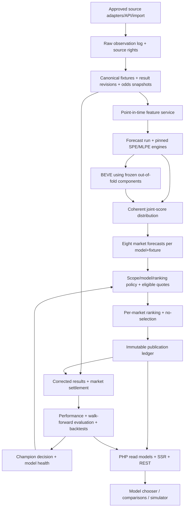

# SIMORA — Unified Production Backend & Multi-Model Architecture Blueprint

**Version:** 4.0 — reconciled master specification  
**Date:** 2026-11-05  
**Application:** Simora — Virtual Football Analytics  
**Repository:** <https://github.com/bellrichies/simora>  
**Authoritative source documents:** `SIMORA_BACKEND_BLUEPRINT_V3(1).md` and `SIMORA_MULTI_MODEL_BACKEND_BLUEPRINT(1).md`  
**Status:** Architecture and implementation handoff; **not yet implemented, tested, licensed, or deployed**.

> **One source of truth.** This document supersedes both input blueprints for *new implementation decisions*. Preserve the originals as historical references; do not instruct Codex to combine them at run time. Where this specification identifies external decisions or repository checks, mark those gates **BLOCKED**, not complete. All tables named in the register are logical entities; only phase-required tables must be physically created.

## 1. Executive decision and scope

Build a **PHP 8.2+ custom MVC, server-rendered web app** backed by **MySQL 8/InnoDB**, authenticated, event-audited and queue-driven, with a separate **Python 3.11+ analytical worker** for numerical forecasting. PHP version upgrade from current 8.1 preview is a host-compatibility gate; retain compatibility until verified. Preserve existing Tailwind/JS frontend and public routes. **Do not rebuild in React**.

Simora supports SportyBet, BetPawa and BetKing **as catalog entries**; a platform is not a source authorization. **No bookmaker is represented as connected until a permitted source and verified market mapping exist.** Real trading/automated bet placement remains disabled; subscription billing and credit wallet remain separately gated. The platform predicts **eight canonical markets** across independently assessed fixtures and three independently versioned model families. Model comparisons must not conflate high hit rates, true probabilities, selection ROI and staking-strategy ROI.

### 1.1 Confirmed source-derived requirements

- Uploaded v3 carries **102 registered tables** and eleven scoped application domains, including identities, subscriptions, wallet, referrals, reviews, support, chat, and explicitly gated auto trading. It requires eight markets, source/revision provenance and immutable predictions.
- Uploaded multi-model blueprint contributes operationally useful worker interfaces, dataset/feature/version lineage, reproducible evaluation, three model-family objectives, risk-aware simulation and incremental Codex prompts; **its six-market list, competing table names and duplicate APIs are not adopted**.
- Both rely on a **previous main-branch repository assessment**, not a verified audit of the current local checkout. Existing `database/schema.sql` is an **unapplied reference schema** according to those documents; this must be rechecked locally.

### 1.2 New engineering conclusions added during this reconciliation

- Three essential missing lineage entities are needed: immutable **`forecast_runs`**, recorded **`evaluation_folds`**, and auditable **`model_champion_decisions`**; append table IDs **103–105**. These are **recommendations**, not claims they already exist in either source.
- Production value forecasts require both an authentic *as-of* quote and **evidence the quote was accessible at decision time**. A retrospective scrape cannot manufacture pre-event odds.
- Exact cross-model comparisons must use **one matched fixture cohort and one declared evaluation clock**; selected-return analysis is a distinct cohort. Model “best” selection must be a previously committed decision, not a dynamic query that can choose yesterday’s winner after seeing today’s result.
- Training/calibration/ensemble artifacts require a reproducible dependency graph and evaluation-fold snapshots. A run/version cannot be activated until dependency and release gates pass.
- Do not create a second relational prediction system beside the v3 register. Specify the additive 3-table delta plus fields/FKs on existing entities, not the multi-model document’s alternate model tables.

## 2. Audited differences and gap closure

**Disposition taxonomy:** `ADOPT` = source rule preserved; `RENAME` = use one canonical name; `REPLACE` = outdated conflicting rule discarded; `ADD` = new recommendation; `GATE` = cannot be truthfully completed from files alone.

| ID | Conflict / gap found | Resolution and authoritative requirement | Disposition | Proof / owner |
| --- | --- | --- | --- | --- |
| R01 | Standalone model document assumes **six markets**; v3 requires **eight** | Eight registry and forecast outputs incl. `under_15`, `over_35`; preserve six existing IDs | REPLACE | Eight-score boundary and complement tests; MarketCatalog |
| R02 | `leagues`/`league_weeks` versus `virtual_leagues`/`virtual_rounds` | **Canonical v4** `virtual_leagues`/`virtual_rounds` with adapter translating legacy IDs; inspect actual deployed schema first | RENAME | schema introspection, legacy route tests |
| R03 | `odds_quotes` versus `market_odds_snapshots` | Only `market_odds_snapshots`, source market mapping and immutable quote provenance | RENAME | unique quote fingerprint + temporal tests |
| R04 | `model_feature_snapshots` versus `feature_snapshots` | `feature_snapshots` with `model_feature_definitions` and hash manifest | RENAME | point-in-time replay |
| R05 | `model_training_runs` versus `training_runs` | `training_runs` + `training_datasets` + experiments; no second training ledger | RENAME | model artifact lineage |
| R06 | `model_calibrations` versus `calibration_artifacts` | `calibration_artifacts`, coherent joint recalibration | RENAME | calibration holdout + complement tests |
| R07 | `model_forecasts` + `model_market_probabilities` versus `score_distributions` + `market_forecasts` | Use **one score distribution per fixture/model/run** plus **eight market forecasts** | RENAME | 8 FKs to one distribution |
| R08 | `prediction_candidates` vs `market_ranking_candidates` | Keep `market_ranking_runs`, `market_ranking_candidates`, `market_ranking_results` | RENAME | per-market no-selection and ranking |
| R09 | `prediction_publications` vs `published_predictions` | Only `published_predictions` as immutable decision ledger | RENAME | pre-kickoff publication test |
| R10 | `model_backtest_runs/results` vs `backtest_runs/entries` | Keep latter + immutable `model_comparison_reports`, add `evaluation_folds` | RENAME/ADD | common-cohort metrics parity |
| R11 | `model_performance_metrics` vs `model_market_metrics` | `model_market_metrics` and `performance_daily` with explicit population/scope | RENAME | row reconciliation to settlement ledger |
| R12 | Duplicate simulator URLs / account preference URLs | One canonical `POST /api/v1/simulations/strategy`; `GET,PUT /api/v1/me/model-preferences` | REPLACE | OpenAPI + route collision tests |
| R13 | Intro v3 SQL has `BIGINT match_id` while v3 authoritative ID is opaque string | Match canonical IDs `VARCHAR(128) ascii_bin`, with identical FK type/collation; bigints only internal records | REPLACE | MySQL `SHOW CREATE TABLE` |
| R14 | v3 has multiple precedence notes and obsolete migration order `021` plus `071` | This v4 register and dependency DAG alone is binding; no obsolete SQL or precedence puzzle | REPLACE | topo-sort migration checker |
| R15 | Forecast records need a stable batch/run identity, not just `(match,model,time)` | Add `forecast_runs` #103, link score distribution and worker job once | ADD | repeat jobs immutable/idempotent |
| R16 | Evaluation fold data hidden in JSON / lacks FK and leakage evidence | Add `evaluation_folds` #104 per experiment; explicit train/val/test availability windows and fixture universe hash | ADD | walk-forward split and embargo tests |
| R17 | Champion selection implicit and subject to hindsight | Add `model_champion_decisions` #105 with as-of decision, segment, evidence report and abstention | ADD | time-travel champion test |
| R18 | Ensemble weighted average called Bayesian without posterior | Genuine posterior/credible model or label regularized ensemble; cannot claim BEVE validated before implemented | REPLACE | inference/interval calibration |
| R19 | Source-time and ingest-time confused; collected-later old matches could leak | `source_published_at`, `observed_at`, `available_at`, `ingested_at` all distinct; no later input in historical replay | ADOPT/CLARIFY | late-backfill leakage test |
| R20 | Joint tail mass ambiguous | Adaptive/analytic tail preserving all eight event probabilities within tolerance | CLARIFY | sum/tail upper error tests |
| R21 | Missing quote and `best_value` pick inconsistently allowed | Probability-only forecast allowed; **no best-value selection** without verified quote | CLARIFY | 200 no_selection + cause |
| R22 | Outcome correction mutates retrospective winner or aggregate | Append source/result/settlement revisions; never mutate published candidate/odds | ADOPT | correction replay |
| R23 | “Most profitable” can be selected from different fixture samples | Forecast skill on common cohort, published ROI on selected cohort, strategy P&L separate | ADOPT/CLARIFY | denominators, coverage, CI |
| R24 | Staking progression can quietly exceed bankroll | Fixed-point bounded policy; stop on breach, don't cap and imply recovery | ADOPT | golden ledgers and limits |
| R25 | Payment/webhook/ledger business tracks omitted from standalone model blueprint | All v3 business modules remain, with separate authorization/approval gates | ADOPT | 105-table traceability |
| R26 | Auto Trade preview conflated with execution | Draft-only routes; **no live order connector** in analytics release | ADOPT | execution disabled integration test |
| R27 | Current repo state and provider rights not verified by source files | Local code audit, schema introspection and written rights are explicit release blockers | GATE | Phase 0 and source approval |
| R28 | Worker timeout, artifact corruption and queue replay can change model | Versioned protocol, checksum and atomic idempotency; no worker in web request | ADD/CLARIFY | retry/crash tests |
| R29 | Production and demo can share cache/report keys | Every observation, forecast, rank, metric and cache includes immutable partition | ADOPT/CLARIFY | synthetic quarantine tests |
| R30 | Calibration/market identity can be inconsistent for binary ML | All 8 derived from calibrated coherent joint score distribution, no independent incompatible binary heads | ADOPT/CLARIFY | market probability invariants |
| R31 | Auto best fails when evidence sparse or model suspended | `insufficient_evidence`, never silently fall back to unapproved version | CLARIFY | eligibility matrix |
| R32 | Published recommendations could be silently withdrawn with odds changes | Immutable published record; separately timestamp visibility/withdrawal status; settlement remains tied to original quote | CLARIFY | immutable publication tests |
| R33 | Deferred FKs and migration order can be lexically confusing | One monotonic dependency-ledger plan with explicit deferred circular-FK patch | REPLACE | create + upgrade test |
| R34 | User preferences unique nullable scope broken in MySQL | normalized non-null `scope_key` with unique `(user_id,scope_key)` | ADOPT | concurrent global + override test |
| R35 | Source rights can lapse after ingestion | Access rights checked for ingestion, retention, model training and public release, not only fetch | ADD | revoke/expiry/quarantine test |
| R36 | Trend/equity P&L may count duplicate overlapping fixtures | Include fixture-cluster exposures and model-policy provenance, warn on correlated selections | ADD | cluster/dedup test |
| R37 | API `mode` is ambiguous: manual/compare vs value/probability | Separate `model_mode` and `ranking_mode`; require scope and server entitlement | CLARIFY | request validation tests |
| R38 | Runtime assumptions conflict: repo PHP 8.1 vs design PHP 8.2+ | Verify host and tests before raising platform requirement; pin PHP/Python versions in CI | GATE | environment matrix |

**What “gap closed” means:** the gap now has one contractual resolution, an owner and a test. None of the above asserts that the related code, feed access or migrations already exist.

## 3. Definitive system architecture



### Ownership boundaries

| Runtime / subsystem | Responsibilities | Must not do |
| --- | --- | --- |
| PHP front controller and application layer | Auth, CSRF, RBAC, entitlement, validated API, SSR read models, promotion approval, selection policy, authoritative settlement, reports | Train LightGBM or fetch provider data on request |
| PHP domain layer | Eight market rules, fixed money/odds arithmetic, publication and eligibility policies, simulation | Use float money or read mutable demo odds as live |
| Python quant worker | Time-safe feature transforms, SPE/MLPE/BEVE training/inference, calibration, uncertainty, numerical tests | Authorize users, modify bills, place wagers, publish unapproved forecasts |
| MySQL 8/InnoDB | Immutable model/version/forecast/quote/publish/settlement lineage, catalog, users, ledger and outbox | Silently overwrite historical evidence |
| Redis queue/cache + MySQL outbox | Durable at-least-once job delivery, lease, retry, idempotent business writes, short-lived public aggregates | Make correctness depend on volatile Redis alone |
| Private object/file store | Immutable source payloads, model binaries, feature/score artifacts, checksums and audit | Serve private artifacts under `public/` |
| Existing demo repository | Offline SSR preview and deterministic UI tests | Populate production training/ROI or subscriber “live” record |

**Worker wire protocol** (versioned JSON schema): `schema_version`, `job_key`, `run_id`, `model_version_id`, `dataset_partition`, `fixture_ids`, `feature_snapshot_ids`, `feature_cutoff_at`, `forecast_as_of`, `artifact_sha256`, `correlation_id`, `deadline`. Response includes `status`, `score_distribution_artifact_uri`, `digest`, `validity`, `warnings`, `deterministic_failure_code` and execution timing. Treat transport as an internal authenticated boundary with schema validation and checksums.

**Retry rule:** Queue delivery is at least once; `forecast_runs.job_key`, ingestion idempotency keys, publication decision keys and outbox keys ensure exactly-once **effects** under DB transactions, not exactly-once delivery.

## 4. Canonical market, identity, time and money contracts

### Markets — eight, no exceptions

| Canonical ID | Public label | Win predicate on authoritative settled score | Complement |
| --- | --- | --- | --- |
| `over_15` | Over 1.5 | H+A >= 2 | under_15 |
| `under_15` | Under 1.5 | H+A <= 1 | over_15 |
| `over_25` | Over 2.5 | H+A >= 3 | under_25 |
| `under_25` | Under 2.5 | H+A <= 2 | over_25 |
| `over_35` | Over 3.5 | H+A >= 4 | under_35 |
| `under_35` | Under 3.5 | H+A <= 3 | over_35 |
| `btts_yes` | GG / BTTS Yes | H>0 and A>0 | btts_no |
| `btts_no` | NG / BTTS No | H=0 or A=0 | btts_yes |

Canonical settlement and forecast invariant: each complementary probability pair sums to 1 within numeric tolerance, all p in [0,1], and `P(over_15)>=P(over_25)>=P(over_35)`. **Derive eight events from one jointly normalized H/A goal distribution per model/fixture.** If any model uses a finite goal grid, handle residual tails with analytical or bounded adaptive integration; an undifferentiated tail bucket is insufficient for BTTS and the 3.5 threshold. Voids/disputes/outages are separate settlement statuses and not binary loss outcomes.

**IDs:** `platforms.id` is existing string slug; canonical football entities use `VARCHAR(128) CHARACTER SET ascii COLLATE ascii_bin` and matching FK definitions; version/audit tables can use `BIGINT UNSIGNED`. Providers' external IDs are source-scoped mappings, not canonical PKs. Migrate reference `leagues`, `league_weeks` and `predictions` **through adapters and staged migration**, do not force-rewrite legacy or assume an applied DB exists.

**Clocks:** All persisted dates UTC `DATETIME(6)`; API UTC ISO 8601; UI `Africa/Lagos`. Define: `source_published_at` (origin timestamp if supplied), `observed_at` (our first trusted observation), `ingested_at` (stored), `available_at` (earliest reliable usable input), `feature_cutoff_at`, `forecast_as_of`, `published_at`, `kickoff_at`, `settled_at`. An ingestion after a historic event cannot pretend to have been available earlier. Condition: `max(feature.available_at) <= feature_cutoff_at <= forecast_as_of < publication_cutoff < kickoff_at` where `publication_cutoff = kickoff_at - configured buffer`. Quotes must be observed at or before publication and not expired. In live ranking, preserve quote source and observed time independently of forecast creation.

**Financial and numerical:** signed `BIGINT` integer minor units (`NGN` typically 2 decimal places), `DECIMAL(12,6)` odds, `DECIMAL(12,10)` probabilities, decimal JSON strings for odds/probability/money where needed. Use PHP BCMath/deterministic rational rounding for money, single declared rounding rule per value. Never use PHP float for settlement amounts or claim probability precision exceeds evidence.

**Data partition:** `synthetic`, `authorized_live`, `approved_backfill`; require same-partition joins and cache keys, plus explicit `validation_use = demo|research|release_eligible` permission. An `approved_backfill` result is **not automatically** eligible for historical tradable ROI: contemporaneous quote/feature observation evidence must exist.

**Market availability:** registry support != source capability. Source rights, league/market mapping, kickoff freshness, market quote and model health must all pass independently. `highest_probability` can provide a probability-only descriptive forecast under an approved policy; `best_value` must abstain without a usable quote.

## 5. End-to-end canonical data lifecycle

1. **Source license and grant:** record allowed access methods, countries, retention, training/publication rights and expiry, source IDs/coverage; reject revoked or out-of-scope grants.
2. **Discover and observe:** fetch only authorized data, persist raw payload hash/URI and source published/observed/ingested clocks; apply idempotency key.
3. **Map and normalize:** resolve platform, source, league, season, round, fixture and market IDs; avoid cross-provider/team/round collisions.
4. **Commit atomic batch:** create canonical rows, observations, ingestion batch, cursor advance and transactional outbox as one database unit; quarantine parser changes and gaps.
5. **Results and odds:** persist immutable quote snapshots; scores first as source result revisions, then accepted-current pointer. New correction adds new revision.
6. **Features:** construct point-in-time frozen feature input from records with `available_at <= cutoff`, hash feature code/schema/values and input manifest.
7. **Run inference:** create `forecast_runs` row and enqueue pinned model-version worker job; worker returns validated joint probability artifact. Enforce no preview-data or unapproved-grant training.
8. **Emit eight forecasts:** one `score_distributions` row and eight `market_forecasts` per model/fixture/run. Store calibrated probability, interval type and data lineage. Probability-only is valid when odds absent.
9. **Market evaluation:** for **each requested model and market** assess *all* eligible fixtures in selected platform/league/time scope; enforce freshness, permissible quote source, quality, model release and uncertainty policy.
10. **Market ranking:** store every candidate/why rejected; market-specific deterministic ordering; persist `market_ranking_results` for **every requested market** including `no_selection`, `insufficient_evidence`, `source_unavailable`.
11. **Publication:** only on completed, approved ranking; snapshot forecast, model version, rule, policy, quote, as-of cutoff. No post-kickoff publication or updating past odds/picks.
12. **Settlement:** after accepted authoritative result, derive eight outcomes by rule version; settle **published** selections, append correcting settlement if results amended, rebuild aggregates/outbox.
13. **Evaluate:** grade skill on a common fixture cohort, published picks on own selected cohort, simulations on past published ledger. Champion decision persists input evidence as of that decision date.
14. **Present:** PHP read repository delivers existing DTO shape to existing SSR pages and backwards-compatible history endpoint. `live` mode never substitutes outcome-selected demo predictions.

### State machine contracts

| Entity | Allowed states and relevant transitions | Illegal transition |
| --- | --- | --- |
| Ingestion | `pending→fetching→parsed→validated→committed→completed`; any step→quarantined/failed | cursor advance before commit |
| Forecast run | `queued→running→succeeded`; `queued/running→failed\|cancelled` | overwrite succeeded artifact |
| Model version | `draft→trained→validated→shadow→approved→active→suspended\|retired` | active without integrity and validation gates |
| Ranking run | `pending→evaluating→completed`; completed→published snapshot | completed without result row for each requested market |
| Candidate | `evaluated→qualified\|rejected`; qualified may become stale before publication | publish rejected or expired quote |
| Publication | `published→withdrawn, expired, or settlement_pending`; settlement recorded separately | change published forecast, quote or time |
| Result | `unverified→accepted\|void\|disputed`; accepted→corrected via new revision | destructive edit to accepted revision |
| Settlement | `pending→won\|lost\|void\|disputed`; correction by new superseding row | mutate old winner row |
| User preference | `version N→N+1` under optimistic concurrency | overwrite without version check |

---

## 6. Authoritative relational register, keys and table ownership

**Logical count: 105.** Tables **1–102** retain the exact names from v3's original numbered register. Tables **103–105** are additive gap closures in this document. An entry's presence in the logical register does not mean a physical table exists or should be migrated in Phase 0. Table owners and phase prerequisites are binding. The *full columns* for phase-active tables must be defined in executable migrations and OpenAPI/DTO schemas, with actual DB introspection. `ON DELETE RESTRICT` is default for immutable business history; nullable ephemeral children may use cautious cascade where approved.

### 6.1 Core catalog & fixtures (10 tables)

| # | Canonical table | Ownership / minimum relationship contract |
| ---: | --- | --- |
| 1 | `schema_migrations` | version PK, checksum, ran_at; MigrationRunner **[phase 0]** |
| 2 | `platforms` | id PK, slug unique, availability state; PlatformCatalog **[phase 1]** |
| 5 | `virtual_leagues` | id PK, platform_id FK, active/scheduled type; LeagueCatalog **[phase 1]** |
| 7 | `league_seasons` | id PK, league_id FK, source-scoped season key; LeagueCatalog **[phase 1]** |
| 8 | `teams` | id PK, league_id FK; TeamCatalog **[phase 1]** |
| 9 | `team_aliases` | team_id FK, normalized alias+league scope; TeamCatalog **[phase 1]** |
| 10 | `virtual_rounds` | id PK, league_id/season_id FK, immutable external mapping; FixtureCatalog **[phase 1]** |
| 11 | `football_matches` | id PK, league_id/round_id/home_team_id/away_team_id same-league FK, kickoff/status; FixtureCatalog **[phase 1]** |
| 15 | `markets` | canonical varchar ID PK, eight rows, threshold/side/category; MarketCatalog **[phase 1]** |
| 16 | `market_rules` | id PK, market_id FK, version unique, effective period, immutable rule; SettlementRules **[phase 1]** |

### 6.2 Source licensing & ingestion (14 tables)

| # | Canonical table | Ownership / minimum relationship contract |
| ---: | --- | --- |
| 3 | `data_sources` | id PK, code unique, source_type, access_status; SourceRegistry **[phase 3]** |
| 4 | `source_access_grants` | source_id FK, permission/expiry/retention scope; SourceRegistry **[phase 3]** |
| 6 | `source_league_mappings` | source_id+external_id+scope unique, league_id FK; SourceRegistry **[phase 3]** |
| 12 | `source_fixture_mappings` | source_id+external_fixture_id+scope unique; match_id FK; FixtureCatalog **[phase 3]** |
| 17 | `source_market_mappings` | source_id+provider_market_code+line+side unique, canonical market FK; OddsAdapter **[phase 4]** |
| 18 | `market_odds_snapshots` | id PK, match_id/market_id/source_market_mapping_id/source_payload_id FK, odds, observed_at, expires_at; OddsService **[phase 4]** |
| 20 | `raw_source_payloads` | id PK, source_id FK, storage URI, SHA256, parser version, observed_at; Ingestion **[phase 3]** |
| 21 | `ingestion_observations` | id PK, raw_payload_id FK, entity mapping, source_record_key, observed_at; Ingestion **[phase 3]** |
| 22 | `collection_jobs` | id PK, source/league FK, type, status, idempotency key unique; JobManager **[phase 3]** |
| 23 | `collection_cursors` | source+league+stream unique, checkpoint and last committed batch; Backfill **[phase 3]** |
| 24 | `ingestion_batches` | id PK, source_id FK, raw/parsed counts, mode, fingerprint, committed_at; Ingestion **[phase 3]** |
| 25 | `transactional_outbox` | id PK, event_key unique, aggregate_type/id, published_at; OutboxDispatcher **[phase 3]** |
| 26 | `data_quality_issues` | id PK, league/match/source FKs as nullable, code/severity/status; QualityService **[phase 3]** |
| 27 | `league_sync_metrics` | league_id FK, sampled_at unique with metric window, freshness/completeness; Monitoring **[phase 3]** |

### 6.3 Results & settlement source (3 tables)

| # | Canonical table | Ownership / minimum relationship contract |
| ---: | --- | --- |
| 13 | `match_results` | id PK, match_id FK, status, current accepted revision pointer; ResultsService **[phase 4]** |
| 14 | `match_result_revisions` | id PK, match_result_id FK, source observation FK, score, received_at, revision_no unique per result; ResultsService **[phase 4]** |
| 19 | `match_market_outcomes` | match_id+market_rule_id+result_revision_id unique; enum won/lost/void/disputed; OutcomeEngine **[phase 4]** |

### 6.4 Model lab & forecast (15 tables)

| # | Canonical table | Ownership / minimum relationship contract |
| ---: | --- | --- |
| 28 | `prediction_models` | id PK, code unique, family, scope; ModelRegistry **[phase 5]** |
| 29 | `model_versions` | id PK, model_id FK, artifact hash, status, release signature; ModelRegistry **[phase 5]** |
| 30 | `training_datasets` | id PK, partition, cutoffs, source manifest hash, training coverage; DatasetBuilder **[phase 5]** |
| 31 | `training_runs` | id PK, model_version_id+dataset_id FK, seed/hyperparameters/commit SHA; TrainingService **[phase 5]** |
| 32 | `calibration_artifacts` | id PK, model_version_id, training_run_id FK, segment/rule/version; CalibrationService **[phase 5]** |
| 33 | `feature_snapshots` | id PK, match_id FK, dataset partition, cutoff/available_at/manifest, hash; FeatureService **[phase 5]** |
| 34 | `score_distributions` | id PK, match_id/model_version_id/feature_snapshot_id FKs, forecast_at, normalized joint grid + tail/validity; ProbabilityService **[phase 5]** |
| 35 | `market_forecasts` | id PK, score_distribution_id FK, match_id/market_id, calibration FK, p/interval/odds_snapshot_id, uniqueness per run/match/market/model; ForecastService **[phase 5]** |
| 95 | `model_feature_definitions` | FeatureService: id; name/version unique; `data_type`; code hash; availability lag; active flag; immutable specification. `feature_snapshots` references feature-set hash/manifest that enumerates definitions. **[phase 5A]** |
| 96 | `ensemble_components` | EnsembleService: id; `ensemble_model_version_id` FK→`model_versions`; `component_model_version_id` FK→`model_versions`; scope; `weight DECIMAL(12,10)`; train/validation cutoff; unique ensemble+component+scope. Validate sums=1 per scope in service transaction. **[phase 5C]** |
| 97 | `model_experiment_runs` | ResearchService: id; dataset FK→`training_datasets`; immutable experiment fingerprint, fold specification, seed, baseline model, code SHA, status, start/end. Links to zero/many training/backtest runs through explicit IDs/manifest. **[phase 5A]** |
| 100 | `model_health_events` | ModelHealthService: id; model_version FK; platform/league/market optional; rule code, severity, observed_at, status, resolved_at, metrics snapshot. Indexed version+time. **[phase 5D]** |
| 102 | `model_deployment_assignments` | ModelRegistry: id; model version FK; platform/league/market scope, channel `shadow`, `limited`, or `production`, percentage/eligibility settings, effective interval, approved_by FK nullable→users; prevent conflicting active assignments per normalized scope in transactional service. **[phase 5D]** |
| 103 | `forecast_runs` | ForecastOrchestrator; model_version FK, fixture batch digest, as_of/cutoff, source partition, idempotency job_key, status |
| 104 | `evaluation_folds` | EvaluationService; experiment_run FK, train/validation/test windows, as-of embargo, fixture universe hash, output hash, fixed seed |

### 6.5 Selection & performance (13 tables)

| # | Canonical table | Ownership / minimum relationship contract |
| ---: | --- | --- |
| 36 | `selection_policy_versions` | id PK, version, ranking mode, qualification thresholds, approved_at; PolicyService **[phase 6]** |
| 37 | `market_ranking_runs` | id PK, selection_policy_version_id FK, data partition, scope, time window, as_of, status; RankingService **[phase 6]** |
| 38 | `market_ranking_candidates` | id PK, ranking_run_id+market_forecast_id FKs, rank/qualification/reasons; RankingService **[phase 6]** |
| 39 | `market_ranking_results` | run_id+market_id unique, selected_count, status qualified/no_selection, reason codes; RankingService **[phase 6]** |
| 40 | `published_predictions` | id PK, run/candidate/forecast IDs FKs, immutable published_at, snapshot odds, source/league/market, status; PublicationService **[phase 6]** |
| 41 | `prediction_settlements` | id PK, published_prediction_id+result_revision_id FK, state, net reference, supersedes_id; SettlementService **[phase 6]** |
| 42 | `performance_daily` | unique platform/league/market/model/policy/day/mode, counters; PerformanceService **[phase 6]** |
| 43 | `model_market_metrics` | id PK, model version/market/league/window/mode unique, Brier/calibration/logloss/ROI/coverage; EvaluationService **[phase 6]** |
| 44 | `backtest_runs` | id PK, dataset/model/policy refs, window, configuration/hash/metrics; BacktestService **[phase 5]** |
| 45 | `backtest_entries` | id PK, run+forecast/match/market FKs, as-of odds/result reference, fold; BacktestService **[phase 5]** |
| 98 | `model_comparison_reports` | EvaluationService: id; experiment/backtest references, fixed common scope, source partition, model version set hash, metrics/CI/coverage, signed report hash, created_at. Immutable and no synthetic/live mixing. **[phase 6B]** |
| 101 | `model_selection_audit_logs` | RankingAuditService: id; `market_ranking_run_id`, optional `market_ranking_candidate_id`, model_version FK; decision, reason codes, policy version, evidence hash and timestamp; idempotent decision key unique. Supplements original general `audit_logs`, does not replace it. **[phase 6A]** |
| 105 | `model_champion_decisions` | ChampionService; scope and effective time, selected model_version FK nullable, evaluation_report FK, selection_policy FK, approver FK, abstain reason, unique decision_key |

### 6.6 User and access (16 tables)

| # | Canonical table | Ownership / minimum relationship contract |
| ---: | --- | --- |
| 48 | `users` | id PK, normalized_email unique, password hash, verification state; IdentityService **[phase 2]** |
| 49 | `roles` | id PK, code unique; RBAC **[phase 2]** |
| 50 | `permissions` | id PK, code unique; RBAC **[phase 2]** |
| 51 | `user_roles` | user_id+role_id unique, actor/timestamps; RBAC **[phase 2]** |
| 52 | `role_permissions` | role_id+permission_id unique; RBAC **[phase 2]** |
| 53 | `sessions` | id PK, user_id FK, hashed token, expiry/revocation; SessionService **[phase 2]** |
| 54 | `email_verification_tokens` | id PK, user_id FK, hash, expiry/use; IdentityService **[phase 2]** |
| 55 | `password_resets` | id PK, user_id FK, hash, expiry/use; IdentityService **[phase 2]** |
| 56 | `audit_logs` | id PK, actor_user_id nullable FK, operation/object/correlation; AuditService **[phase 2]** |
| 57 | `settings` | id PK, user_id nullable FK, key/scope unique; SettingsService **[phase 2]** |
| 58 | `notifications` | id PK, user_id FK, event type/payload/read_at; NotificationService **[phase 9]** |
| 59 | `notification_outbox` | id PK, notification_id FK, channel/status/dedupe; NotificationService **[phase 9]** |
| 65 | `entitlements` | id PK, user_id/subscription_id optional FK, feature/limit/effectivity; AccessService **[phase 9]** |
| 66 | `usage_counters` | user_id+feature+period unique, version and used count; QuotaService **[phase 9]** |
| 67 | `usage_events` | id PK, user/feature/request_id unique, delta, consumption status; QuotaService **[phase 9]** |
| 99 | `user_model_preferences` | PreferenceService: id; `user_id` FK→`users`; optional platform/market FKs represented by normalized `scope_key` (not nullable unique columns); mode `manual\/validated_best\/compare`; optional model FK; optimistic version; unique user+scope_key. **[phase 2B/7B]** |

### 6.7 Simulator (2 tables)

| # | Canonical table | Ownership / minimum relationship contract |
| ---: |- -- | --- |
| 46 | `simulation_runs` | id PK, owner_user_id nullable only for bounded guest demo, config/hash, mode, summary; SimulationService **[phase 8]** |
| 47 | `simulation_entries` | id PK, simulation_run_id FK, ordinal/stake/odds/outcome/bankroll; SimulationService **[phase 8]** |

### 6.8 Billing (9 tables)

| # | Canonical table | Ownership / minimum relationship contract |
| ---: | --- | --- |
| 60 | `plans` | id PK, code unique; PlanCatalog **[phase 9]** |
| 61 | `plan_versions` | id PK, plan_id FK, immutable published features/effective_at; PlanCatalog **[phase 9]** |
| 62 | `plan_prices` | id PK, plan_version_id FK, currency/minor amount/interval; BillingCatalog **[phase 9]** |
| 63 | `subscriptions` | id PK, user_id/plan_version_id FKs, period/status; SubscriptionService **[phase 9]** |
| 64 | `subscription_events` | id PK, subscription_id FK, immutable change audit; SubscriptionService **[phase 9]** |
| 68 | `invoices` | id PK, user/subscription FK, immutable number and amounts; InvoiceService **[phase 10]** |
| 69 | `payments` | id PK, invoice/user FK, provider_reference unique per provider, status/amount; PaymentService **[phase 10]** |
| 70 | `payment_webhooks` | id PK, provider+external_event_id unique, signature/processing result; WebhookService **[phase 10]** |
| 71 | `refunds` | id PK, payment_id FK, reference and amount/status; RefundService **[phase 10]** |

### 6.9 Wallet & ledger (5 tables)

| # | Canonical table | Ownership / minimum relationship contract |
| ---: | --- | --- |
| 72 | `wallet_accounts` | id PK, owner/currency/type unique; WalletService **[phase 10 gated]** |
| 73 | `wallet_journals` | id PK, external_event_key unique, reversal_of_id optional FK, posted_at; LedgerService **[phase 10 gated]** |
| 74 | `wallet_postings` | id PK, journal_id/account_id FKs, debit_minor/credit_minor, append-only; LedgerService **[phase 10 gated]** |
| 75 | `wallet_balances` | account_id PK FK, version/current_minor as reconciliation cache only; WalletService **[phase 10 gated]** |
| 76 | `wallet_adjustments` | id PK, journal_id FK, request/approval refs; WalletAdmin **[phase 10 gated]** |

### 6.10 Community and support (11 tables)

| # | Canonical table | Ownership / minimum relationship contract |
| ---: | --- | --- |
| 77 | `referral_codes` | id PK, user_id FK, code unique; ReferralService **[phase 11 gated]** |
| 78 | `referral_attributions` | id PK, referrer/referred user FK, unique referred_user, proof; ReferralService **[phase 11 gated]** |
| 79 | `referral_rewards` | id PK, attribution_id/user_id FK, reward status and idempotency; ReferralService **[phase 11 gated]** |
| 80 | `reviews` | id PK, author_user_id FK, content/rating/status; ReviewService **[phase 11]** |
| 81 | `review_moderation` | id PK, review_id/actor FK, decision/audit; ReviewService **[phase 11]** |
| 82 | `support_tickets` | id PK, owner_user_id FK, status/priority; SupportService **[phase 11]** |
| 83 | `support_messages` | id PK, ticket_id/actor FK, body/visibility; SupportService **[phase 11]** |
| 84 | `faq_articles` | id PK, slug unique, version/published_at; SupportService **[phase 11]** |
| 85 | `chat_rooms` | id PK, platform/league FK optional, visibility/status; ChatService **[phase optional]** |
| 86 | `chat_memberships` | room_id+user_id unique, role/mute state; ChatService **[phase optional]** |
| 87 | `chat_messages` | id PK, room_id/user_id FK, body/moderation; ChatService **[phase optional]** |

### 6.11 Auto-trade gated (7 tables)

| # | Canonical table | Ownership / minimum relationship contract |
| ---: | --- | --- |
| 88 | `provider_connections` | id PK, user/source FK, encrypted credentials reference, consent; AutoTrade **[phase gated]** |
| 89 | `auto_trade_drafts` | id PK, user/platform/market config, draft only; AutoTrade **[phase gated]** |
| 90 | `auto_trade_configs` | id PK, draft/user FK, immutable approved version; AutoTrade **[phase gated]** |
| 91 | `auto_trade_sessions` | id PK, config/user FK, state, budget, schedule; AutoTrade **[phase gated]** |
| 92 | `bet_orders` | id PK, session/forecast/quote refs, idempotency_key unique, state; AutoTrade **[phase gated]** |
| 93 | `bet_order_events` | id PK, bet_order_id FK, external events and dedupe; AutoTrade **[phase gated]** |
| 94 | `risk_reservations` | id PK, session/order/user FK, exposure_minor, active/released; AutoTrade **[phase gated]** |

### 6.12 Mandatory FK, indexes, uniqueness and concurrency design

**All references are required where they make relational sense, not optional JSON-only relationships.** Use normalized entity ID types and matching collation. Author named FK/index constraints. The full database lifecycle must support both a fresh install and incremental upgrade of any locally observed schema.

| Contract ID | Relational invariant | Owner / test |
| --- | --- | --- |
| FK01 | `virtual_leagues.platform_id→platforms.id`; season/team/round/match scopes remain league-consistent via composite unique `(league_id,id)` targets | LeagueCatalog + scope crossover test |
| FK02 | Provider mappings unique by `(source_id,external_id,scope_key)` and FK to canonical league/fixture/market | SourceRegistry + collision test |
| FK03 | `match_results` one row per match; `match_result_revisions.match_result_id` FK; accepted current revision points to the same result | ResultsService + correction/circular FK migration test |
| FK04 | `market_odds_snapshots` FK to exact match, market, source mapping and raw observation, index `(match_id,market_id,observed_at,id)` | OddsService + point-in-time EXPLAIN |
| FK05 | `feature_snapshots` FK match; manifest and hash immutable; feature def IDs/versions in checked manifest (or normalized association if justified) | FeatureService + tamper test |
| FK06 | `forecast_runs` unique `job_key`, FK `model_versions`, partition, cutoff and feature batch digest | ForecastOrchestrator + crash/replay test |
| FK07 | `score_distributions` FK `forecast_runs`, `model_versions`, `feature_snapshots`, match; unique `(forecast_run_id,match_id,model_version_id)` | ProbabilityService + 3-model same fixture test |
| FK08 | `market_forecasts` FK to score distribution and canonical market; unique `(score_distribution_id,market_id)` and check valid probability/intervals | ForecastService + eight-outcome test |
| FK09 | `ensemble_components` FK both ensemble and component model_versions; prevent self-reference and cycles; weights in [0,1], sum one per declared mixture scope | EnsembleService + directed graph cycle test |
| FK10 | `market_ranking_candidates` FK ranking run+market forecast, quote FK if used; unique `(run_id,forecast_id)` per candidate; ranking result unique `(run_id,market_id,model_scope_key)` | RankingService + two-model/market tests |
| FK11 | `published_predictions` FK qualified ranking candidate and exact quote/rule/policy/version or trusted derivable path; one immutable decision key; freeze evidence and timestamp | PublicationService + concurrent duplicate test |
| FK12 | `prediction_settlements` FK publication, result revision and `supersedes_id`; one accepted active projection per publication enforced transactionally | SettlementService + late correction test |
| FK13 | `evaluation_folds` FK experiment; immutable training and validation/test ranges, group/availability constraints and fixture universe hash | EvaluationService + holdout leakage test |
| FK14 | `model_champion_decisions` FK comparison report/policy/model version; unique normalized scope+decision timestamp/key; no winner when insufficient evidence | ChampionService + time-travel selection test |
| FK15 | `user_model_preferences`: unique `(user_id,scope_key)` with nonnull scope key, FKs to user/model; optimistic `row_version` | PreferenceService + concurrent write test |
| FK16 | `wallet_postings` FK journal and account; journal+postings atomically balance, reversal via append-only journal | LedgerService + double-entry test |
| FK17 | `usage_events` unique `user_id,feature,request_id` with atomic counter mutation; webhook external event keys unique per provider | Quota/PaymentService + replay test |
| FK18 | Active model deployment assignment overlapping same normalized scope requires transactional exclusion and health check | ModelRegistry + concurrency test |

**Polymorphic linkage constraint:** If `ingestion_observations` refers to varied entity types, never imply a normal SQL FK works across polymorphic target tables. Use explicit nullable typed FKs for the approved entity classes or enforce with a referenced mapping table and transactional validation. Record this as an ADR; raw payload FK is mandatory.

**Materialization:** Use event append + projections, not silent updates to immutable input. If a table has mutable `status`, distinguish status projection from immutable evidentiary attributes. Security: immutable/audited source data should not cascade-delete through a user account.

## 7. Physical migration plan — one DAG, no conflicting numbered orders

**Schema migration runner:** record `id`, immutable `checksum`, `applied_at`, `applied_by`, execution duration, recorded dependency list, success/failure state and build SHA. Lock migration execution in DB. MySQL DDL is often non-transactional/implicit-commit; do not promise automatic rollback of all DDL. Write safe expand/backfill/dual-read/contract migrations and tested restore procedures.

| Migration | Dependencies | Physical work and runtime feature gate |
| --- | --- | --- |
| `000_schema_ledger` | none | migration ledger, app/env bootstrap |
| `010_catalog` | 000 | catalog, eight markets, rules, leagues/seasons/teams/rounds/matches; existing reference table reconciliation |
| `020_identity` | 000 | users, RBAC, sessions, verification/reset and audit/settings |
| `030_source_provenance` | 010 | feed access grants, raw observations, maps, ingestion jobs/batches/cursors, outbox and quality |
| `040_results_odds` | 010,030 | versioned result/outcome, mapping/quotes, deferred current revision FK |
| `050_model_lab` | 040 | model family/version, datasets, training runs, calibrations, snapshots, score distributions, market forecasts, backtests |
| `051_feature_registry` | 050 | #95 feature definitions and manifest FK/rules |
| `052_experiments` | 051 | #97 model experiments and #104 evaluation folds, training/backtest links |
| `053_forecast_runs` | 052 | #103 forecast runs and FK from score distributions, worker idempotency |
| `054_ensemble` | 053 | #96 component lineage and posterior metadata |
| `055_model_health` | 054,020 | #100 health events, #102 deployment assignments, model suspension rules |
| `060_prediction_selection` | 055 | #36–43, #101 auditing and immutable publication/settlement, rankings for eight markets |
| `061_model_comparisons` | 060 | #98 comparison reports, metrics lineage, confidence intervals |
| `062_champion_decisions` | 061 | #105 auditable segment champion/no-champion and policy support |
| `070_simulation` | 060,020 | #46–47, strategy ledger and exact amounts |
| `071_model_preferences` | 020,050 | #99 account-specific model preferences and resolution |
| `080_access_notifications` | 020 | plans, subscriptions, grants, usage and notification outbox; **no billing payment activation yet** |
| `090_payments_wallet_gated` | 080 | payments, invoices, signed webhook ledger and optional approved wallet tables |
| `100_experience_gated` | 020; 090 for financial rewards | referrals, reviews, tickets, FAQs |
| `110_chat_optional` | 020 | rooms, memberships, moderated messages |
| `120_auto_trade_execution_gated` | 020,060,080 and independent approvals | provider connections/configs/orders/reservations; **must not enable executable adapter without authorization** |

**Physical ordering:** `000→010→020→030→040→050→051→052→053→054→055→060→061→062→070→071→080→090→100→110(optional)→120(gated)`. Migrations may install later user-facing optional tracks only if prerequisites/approvals satisfied; a fresh-install script should support `--through` stage. If a previously deployed migration uses a different number/name, **never rename/replay it**: implement equivalent additive delta using next safe identifier and record the mapping.

**Revisit phase 050 creation order:** `model_versions` and `training_runs` must not have impossible circular non-null FKs. Create version as candidate, dataset, training run, then promote/freeze selected training reference. Defer accepted-current result revision pointer until both sides created. Ensure #103 forecast run FK can be added to scores in expand migration without rebuilding all history.

### Legacy adapter and rollout rules

- Preserve `src/Contracts/PlatformDataRepository.php` return keys `leagues,results,upcoming,picks,quota,source`, current PHP page routes and `GET /api/platforms/{slug}/predictions`. Existing local data generator retains six-market fixture data until additive eight-market demo generation is supported; **do not fabricate new historic results to make old demonstrations look successful**.
- The reference `database/schema.sql` may contain `platforms`, `leagues`, `league_weeks`, `predictions`, `football_matches`. Inspect current local migration ledger. If not deployed, treat as reference only; if deployed, build a compatible migration bridge with stable public IDs. Never rename/drop without a staged copy and parity check.
- `SIMORA_DATA_MODE` is the three-state **serving mode** `demo|shadow|live`, distinct from stored data partitions. `demo` serves synthetic, `shadow` serves demo but computes and compares isolated live projections, `live` serves approved DB data only. A live outage shows unavailable, not demo substitution.
- Version all API presenters; convert database `DECIMAL` odds to legacy `odds_hundredths` only at presenter boundary with explicit rounding/warning. Do not accidentally reduce production precision in analytics or forecasts.
- Run `EXPLAIN ANALYZE` on keyset history, ranked candidate lookup, next fixtures and aggregate queries under representative data volumes, and set index/p95 budgets in operational ADR.

## 8. Prediction model design, training and release gates

### 8.1 SPE — Statistical Probability Engine (`spe`)

Fit league-conditioned observed goal rates with hierarchical/shrunk priors, optional time decay, independent home/away Poisson probabilities. Dixon–Coles/low-score dependence is an **optional challenger**, not a default; test on held-out data before using. A virtual football provider may randomize scores and not encode realistic team characteristics. Compute full joint H/A distribution and all eight probabilities. `ScoreDistributionDTO` includes `(goal_grid,tail_policy,numerical_error_bound,method,feature_version,as_of)`.

### 8.2 MLPE — Machine Learning Prediction Engine (`mlpe`)

Use LightGBM or another pinned gradient boosting implementation for structured goal or bivariate-score probability distribution. Include only **available-before-decision** rolling frequencies, league/round context, missingness/source quality and verified prematch odds. Per-market binary heads are permitted **only** if reconciled through a valid joint distribution with bounded calibration error. Chronological forward-chaining folds group entire virtual rounds; preprocess inside folds. No labels or outcome-selected synthetic demo data may enter released model training. Store artifact SHA, code SHA, feature schema, data digest, seed, training cutoff and supported segments. Fail promotion when baseline not beaten or evaluation insufficient.

### 8.3 BEVE — Bayesian Ensemble & Value Engine (`beve`)

Use **frozen, previously out-of-fold SPE/MLPE joint distributions** and an explicit weight posterior/hierarchical uncertainty model. Mixture distributions with nonnegative weights summing to one produce coherent eight-market probabilities. Bayesian nomenclature requires an implemented/documented posterior estimator and interval coverage; until then label `regularized_ensemble` in operator-facing metadata and block BEVE live activation. Do not fit ensemble on the untouched test set. If component missing, fail closed or use an explicitly versioned fallback with separate validation and label.

### 8.4 Baselines and the limits of virtual-game predictability

Baseline models are first-class **research comparators**: league base rates, empirical score distribution, bookmaker-implied probability adjusted for available market margin, simple Poisson and optionally regularized logistic regression. De-vig odds require a complete, contemporaneous outcome pair/group and verified provider mapping; an isolated quote does not permit an assumed vig correction. Do not mistake statistical significance for tradable edge. If independent virtual matches have no stable predictive signal, model performance may not exceed baseline; output `insufficient_evidence` or `no_selection`.

### 8.5 Training and inferencing contract

**Train:** request immutable `training_datasets` and `evaluation_folds`, artifact/feature hashes. The worker produces deterministic report/artifact; registry verifies compatibility, validity and independently gated holdout metrics. Calibrations are fitted on training/validation folds only. A promoted version is immutable.

**Infer:** no training during HTTP request; queue forecast run tied to eligible upcoming fixtures and frozen cutoff. Build score distribution, then create exactly 8 forecast rows per supported fixture (or explicit unsupported state if provider market availability differs). For a model that only supports a subset, do not falsely create probability values for unsupported segments; the model must still satisfy eight-market mathematical registry semantics for its supported fixture score distribution.

### 8.6 Promotion and model health criteria

- Authorized data rights for training/public display, validated model artifact+feature schema, sufficient independent samples per platform+league+market, predeclared untouched holdout and no leakage.
- Brier/log loss and calibration tested against baseline on common fixture cohort. Selected ROI at observed odds is supplemental and must report uncertainty, coverage, drawdown and time window; **no automatic champion on raw ROI alone**.
- Versioned champion decision references a comparison report and as-of time; no lookahead. With insufficient evidence, decision is **no champion**. Per market/champion can differ, but a previously committed model selection remains frozen for a published recommendation.
- Health checks: source lag, feature drift, calibration drift, sharp selection/odds regime changes, artifact mismatch, missing forecasts, high no-selection ratio and degraded metrics; auto-suspend on critical integrity alarms.
- Deployment channel: `draft→validated→shadow→limited→production`; approval signature and rollback. Shadow outputs cannot feed public predictions or subscribers' claimed performance.

## 9. Market-specific ranking, abstention and publication

### Orthogonal request dimensions

`model_mode = manual|validated_best|compare` and `ranking_mode = best_value|highest_probability|balanced` are distinct. `manual` requires `model_code` or pinned version, `validated_best` resolves a previously committed champion per eligible segment (else insufficient evidence), `compare` includes each eligible engine separately and never invents a unified anonymous “best” pick.

**Scope:** exact platforms, selected leagues or explicitly all leagues, eight market IDs, `[from,to)` UTC fixture window, ranking snapshot/as-of, eligible source and data mode, user authorization context. Cross-league picks must display their actual league; a selected league board must never silently show another league.

**Eligibility and price:** For each `(platform,league,market,model version)` evaluate **all** scheduled fixtures in requested time scope. Require authorized source, healthy released model, admissible point-in-time features, calibrated coherent probabilities, observed and unexpired source-mapped price for `best_value`, minimum evidence and cutoff buffer. `highest_probability` can rank descriptive probabilities without odds under approved policy; do not calculate EV without quote. Policy versions specify all thresholds and deterministic tie-breakers.

**Candidate scoring:** theoretical `EV = p*o − 1`; conservative `EV = p_lower*o − 1` only if lower bound is a validated interval. Ranking metric by mode: `best_value` conservative EV when policy allows, `highest_probability` p, `balanced` documented multi-criterion score. Ties sort by predefined metric, uncertainty, source freshness, earlier kickoff, stable match ID; persist ranks and rejection codes. Positive estimated EV is not proof of realized advantage.

**Abstention:** Persist `market_ranking_results` for every requested `(run,market,model_scope)` with `qualified`, `no_selection`, `insufficient_evidence`, or `source_unavailable`; missing/expired quotes in value mode yield no selection. Return HTTP **200** with empty picks and machine-readable reasons. No post-hoc backfill to fabricate picks.

**Publication atomicity:** use database transaction/unique idempotency key on `(policy,model_version,market,fixture,decision_window,partition)` and explicit cutoff. Publish immutable odds quote/forecast/feature/model/rule/policy as a referenced decision. If quote changes after publishing, do not rewrite previous quote or probability; use separate stale/withdrawn visibility and retain historical settlement rights.

**Correlation:** For a fixture appearing in multiple models or markets, selection report shows independent model results but analytics computes exposure clusters for strategy simulations. Model accuracy may be graded on same match multiple times *per market*, but financial strategy must not treat correlated simultaneous positions as independent bankroll paths.

## 10. Performance, model comparison and champion-selection math

### Three noninterchangeable evaluation populations

| Population | Unit | Purpose | Indicators |
| --- | --- | --- | --- |
| A: all eligible fixture-market forecasts | same matched predeclared fixture+market IDs for each compared model | compare predictive *skill* | log loss, Brier, calibration curve, interval coverage, baseline delta; identical denominators |
| B: genuinely published market selections | different model selections possible, with no-pick opportunities counted as coverage denominator | compare *decision policy* returns | net profit, total stake, ROI, win rate, max drawdown, quote distribution, abstention rate, correlation, CI |
| C: hypothetical stake sequence replay of B | chosen last N chronologically settled publications, identical capital/policy | compare *staking strategy* exposure | equity, profit/loss, ruin/breach, max stake, drawdown, next stake and loss sequence |

**Returns:** win net `(odds−1)×stake` less applicable verified fees, loss net `−stake`, void net per verified settlement contract (typically refund). ROI = total net / **sum of stakes actually placed** (not bankroll or winning amounts). When no stakes were placed, ROI is `null`, not 0. Profit factor = gross positive returns / absolute gross losses (undefined if denominator 0); avoid infinite display.

**Confidence:** use block-bootstrap clustered by virtual round/fixture for ROI and model deltas, with confidence/credible interval method declared. A selected candidate can share fixture with another model, so bootstrap matched fixtures when comparing forecast skill. Report interval, sample count, win/loss/void, model/policy/version, platform/league/market and date window. Multiple testing is an explicit experiment-level risk; no cherry-picking best market/time window after outcomes.

**Recalculation:** corrections append result and settlement revisions, invalidating aggregate projections/backtests; reproducible backtest records retain old run manifests (clearly superseded) and trigger a new run rather than being silently edited. Champion decisions are append-only snapshots and only new decisions can change future selection.

**`validated_best` selector:** find last effective approved `model_champion_decisions` for `(platform,league,market,policy_version)` whose `decided_at<=selection_as_of`, whose model is still healthy and authorized. Never ask the report endpoint to calculate a champion dynamically with future data. If none eligible, return `insufficient_evidence`, not an arbitrary engine.

## 11. User preferences, entitlements and SSR UI

### Preference precedence and access

`platform+market override > market override > platform override > global > product-approved default`, with deterministic non-null `scope_key` such as `global`, `platform:sportybet`, `market:over_15`, `platform:sportybet|market:over_15`. Unique `(user_id,scope_key)`. Version every update and return HTTP 409 on optimistic mismatch. Preferences cannot override model validation, source authorization, suspended model, or plan entitlement. No user-specific preference is used to retrain a global model without explicit authorized product design.

Keep **session auth + CSRF** for SSR/AJAX (JWT only if a separate mobile/API contract later requires it), secure cookie/session rotation, RBAC and row ownership, quotas transactionally enforced. A front-end plan preview is never authorization. All model and comparison read paths must use true server-side entitlement checks.

### Existing surfaces — additive, no React rewrite

| View | Addition | Preserve |
| --- | --- | --- |
| `/dashboard` | model form and market pulse from same read source with as-of, evidence count, data mode | overview layout/route |
| `/platforms` | model-comparison performance for platform and market, selectable period and league | league selector and flags |
| `/predictions` | model/market chooser, independent candidate previews, comparison, strategy lab | native GET forms, responsive design |
| `/{platform}` | model mode + ranking mode, 8 market tabs, exact selected league, quote/probability/evidence | existing platform boards and histories |
| `/settings` | global/platform/market model preferences when authenticated | existing settings architecture |
| Auto Trade preview card | optional approved model code in inert draft | no connection or wager execution |

**Display must distinguish:** `calibrated_probability` (per-match probability) vs `historical_win_rate` (earlier selections, sample denominator), `expected_value` (theoretical), `realized_roi` (settled returns), and demo badge. States: `loading`, `synthetic_demo`, `no_selection`, `insufficient_evidence`, `probability_only`, `stale_quote`, `source_unavailable`, `access_limited`, `empty`, `error`, `verified_live`. No success percentages should be invented in live mode.

## 12. Canonical REST API and contracts

**Compatibility rule:** Leave `GET /api/platforms/{slug}/predictions` response fields and legacy string error unchanged. `/api/v1` uses `{data, error:null|{code,message,details?}, meta:{request_id,as_of,data_mode,...}}`. UTC ISO timestamps, stable cursors and safe pagination. `GET` read endpoints may use ETag/short TTL when public; private data `Cache-Control:no-store`.

### Prediction/model routes

| Method | Path | Outcome, validation and auth |
| --- | --- | --- |
| GET | `/api/v1/platforms` | catalog/authorized availability |
| GET | `/api/v1/platforms/{slug}/leagues` | verified league roster and freshness |
| GET | `/api/v1/leagues/{id}/rounds` | exact canonical round list |
| GET | `/api/v1/rounds/{id}/matches` | source schedules/results |
| GET | `/api/v1/matches/{id}` | match, result revision and provenance |
| GET | `/api/v1/matches/{id}/odds` | public/authorized observed odds only |
| GET | `/api/v1/prediction-markets` | 8 markets/versioned rules |
| GET | `/api/v1/models` | released SPE/MLPE/BEVE catalog, support/health |
| GET | `/api/v1/models/{id}` | version, support, source and evidence |
| GET | `/api/v1/models/{id}/performance` | model/market/period/scope; null missing metrics |
| GET | `/api/v1/models/compare` | identical forecast cohort and separate selection ROI |
| GET | `/api/v1/predictions/best` | query: platforms, leagues, markets, from, to, as_of, `model_mode`, `ranking_mode`, model, limit; **per-market response** |
| GET | `/api/v1/predictions/{id}` | frozen published prediction and evidence |
| GET | `/api/v1/predictions/history` | keyset published settled history, model/market filters |
| GET/PUT | `/api/v1/me/model-preferences` | owner session, CSRF for PUT, expected version and model validation |
| POST | `/api/v1/backtests` | admin/analyst queued research, bounded specification, idempotent |
| GET | `/api/v1/backtests/{id}` | owner/analyst authorized status/result |
| POST | `/api/v1/simulations/strategy` | owner read-only replay, bounded bankroll/stake/last N and strategy |
| GET | `/api/v1/simulations/{id}` | user-owned immutable run |
| GET | `/api/v1/analytics/platforms/{slug}/performance` | source/version scoped summary |
| GET | `/api/v1/admin/models/health` | admin health/suspension state |
| POST | `/api/v1/admin/models/{id}/training-runs` | queue training, idempotency and RBAC |
| POST | `/api/v1/admin/models/{id}/activate-version` | approve health-checked deployment, audit and CSRF |
| POST | `/api/v1/admin/models/{id}/suspend` | urgent fail-closed disable, audit |

**Route precedence:** Register static `/models/compare` **before** dynamic `/models/{id}`, and `/predictions/best` and `/predictions/history` **before** `/predictions/{id}`. HTTP method and path patterns must not collide. Never introduce `/api/v1/users/me/model-preferences` or `/api/v1/strategy-simulations` as a duplicate canonical route.

### Existing broader product endpoints remain in scope

- Identity: `POST /api/v1/auth/register|login|logout`, `GET/PATCH /api/v1/me`, `GET/PATCH /api/v1/me/settings`.
- Accounts/notifications: `GET /api/v1/me/notifications`, `PATCH /api/v1/me/notifications/{id}/read`.
- Billing and subscriptions: `GET /api/v1/plans`, `GET /api/v1/subscription`, `POST /api/v1/billing/checkouts`, `POST /api/v1/billing/webhooks/{provider}` (signed provider webhook; no browser CSRF, verified signature and idempotent processing), `GET /api/v1/billing/invoices`.
- Wallet: `GET /api/v1/wallet`, `GET /api/v1/wallet/transactions`; **only when approved and ledger-backed**.
- Referrals/reviews/support: `GET /api/v1/referrals`, `GET|POST /api/v1/reviews`, `GET /api/v1/support/articles`, `GET|POST /api/v1/support/tickets`.
- Auto Trade: `POST /api/v1/auto-trade/drafts` stores **only an inert draft**; connection and order paths must stay disabled.
- Admin source/quality/rankings/billing/audit routes specified in the original v3 must remain implemented when their respective phases are released.

### Full eight-market best-pick response example (illustrative only)

```json
{
  "data": {
    "ranking_run_id": "rank_example_01",
    "model_mode": "manual",
    "ranking_mode": "best_value",
    "model": {"code": "spe", "version": "1.0.0"},
    "scope": {"platforms": ["sportybet"], "leagues": ["league_example"], "from": "2026-11-05T08:00:00Z", "to": "2026-11-05T09:00:00Z"},
    "markets": {
      "over_15": {"status": "qualified", "picks": [{"match_id": "fixture_A", "model_version_id": "mv_example", "probability": "0.7200000000", "odds_decimal": "1.600000", "expected_value": "0.1520000000", "published_at": "2026-11-05T08:00:00Z", "kickoff_at": "2026-11-05T08:05:00Z"}]},
      "under_15": {"status": "no_selection", "picks": [], "reasons": ["no_qualifying_candidate"]},
      "over_25": {"status": "no_selection", "picks": [], "reasons": ["insufficient_evidence"]},
      "under_25": {"status": "no_selection", "picks": [], "reasons": ["source_unavailable"]},
      "over_35": {"status": "no_selection", "picks": [], "reasons": ["no_qualifying_candidate"]},
      "under_35": {"status": "no_selection", "picks": [], "reasons": ["no_qualifying_candidate"]},
      "btts_yes": {"status": "no_selection", "picks": [], "reasons": ["stale_quote"]},
      "btts_no": {"status": "no_selection", "picks": [], "reasons": ["model_not_supported"]}
    }
  },
  "error": null,
  "meta": {"data_mode": "illustrative_contract", "demo": true, "as_of": "2026-11-05T08:00:00Z", "request_id": "example_request"}
}
```

**API note:** actual qualification for the eight market values above is entirely illustrative, not a real source observation. `GET /api/v1/predictions/best` reads stored completed rankings; it must not synchronously perform full training or run a source collector. If a ranking doesn't exist, return a clearly identified unavailable/pending status under the documented contract, not synthetic pick substitution.

### Error/authorization matrix

| Condition | Status | Code |
| --- | ---: | --- |
| Invalid parameter/unsupported market | 422 | `validation_error` |
| Not logged in for private resource | 401 | `unauthenticated` |
| Logged in but not allowed | 403 | `forbidden` |
| Owner resource not found | 404 | `not_found` (avoid leaking others' existence) |
| Concurrent optimistic conflict | 409 | `version_conflict` |
| Quota exhausted | 429 or product-specific 403 | `quota_exhausted` (document policy) |
| Temporarily stale/absent backend | 503 | `service_unavailable` |
| Valid market but no pick | 200 | `no_selection` in **data**, not API error |

## 13. Simulation and accounting policy

**Source of truth:** existing selection publication ledger, not outcome-selected fixture records. Input includes model/market/platform/league, last N truly published & settled picks in chronological order, `bankroll_minor`, `base_stake_minor`, bounded risk strategy and optional `next_odds_decimal` for hypothetical next stake. Default last N max=100 for UI parity, configurable by entitlement. Simulations remain analytics, never order execution.

| Strategy | Next stake | Risk/settlement rule |
| --- | --- | --- |
| Flat | Base stake | same amount until bankroll/exposure cap |
| Martingale | `base × multiplier^current_consecutive_losses`, rounded to increment | reset on win; finite steps, stop on cap/insufficient bankroll; void neither advances nor resets unless approved policy |
| Recovery | `ceil_to_increment((outstanding_net_loss+extra_target)/(next_odds−1))` | outstanding from *realized sequence net after verified fees*; stop on bankroll/max stake/max loss; clear/reset only after explicit target rule |

**Exact arithmetic:** Money as signed minor-unit integers; odds and probabilities as decimal strings. Calculations using BCMath/decimal math, with one documented rounding mode per operation. Example for fixed stake: win net is `round_minor(stake_minor * (odds_decimal - 1))`, loss net `-stake_minor`. Don't silently change historical odds to user's hypothetical next odds. Simulation stops at risk/ruin boundary, records attempted and refused hypothetical stakes, never claims recovery is assured.

**Results:** `simulation_run_id`, source model/version, market, chronological inclusion ledger, total staked, gross payouts, net P&L, ROI or null, ending bankroll, peak/trough/equity chart, max drawdown, max stake, loss streak, guardrail breach, next hypothetical stake/guardrail verdict and risk warnings. Comparisons of staking methods use identical chronological picks and starting bankroll and declare if one strategy terminated before finishing sequence.

**Edge case tests:** win/loss/void/disputed/missing price, changed settlement revision, multiplier overflow, cent rounding, consecutive losses, last-win reset, insufficient bankroll, max step/stake, odd <=1, out-of-order schedule and correlated multi-market events.

## 14. Security, reliability, operations and compliance

**Security:** `vlucas/phpdotenv`, no credentials in Git; PSR-4/PSR-12 and SOLID DI/repository/service/controller separation; session auth, `password_hash()`, CSRF, secure HttpOnly SameSite cookie, login rotation, strong authorization, optional admin MFA, account ownership checks, server-side plan enforcement and rate limits. Webhooks use signatures, timestamp/idempotency checks and not browser CSRF. Sanitize/escape HTML; no sensitive data in logs.

**Sources and legal:** approved feed rights including commercial display, model training, retention and machine-processing terms. Platform website availability isn't blanket permission to scrape or place bets. Legal review required for Nigerian regulatory age/access/privacy implications before revenue/execution features; implement transparent probabilistic claims and responsible use notices.

**Queues:** Redis + MySQL outbox, retry/dead-letter, exponential backoff, per-source/league lease, bounded concurrency, heartbeat, worker health. Transaction commit cursor/outbox before consumer can observe task. Consumer must be idempotent. Keep response pages independent of collector uptime; show explicit freshness.

**Cache:** mode/model version/policy/quote/as-of/league/market keyed cache for public published models and ranking results; user private response no-store. Invalidate on authorized corrections, model promotion/suspension, price expiry, selection publication and rights changes. No synthetic contamination.

**Observability:** structured request/job/run/source IDs, ingestion lag, queue age, prediction latency, quote freshness, calibration drift, Brier, ROI with interval, no-pick rate, suspension state, billing webhook failures, ledger mismatch. Secrets redacted. Alert on source grant revoked/expired and on training or inference integrity alarms.

**SLO proposals (not source-verified or contractual):** 99.5% monthly availability for read-only SSR during initial rollout; p95 API GET under 500ms for cached indexed responses; stale source warning when beyond provider-specific approved TTL; RPO 24h/RTO 8h until business specifies stricter. Validate under production-like load and refine before contracts.

**Deployment:** CI lint, PHPStan/PHPUnit, Python pytest/type check, Node UI tests, MySQL migration fresh/upgrade/rollback, OpenAPI contract validation, dependency/secret audit, source-rights gates, smoke tests; staging→shadow→limited analytics→general release with manual rollback/backup restore drill. No live wagering code released by this track.

## 15. End-to-end verification strategy

| Gate | Executable proof |
| --- | --- |
| V01 catalog | exactly 8 canonical markets in config, migrations and read DTOs, boundary scores and complements |
| V02 ingestion | multi-source external ID collision and season rollover, authorized grant, late backfill, atomic cursor/outbox retry |
| V03 time | feature/quote `available_at<=as_of`; no post-cutoff prediction/quote; stale quote abstention |
| V04 probabilities | all joint distributions normalized incl tail, 8 complements/goal ordering after calibration and ensemble mixing |
| V05 SPE | rates shrink/reproduce; compare league base rate and Poisson held-out |
| V06 MLPE | grouped time folds, late features excluded, artifact hash mismatch fails, calibration held out |
| V07 BEVE | component version graph acyclic, weights valid, Bayesian label justified, no test set weight fit |
| V08 ranking | A/B/C fixtures: each market chooses potentially different winner; repeat same fixture permitted; no selection explicitly returned |
| V09 publication | immutable quote/model/snapshot/policy, before kickoff, idempotency with concurrent workers |
| V10 settlement | void/dispute, source correction revision and append-only prediction settlement; performance reproject |
| V11 comparison | matched fixture denominators for skill, separately published ROI and no-pick coverage; champion as-of immutable |
| V12 user preferences | global/platform/market override, optimistic 409, ownership, RBAC/CSRF/entitlement |
| V13 simulator | three strategies, same last N chronological selected picks, exact rounding/limits, JS parity |
| V14 business | signed payment webhook replay, atomic quota, balanced wallet journal and immutable reversal (when approved) |
| V15 operations | Redis crash/replay, missing source, expired grant, stale cache, artifact corruption, backup restore and rollback |
| V16 SSR | original URLs, form params, pagination, mobile/no-JS, WAT dates, all 8 market tabs, overview/platform consistency |
| V17 synthetic | no demo rows in live model fitting, report, subscription metrics or odds; demo remains visibly marked |
| V18 auto trade | no executable wager/account interaction until independently released and legally authorized |
| V19 DB | table count register reconciled to stage, all FK/unique names, migration checksum/upgrade tests |

**Existing tests to preserve:** discover exact scripts in current repo and run `php tests/platform-details.php`, `php tests/predictions-hub.php`, `node tests/platform-interactions.cjs`, `node tests/history-load-more.cjs`, `node tests/mobile-navigation.cjs`, `node tests/platforms-page.cjs`, `npm run build:css` **when present**. Test suite names are from prior docs, not proof a tool has executed them in this task.

## 16. Full project rollout and phase-gated backlog

| Phase | Work and scope | Exit gate |
| --- | --- | --- |
| 0 Baseline | Audit local tree / git status / schema / all routes/tests; composer/CI/ADRs, exact v4 diff | approved conflicts resolved, initial tests recorded |
| 1 Catalog | MySQL migrations, canonical IDs and 8 market rules, route/DTO compatibility | fresh+upgrade migration tests |
| 2 Identity | sessions/auth/roles/settings, CSRF and ownership | full security acceptance |
| 3 Ingestion | legal feed grants, adapters, raw observation, cursor/outbox, multi-league reconciliation | authorized source + idempotent import |
| 4 Live source | kickoff odds/results corrections and 8-market settlement | source temporal and market tests |
| 5A Model platform | versions/datasets/features/experiments/folds, forecast runs, worker protocol | reproducible artifacts |
| 5B SPE+MLPE | statistical + boosted structured goal models, calibration, baselines | walk-forward mathematical gates |
| 5C BEVE | frozen component mixture, posterior uncertainty | ensemble interval / holdout tests |
| 5D Model health | release, deployment assignments, drift, freeze/rollback | shadow/limited gates |
| 6A Rankings | separate market/model candidates, no-selection, immutable publications and settlement | time/quote/duplication checks |
| 6B Evaluation | common-fixture comparisons and selected ROI, champion decision registry | uncertainty/coverage and no-hindsight |
| 7 API/SSR | selectors, new REST routes, preferences, all eight market tabs, preserve layout | regressions and E2E |
| 8 Strategy | authoritative flat/Martingale/recovery report, bankroll chart and next stake | golden numerical tests |
| 9 Access | approved plan/quota/notification grants | entitlement concurrency tests |
| 10 Payments/Wallet gated | signed provider payments, optional subscription-credit double-entry ledger | business/financial signoff |
| 11 Experience | referrals, moderation/reviews, support, optional chat | individual privacy/anti-abuse tests |
| 12 Release | performance/security CI, alerts, backup, staged rollout | audited read-only analytics release |
| Separate, explicitly gated | Auto Trade provider connection and real order execution | verified provider rights, regulatory/security/risk approval |

**Prioritization:** Real-data read-only analytics can progress through Phases 0→1→3→4→5→6→7 while Phase 2 is developed in parallel; user preferences and private features wait for Phase 2. The model simulator waits for immutable selected history. Subscription/payments do not block source-independent analytics. Only deploy models that have qualified release evidence; otherwise maintain demo/informational mode without false rankings.

## 17. Codex / VS Code implementation instructions

### 17.1 Location and source-of-truth

Save this document at `docs/SIMORA_MASTER_BACKEND_BLUEPRINT_V4.md`. The older V3 and standalone multi-model docs are **reference only**. Codex must read the master first, then inspect the current local code, the original docs and `docs/auto-trade.md`. A source-derived product rule may not be removed solely because a new feature focuses on predictions.

**Standing Codex rules:**

```text
You are implementing Simora using docs/SIMORA_MASTER_BACKEND_BLUEPRINT_V4.md
as the authoritative specification. Begin each phase by inspecting the
current local Git tree, migration ledger, tests and code. Preserve the PHP
server-rendered UI and legacy history endpoint. No duplicate tables or
alternate backend blueprints. All 8 canonical markets must remain.

Follow PSR-4/PSR-12, custom PHP MVC, constructor DI, thin controllers,
services/repositories, PDO MySQL, explicit transactions and audit trails.
Python numerical workers are internal and versioned. Redis queue uses
MySQL outbox and idempotent handlers. Secure sessions/CSRF/RBAC and
server-side entitlements. All observations must be point-in-time valid.

Never train/evaluate a production model on outcome-selected synthetic
fixtures. Never fabricate odds, predicted confidence or financial ROI.
Run market-specific ranking independently for each eligible model/market.
Persist no_selection; do not publish if odds/source/model quality fail.
Never enable Auto Trade execution absent independently approved provider,
security, legal, consent and risk gates. No claim of profitability.

Perform only the phase requested. Deliver changed paths, migration and
FK report, API diffs, tests ACTUALLY run, output, regressions, blockers,
rollback/restart plan and implementation status. Do not silently alter
contracts when code or external provider requirements conflict; report
and escalate. Do not proceed to next phase automatically.
```

### 17.2 Phase 0 — exact prompt (first action)

```text
Implement Phase 0 ONLY according to docs/SIMORA_MASTER_BACKEND_BLUEPRINT_V4.md.
Read original README, data-contract, platform-board, predictions-page,
implementation-plan, auto-trade, schema.sql, all src/contracts, controllers,
services, repositories, current config and test files. Inspect Git status
and current branch; do not assume the older reference commit is current.

Output docs/architecture/current-state-audit.md, docs/architecture/
source-contract-conflicts.md, docs/traceability.md (all 105 logical
entities), docs/architecture/decision-records/README.md, and
IMPLEMENTATION_STATUS.md. Verify the current DB/migrations vs reference
schema; create accurate route/service/DTO map and migration DAG. Capture
actual commands and results for all baseline PHP/JS/build tests. Distinguish
confirmed, proposed, unavailable and externally blocked capabilities.
Do not change live model/source/trading behavior or fabricate test passes.
```

### 17.3 Follow-on phase prompts

| Phase | Codex task prompt (run exactly one phase at a time) |
| --- | --- |
| 1 | Implement only Catalog: migration framework, canonical source-scoped IDs, eight market rules, reference schema reconciliation, legacy adapter, tests. |
| 2 | Implement only Identity: secure SSR auth/session/CSRF/RBAC, audit, owner authorization, settings; no billing activation. |
| 3 | Implement only Ingestion: authorization grants, raw hash, source/fixture mapping, queue/outbox and cursor idempotency, no unapproved scraping. |
| 4 | Implement only Live Source: fixed kickoff, as-of odds snapshots, revised results, void/correction, eight outcomes, comprehensive time tests. |
| 5A | Implement only Model Platform: datasets, model versions, features, evaluation folds, forecast runs and authenticated Python worker; checksum/contract tests. |
| 5B | Implement only SPE and MLPE: shrunk Poisson/optional evidence-backed dependence, structured LightGBM, eight coherent markets, walk-forward, baselines and leakage tests. |
| 5C | Implement only BEVE: out-of-fold frozen component versions, explicit posterior uncertainty, mixture coherence, weight/coverage/cycle tests. |
| 5D | Implement only health, model approvals, shadow+limited deployment, drift monitoring, fail-closed suspension and rollback. |
| 6A | Implement only independent market/model ranking, qualified quotes and policies, no selection, immutable published recommendations and correction settlement. |
| 6B | Implement only common-fixture model evaluations, selected ROI, confidence intervals, report snapshots and as-of champion decisions. |
| 7 | Implement only new REST APIs, user model preferences, existing PHP SSR integration, all eight markets and old route regression tests. |
| 8 | Implement only server strategy simulator with model-specific published histories, exact fixed-point accounting, caps, next stake and chart; no wagers. |
| 9 | Implement only approved plans, quota, entitlements and notifications; verified server-side access. |
| 10 | Implement only separately approved payment/webhook lifecycle and optional balanced subscription-credit ledger; no unauthorised payouts. |
| 11 | Implement only referrals/reviews/support/optional chat, with privacy, moderation, anti-abuse and approval gates. |
| 12 | Implement only CI/CD, monitoring, model health, migration/backup/restore drills, SLO verification and staged rollout review. |

### 17.4 Required phase completion report

For each phase deliver: `summary`, `changed_paths`, `schema_changes`, `applied_migrations`, `route_contract_changes`, `security_and_source_impact`, `tests_run_with_results`, `unverified_areas`, `release_flags`, `rollback_plan`, `remaining_risks`, `phase_status`. A phase cannot be marked complete merely because files were generated.

## 18. Explicit external decisions and release blockers

| Decision | Who/why | State |
| --- | --- | --- |
| SportyBet/provider source API or authorized import rights, including data retention, training, commercial publishing | commercial/legal + provider | **BLOCKED pending evidence** |
| Verified per-provider league/market mapping and actual quote/fixture event clocks | source integration owner | **BLOCKED pending feed** |
| Real predictive value of virtual matches and model baseline superiority | model research | **UNKNOWN; requires experiment** |
| Provider odds freshness and pre-kickoff buffer thresholds | product/provider terms | configurable **pending validation** |
| Model promotion/selection sample and interval criteria | product+data science | versioned policy **pending research** |
| Current DB deployed schema and local code changes | current development checkout | **Phase 0 audit** |
| Runtime PHP upgrade and Python worker hosting | DevOps | **deployment check** |
| Subscription price/tax/refund/trial policy, payment gateway | product/finance/legal | **separate approval** |
| Wallet regulated-credit scope and reward program rules | finance/legal/compliance | **separate approval** |
| Auto-trade provider permission, risk/consent/age/compliance | provider/legal/security | **execution remains off** |

## 19. Definition of done — architectural and executable

- [ ] One documented source of truth with no conflicting six/eight market, entity name, route or migration instructions.
- [ ] All **105 logical tables** uniquely registered, owner/phase/FK/test traceable; only active-phase physical tables created.
- [ ] All eight market settlements/probabilities coherent including tail mass, voids and corrections.
- [ ] SPE, MLPE and appropriately labeled BEVE artifacts individually trained/evaluated, immutable and reproducible.
- [ ] Valid point-in-time input manifests, quotes, forecasts and publication cutoffs reconstruct every prediction.
- [ ] All eligible matches ranked separately for each market/model; same match may appear across markets; no selection persists.
- [ ] Common-cohort evaluation and selected-pick ROI are distinct; validated-best selection is as-of decision history.
- [ ] Flat/Martingale/recovery simulation is model-specific, exact money, bounded, chronological and clearly hypothetical.
- [ ] User preferences, model access, SSR routes, canonical REST and legacy error envelopes pass tests.
- [ ] Original billing, double-entry wallet, referrals, reviews, support, chat and auto-trade gated tracks have not been omitted.
- [ ] Source rights, synthetic isolation, production auth, queue/outbox, drift, rollback and security gates enforced.
- [ ] CI tests, fresh/upgrade migrations, backup restore, traceability and incident runbooks successfully executed before release.
- [ ] No unverified model accuracy/profitability or real source availability presented as accomplished.

**Implementation reality:** This is a design-level unified blueprint. It does **not** include executable migration files or demonstrate that tests, deployment or licensed provider access are already complete. Those are Codex implementation-phase deliverables.
