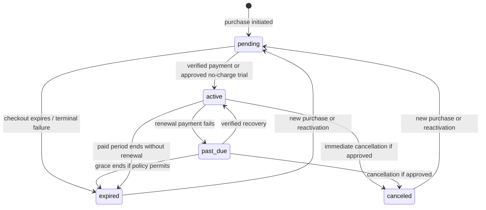

# Plans & Billing implementation blueprint

Status: **data-driven frontend preview implemented; live billing remains gated by the decisions below**. This is the detailed billing design for the existing [implementation plan](implementation-plan.md). Confirmed facts and product decisions are distinguished from proposed engineering defaults below. The user has confirmed the prices and durations below; no payment provider or entitlements have been specified.

## 1. Existing system assessment

- [README](../README.md), [data contract](data-contract.md), [platform board](platform-board.md), [reference analysis](reference-analysis.md), [community chat plan](community-chat.md), [implementation plan](implementation-plan.md), `public/index.php`, controllers, views, configuration, fixtures and [reference schema](../database/schema.sql) establish the current boundary. No separate SRS, ADR, approved billing specification, migration framework or provider configuration was found in the repository. Historical observations of another interface do not establish its payment behavior.
- `/plans` is a placeholder via `DashboardController` and `views/section.php`; the shared layout contains a premium preview dialog. Its Day trial, Basic, Pro and Max cards are illustrative and are **not** an approved catalog. The user has now confirmed the plan names **Trial, Standard, Pro, Max**. The user subsequently specified Trial at ₦2,000 per day, Standard at ₦30,000 per two weeks, Pro at ₦50,000 per month and Max at ₦80,000 per month. These are displayed in the local preview; features and payment behavior remain unresolved.
- The account fixture says Free and 3/10 analyses, and `access=pro` changes only a local preview. Neither is authentication, a real entitlement, a product rule or a subscription. Overview's wallet and active-plan values are fixtures. Do not import them as customer or billing records or use wallet data for payment.
- Actual code is PHP 8.1+ with a small front controller, manual `App\` autoloading, constructor-injected services and repository interfaces, server-rendered views, compiled Tailwind and small JavaScript. The roadmap proposes Composer PSR-4, middleware, sessions, PDO, MySQL and queues; these foundations are not yet implemented. The MySQL schema is a non-applied reference and has no users or billing tables. Existing prediction JSON uses `{data,error,meta}` with a string error. The new contracts retain that envelope; adding machine-readable errors requires a versioned or backwards-compatible convention and must not alter existing prediction responses.
- `config/app.php` uses NGN and Africa/Lagos for the demo. Neither establishes approved billing currency, tax jurisdiction, renewal timezone or provider. The production account, notification, quota and payment boundaries must be built before live billing.

## 2. Decisions and release gates

Confirmed prices: Trial ₦2,000/day; Standard ₦30,000/2 weeks; Pro ₦50,000/month; Max ₦80,000/month. Amounts denote Nigerian naira. Whether these prices include tax and whether Trial renews automatically remain unresolved.

The following are **unresolved product/operations decisions**, not inferred from names or mockups. Obtain written decisions before implementing dependent features; disable unavailable flows rather than guess.

| Decision | Needed for |
| --- | --- |
| Confirm effective dates, tax treatment, price changes and whether any additional intervals are offered. Confirm the calendar and renewal semantics for daily, two-week and monthly periods. | Catalog, checkout, invoices |
| Trial price, length, eligibility, payment method, conversion, abuse controls and whether it can recur; free access after trial and after expiry | Lifecycle and entitlement |
| Feature keys, values, quotas, scope, reset timezone, rollover, consumption semantics and fallback access | Enforcement and usage |
| Account owner, number of concurrent subscriptions and plan scope (global or platform); business identity and role model | Data constraints and authorization |
| Provider(s), countries, supported checkout, recurring mandates, event signatures, settlement, refunds, chargebacks and sandbox | Adapter and operational design |
| Renewal default/consent, calendar boundary, grace length, retry and reminder schedule, expiry, reactivation | Scheduling and messaging |
| Upgrade/downgrade timing, entitlement change, proration, credits and rounding; eligibility of existing customers for new prices | Quotes and invoicing |
| Cancellation effective date, refund rights, dispute and chargeback effects, invoice numbering and corrections | Financial workflows |
| Legal entity, applicable tax/data protection/payment obligations, terms, retention, privacy, deletion, permitted receipt content | Legal review and operations |
| Administrative roles, adjustment limits, approval thresholds, separation of duties and analytics definitions | Admin release |

Proposed baseline: one billing owner and at most one effective subscription per approved scope, enforced under a locked owner/scope record; pending attempts never grant access. Treat this as a design assumption to confirm, not a business rule. Enable only approved intervals and operations. A trial is modeled as an offer/entitlement period only after eligibility and payment rules are agreed; it need not be a payment transaction.

## 3. Functional requirements and lifecycle

Customers can inspect published plan versions and their applicable prices and entitlements, see their own authoritative subscription and usage, initiate an eligible purchase, inspect its pending outcome, manage approved renewal/cancellation/change options, and view their own billing history and downloadable authorized documents. Actions must present the exact server quote and effective date before confirmation. Show unsupported operations as unavailable with an explanation; never imply the fixture preview is a purchase. Catalog activation/deactivation prevents new sales without rewriting existing agreements. Published prices and terms are immutable; create versions for changes. A version's withdrawal must be rechecked when a quote is accepted.

Recommended state model (names are proposed, conditional rules require decisions above):

`cancel_at_period_end` and scheduled plan change are separate attributes, not terminal states: access continues through the paid-through boundary unless an approved reversal/dispute policy changes it. Scheduled jobs use UTC instants and lock/version-check the subscription; a request and renewal cannot both apply conflicting changes. Record every transition, reason, actor, effective time and version. A checkout redirect, client callback, unverified webhook, pending payment or provider timeout never activates paid access. A free trial, if approved, has a separate explicit eligibility and activation rule. Failed renewal, retry, grace and the exact access at period end remain policy gates. A cancellation stops future charges only after provider mandate cancellation is confirmed or tracked for retry; do not promise cancellation of an already submitted charge. Show pending provider operations honestly.

Each paid period has an immutable agreed price/currency and entitlement snapshot; current catalog changes never rewrite old invoices or periods. If permitted, upgrades/downgrades first obtain an expiring server quote specifying old/new version, effective instant, charges/credits, tax, rounding and resulting period. Require confirmation against that quote and subscription version; stale quotes return conflict. Proration algorithm, credits and examples cannot be finalized until policy is approved. No implicit refund or credit is created. Refunds and chargebacks are separate provider-confirmed financial events and their access effect is policy-dependent. Reactivation creates a new attempt/period and cannot silently reuse a canceled mandate.

## 4. Architecture and payment flow

Use server-rendered PHP MVC and progressively enhanced forms, existing service/repository boundaries, injected clock, PDO and provider adapter. Introduce Composer, routing/middleware, session/CSRF, persistent users, RBAC, migrations, a shared rate-limit store and durable jobs as foundation work; do not pretend those exist. Suggested use cases: `CatalogService` publishes immutable versions; `SubscriptionService` governs transitions; `EntitlementService` resolves effective snapshots; `QuotaService` atomically consumes usage; `CheckoutService` issues quotes and initiates attempts; `PaymentService` verifies outcomes; `WebhookService` authenticates and records events; `ReconciliationService` compares provider records; `BillingDocumentService` produces controlled documents; `AuditService` records sensitive actions. Thin controllers validate/authorize, services coordinate repositories, and provider-specific code implements a small `PaymentGateway` interface (initialize, verify, mandate/cancel, refund and reconcile only when supported). No network call occurs inside a long-lived DB transaction.

1. A customer requests a quote; server determines owner, eligible published price, amount, tax and expiration. A checkout command locks the subscription/owner, revalidates the quote and version, reserves a uniquely referenced pending attempt and commits an outbox job in the same transaction. Repeated client idempotency keys map to the same request and result.
2. Worker sends the provider a stable merchant reference/idempotency key where supported. Persist the provider reference and redirect URL only after response. On timeout mark outcome unknown and query provider by reference before retrying; if provider lacks safe lookup/idempotency, hold for manual reconciliation rather than risk a second charge. Return only an approved HTTPS hosted checkout URL; never collect raw card data.
3. Browser return displays pending and triggers an authenticated status read; it is not proof of payment. Provider webhook verifies the raw bytes using the provider's documented algorithm and key, timestamp/replay mechanism where supported, then durably stores a deduplicated event before acknowledging. Authenticate independently of customer sessions and do not log secrets or card data. If no stable event ID exists, determine a provider-specific deduplication strategy before enabling it.
4. Worker queries authoritative provider status where required by the provider contract, validates merchant reference, provider account/environment, amount, currency and intended customer/attempt. Lock the attempt and subscription; atomically record the transition, paid invoice/period and entitlement snapshot once, then enqueue notifications through an outbox. A duplicate or out-of-order event is harmless; do not regress final state from stale events. Mismatches go to a restricted reconciliation queue and grant nothing.
5. Scheduled reconciliation queries provider transactions and compares against local attempts and invoices with overlapping windows and durable checkpoints; retry with backoff, dead-letter and alert on age/count thresholds agreed by operations. Handle late success, reversal and dispute as new events, not deletion or overwriting of original payment. Document manual resolution and operator audit. Pending/unknown checkout remains pending until verified or explicitly resolved.

Recurring charges require approved provider mandate/token capabilities and explicit user consent. Store only provider-issued opaque references and non-sensitive display metadata; verify mandate state before each renewal. Provider webhooks can arrive before checkout response: match the pre-created merchant reference and process safely. Scheduling is at-least-once: unique period/operation keys, locks and provider idempotency prevent repeat charges. Reminders and retries use deduplicated jobs; cancellation and renewal race on the same locked subscription. Record provider response reconciliation separately from local job completion.

## 5. Data design and migration

Proposed MySQL 8/InnoDB model; IDs are opaque public IDs backed by indexed internal keys, UTC `DATETIME(6)`, integers in currency minor units and foreign keys. All actual field types, limits and migration ordering must be finalized against the eventual user schema. Use a shared injected PDO connection, explicit transactions and optimistic version plus row locks; no float calculations. All user-facing history is account-scoped. Monetary snapshots include currency, subtotal, tax, total, tax treatment and rounding policy; immutable lines capture description and period.

| Entity | Main fields and constraints / indexes |
| --- | --- |
| `plans` | Stable unique code and display name; Trial, Standard, Pro, Max are seed candidates only after catalog approval. |
| `plan_versions` | plan FK, version, publication status, effective bounds, immutable descriptive snapshot; unique `(plan_id,version)`. |
| `plan_prices` | version FK, interval unit/count, amount_minor, currency, active dates; unique version/interval/currency/effective start. Validate nonnegative amounts and supported intervals; do not assume all plans offer all intervals. |
| `plan_entitlements` | version FK, feature key, typed value and unit; unique `(version_id,feature_key)`. Define units and validation from approved policy. |
| `subscriptions` | owner FK, scope, state, current period FK, cancel flag, pending change, version; index owner/scope and state/end. Lock a unique owner/scope guard row to enforce one effective subscription when approved; SQL unique status alone cannot enforce overlapping periods. |
| `subscription_periods` | subscription FK, plan version/price FKs, start/end, immutable price and entitlement snapshot, source; unique `(subscription_id,start_at)` and index end. Enforce non-overlap while holding subscription lock; start inclusive/end exclusive. |
| `usage_counters`, `usage_events` | owner/scope, entitlement key, window boundaries and count; unique counter per scope/key/window; unique operation ID for consumption. Lock/update atomically and check limit in same transaction as authorized operation. Corrections are auditable events. |
| `quotes` | owner, version, amount/tax snapshot, intended operation, subscription version, expiry, status; index owner/expiry. Single-use under lock. |
| `invoices`, `invoice_lines` | owner/subscription, document number, period, status, immutable monetary and legal snapshots; unique document number when issued; index owner/issued/id. Drafts may change; issued corrections use credit/debit documents, never overwrite. Legal numbering and retention require approval. |
| `payment_attempts` | owner, invoice/quote, provider/account/environment, merchant reference, provider reference, amount/currency, state, version; unique merchant reference and provider/account/environment/reference where non-null; index pending age. One attempt can have multiple provider events. |
| `provider_events` | provider/account/environment/event ID, signature verification result, digest, received/processed timestamps, processing state; unique provider/account/environment/event ID; index pending. Restricted encrypted payload only if necessary and approved retention; preserve raw bytes needed for signature verification. |
| `payment_adjustments` | payment FK, type refund/chargeback/reversal, provider reference, amount/currency, state, timestamps; unique provider-scoped adjustment reference; enforce cumulative refund limit under payment lock. |
| `payment_methods` | owner/provider, opaque mandate/token reference, safe brand/last digits, state and consent evidence; unique provider-scoped token; never store PAN/CVV. |
| `idempotency_requests` | owner, operation, key, canonical request hash, response reference/state, expiry; unique owner/operation/key. Retention must exceed retry and provider reconciliation windows. |
| `audit_events`, `outbox_jobs`, `reconciliation_runs` | actor, action, target, reason, correlation and immutable timestamp; transactional outbox unique event key with retry/lease; run checkpoints, discrepancies and resolution metadata. Restrict modification/access and audit reads. |

Add versioned forward migrations after the actual users/auth foundation; test empty install, upgrade and recovery on disposable MySQL. Seed only approved catalog data; no fixture-account migration. Backfill only from an independently verified authoritative source with reviewed reconciliation. Financial migrations are forward-corrected after production use, not destructive rollback; document backup, restore and expand/contract deployment. Apply foreign keys after dependency creation and validate constraints and indexes on production-like volumes. Do not merge billing into the wallet ledger without a separately approved accounting design.

## 6. Proposed API contracts

All paths below are proposed, not implemented. Canonical page is `/plans`, matching the existing local route. Session authentication and ownership apply to customer APIs; CSRF and origin checks apply to all session writes. Admin routes require separate server-side permissions; webhooks use provider authentication, not browser CSRF. HTTPS and `Cache-Control: private, no-store` for account/billing responses. Catalog may be publicly cacheable only if policy permits. Standard success `{ "data": {...}, "error": null, "meta": null }`; failures `{ "data": null, "error": {"code":"...","message":"..."}, "meta": null }` for these new routes only. Money is `{amount_minor: integer, currency: "ISO-4217"}`, timestamps ISO 8601 UTC, IDs opaque. Never accept price, user ID, entitlement or status from the client as authority.

| Method and route | Purpose / request and validation | Access / result |
| --- | --- | --- |
| GET `/api/billing/plans` | Published eligible catalog; optional approved currency/interval enum. | Authenticated; versions, prices and features; 200. |
| GET `/api/billing/subscription` | Current period, state, scheduled action, provider mandate status and version. | Owner; 200 with null if none. |
| GET `/api/billing/usage` | Current counters, limits, units and reset instants. | Owner; 200, only supported features. |
| POST `/api/billing/quotes` | `{plan_version_id, price_id, operation}`; operation enum purchase/change; validate eligibility, state and price association. | Owner + CSRF; 201 quote with totals, effective time, expiry and subscription version. |
| POST `/api/billing/checkouts` | `{quote_id}` and `Idempotency-Key`; unexpired owner quote, current version, eligible catalog. | Owner + CSRF; 202 attempt ID, pending state and hosted checkout URL when available; poll status. |
| GET `/api/billing/checkouts/{id}` | Payment/checkout state, safe next action. | Owner; 200; 404 for another owner. |
| POST `/api/billing/subscription/cancellation` | `{mode, expected_version}`; mode limited to approved policy. | Owner + CSRF + idempotency; 202 pending provider action or 200 scheduled; 409 stale version. |
| POST `/api/billing/subscription/changes` | `{quote_id, expected_version}`; quote must specify change and accepted terms. | Owner + CSRF + idempotency; 202 if payment/provider needed, otherwise 200 scheduled. |
| POST `/api/billing/subscription/reactivation` | `{quote_id, expected_version}`; only eligible inactive state. | Owner + CSRF + idempotency; 202 pending verification or approved free activation. |
| GET `/api/billing/payment-methods` | Safe provider-issued display metadata and status only. | Owner; 200. Management/setup endpoints depend on provider and consent approval. |
| GET `/api/billing/transactions` | `status`, `from`, `to`, opaque `cursor`, `limit` 1–100; bounded date range and allowlisted status. | Owner; stable `(created_at,id)` descending pagination; `meta.next_cursor`, 200. Search only approved reference/number fields, bounded and indexed. |
| GET `/api/billing/invoices/{id}` and `/receipt` | Authorized invoice detail or generated document; correct content disposition and no public URL. | Owner; 200 or 404; availability depends on issued document/provider confirmation. |
| POST `/api/billing/webhooks/{provider}` | Size-bounded raw body and provider signature headers; validate against configured provider. | Provider signature; 2xx only after durable acceptance or known duplicate, 400/401 invalid, 503 transient failure. No CSRF. |
| GET `/api/admin/billing/subscriptions`, `/transactions`, `/reconciliation` | Allowlisted filters, date range, cursor, bounded page size; minimal authorized data. | Separate view permissions; 200 paginated. |
| POST `/api/admin/billing/plans`, POST `/api/admin/billing/plans/{id}/versions`, POST `/api/admin/billing/versions/{id}/publish` | Validate draft names, immutable version/price/features and effective dates; publish only approved versions. | Catalog edit/publish permissions and CSRF; 201/200, audit and approval if policy requires. |
| POST `/api/admin/billing/subscriptions/{id}/adjustments` | `{reason, expected_version, ...approved_adjustment}`; explicit amount/time bounds, no raw status override. | Adjustment permission, CSRF, idempotency and policy-required second approval; 202 pending or 200 applied, immutable audit. |
| POST `/api/admin/billing/payments/{id}/refunds` | `{amount_minor, reason}` within available refundable balance; approved currency inherited from payment. | Refund permission, CSRF, idempotency and required approval; 202 until provider confirms. |

Sensitive commands require a bounded opaque `Idempotency-Key` scoped to owner and operation; same key and canonical payload returns the original result/status, different payload returns 409. Concurrent distinct commands use `expected_version` and lock/recheck, returning 409 on conflict. Document retention and polling behavior in implementation. Common errors: 400 malformed input, 401 unauthenticated, 403 forbidden/CSRF, 404 inaccessible resource, 409 conflict/stale/idempotency, 422 semantic validation/eligibility, 429 with `Retry-After`, 503 temporary dependency failure. Use stable safe codes such as `QUOTE_EXPIRED`, `STALE_SUBSCRIPTION`, `PAYMENT_PENDING`, `PROVIDER_UNAVAILABLE`; do not expose provider secrets or internal errors. Responses may include a correlation ID in `meta`. Do not return a success for an unconfirmed charge.

## 7. UX specification

Reuse `views/layout.php`, existing sidebar, typography, colors, buttons and dialog conventions. Render the initial page server-side and use small deferred JavaScript for enhancement; all enabled actions must have working server-side form fallbacks with CSRF and accessible status pages. Do not expose checkout or fixture-account actions until prerequisites exist.

- Header and breadcrumb: Plans & Billing; concise status and help link if support is available. Current subscription card shows plan, status, paid-through or next charge date, interval and clear cancel/renewal state. Show no-subscription, trial, past-due, pending, expired and unavailable states without fabricated dates.
- Available plan cards: Trial, Standard, Pro and Max, populated only from published catalog; show price/interval, taxes where approved, key features and a comparison disclosure. Mark current plan and only eligible actions. Never display unapproved prices or benefits. Use compact vertical stacking on small screens and grid on wider screens.
- Usage: show only enforced features with accessible text values, reset times and progress bars; distinguish unlimited, unknown and unavailable from zero. Billing information: safe method summary and management action only if provider supports it. History: date, document/reference, amount/currency, status and receipt/invoice actions, with labeled filters, server pagination and mobile cards. Keep sensitive details out of URL query strings.
- Management: contextual change, renewal and cancel actions. Confirm dialogs name consequences, effective time, quote total/tax and consent; avoid preselected recurring consent. Async checkout shows pending, refresh/retry and safe recovery; timeout does not say payment failed or invite another charge until status is known. Scheduled cancellation and any mandate failure remain visible. Use explicit success, actionable failure, empty, loading and offline states; announcement regions should not repeatedly interrupt users.
- Semantic headings, landmarks, labels, visible focus, keyboard operation, sufficient contrast, non-color status labels, screen-reader announcements, and modal focus containment/restore are required. Support narrow widths, zoom and reduced motion; no horizontal page overflow. Format currency using approved currency metadata and display dates with an explicit timezone; calculations use UTC. Use escaped output and accessible HTML table semantics.

## 8. Administration, security and operations

Separate catalog read/edit/publish, subscription view/adjust, payment view/refund, reconciliation and analytics permissions; least privilege and ownership are enforced on every request, including documents. Approval thresholds, second approver, privileged authentication and staff support access depend on policy; do not enable an adjustment/refund without an approved workflow. Audit actor, target, before/after references, reason, approval, correlation and time in append-only restricted storage; never log secrets or card details. Audit and financial records must not be silently edited. Operational dashboards should show pending age, failures, webhook verification failures, reconciliation gaps, retry/dead-letter counts, upcoming expirations and provider errors; revenue analytics require approved definitions and timezone.

Secrets come from environment/secret manager, with key rotation and distinct sandbox/live accounts; HTTPS, secure session cookies, CSRF, output escaping, input validation, shared rate limits and least-privilege DB roles are prerequisites. Provider signature verification must follow its current official documentation, including timestamp tolerance and key rotation where supported; do not invent a generic signature format. Apply payload limits, encrypted restricted storage, access and retention controls, alerts and incident runbooks. Tax, invoice legal validity, privacy, retention, PCI scope and applicable local requirements require qualified review for the chosen provider and operating jurisdictions; this document does not assert compliance. Record terms/consent versions and timestamps where approved. Restore drills, provider incident procedures and reconciliation ownership are launch gates.

## 9. Acceptance and test strategy

| Capability | Measurable acceptance and verification |
| --- | --- |
| Catalog | Only approved published versions and supported prices appear; changes do not alter prior period/invoice snapshots. Unit and migration tests cover versioning and constraints. |
| Checkout/activation | A verified matching successful payment activates exactly one period; browser return, invalid signature, wrong amount/currency, pending or timeout activates none. Integration tests use provider sandbox and controlled failure injection. |
| Webhooks/reconciliation | Duplicate and reordered callbacks, callback before redirect response, provider timeout, late success and worker crash/retry produce one financial effect; mismatches create a tracked discrepancy. Verify signature, replay, event uniqueness and recovery. |
| Lifecycle | Approved transitions, expiry boundaries, scheduled change/cancellation and renewal races are tested with a fixed clock and concurrent DB connections; unauthorized or stale commands fail without changes. Trial, proration, grace and refund tests require approved examples first. |
| Entitlements/usage | Server enforcement and quota consumption are atomic; concurrent final-unit requests cannot exceed the approved limit, retries do not double count, and expired access follows policy. Test reset boundaries and snapshots. |
| Billing records | Invoice totals match line/tax snapshots in minor units; refund cannot exceed refundable balance; reversal retains original transaction and records adjustment. Test authorized downloads and historical price changes. |
| Security/admin | Cross-account reads/writes return no data; CSRF, RBAC, approval, rate-limit and idempotency tests pass. Audit entries include actor and reason; secrets/PAN/CVV are absent from application logs and storage. |
| UX | Keyboard-only flows, focus return, screen-reader status, responsive phone/desktop, zoom and reduced-motion checks pass; loading, empty, error, pending and no-JS flows are exercised. No demo state is represented as paid access. |
| Operations | Run a sandbox end-to-end purchase, renewal/failure, cancellation, refund if enabled and reconciliation; restore a backup and process a dead-letter replay without duplication. CI runs unit, API, DB integration, asset build and security checks. Set latency, alert thresholds, availability and retention targets with operations before launch. |

## 10. Dependency-aware implementation roadmap

Each phase is complete only when its documented acceptance checks pass in CI, migrations and rollback/forward recovery are reviewed, operational documentation is updated and product/security sign-off for that phase is recorded.

1. **Decisions and provider discovery.** Resolve section 2, obtain provider sandbox and verified official capabilities, legal/tax input, signed lifecycle examples and approved catalog. Deliver decision record, pricing/entitlement matrix and provider mapping; no DB/API/UI functionality. Done: every enabled flow has an owner, policy and testable expected outcome.
2. **Platform foundation.** Add Composer PSR-4, routing, dependency injection, real users, session/CSRF, RBAC, migrations, DB transactions, shared rate limiting, durable jobs/outbox and CI. Deliver baseline migrations and auth middleware; no live payment endpoints. Done: fresh install/upgrade, auth and concurrency/security tests pass; recovery and deployment rehearsed.
3. **Catalog and entitlement core.** Add versioned plan/price/feature tables, subscription/period/usage and audit repositories, services, read APIs and server enforcement. Implement only agreed trial/free rules. Deliver admin drafts/publishing with permissions and catalog/current/usage UI. Done: version history, access and atomic quota criteria pass without relying on fixtures.
4. **One-time checkout and billing.** Add quotes, invoices, attempts, idempotency, provider adapter, verified webhook, outbox, status/history/document APIs and checkout UI. Configure sandbox only initially. Done: sandbox scenarios, duplicate/timeout/late-event and reconciliation tests pass; no paid access before verified matching success.
5. **Lifecycle and recurring operations.** Add only approved mandates, consent, scheduler, retry/grace, cancellation, changes, quotes/proration, reactivation, notifications and adjustment records. Deliver management UI and operational runbooks. Done: clock-boundary/race and provider cancellation/recovery tests pass; each policy scenario has agreed examples.
6. **Admin, reconciliation and launch.** Add approved permissions, approval workflows, refund/dispute handling, reconciliation console, analytics and alerts. Run independent security, accessibility, privacy/tax/payment review, load/restore drills and staged rollout with a kill switch and monitored reconciliation. Done: all enabled features meet section 9, unresolved policies remain disabled, incident owners and launch approval are recorded.

The milestone ordering is a dependency graph, not a commitment that every optional feature is approved. Reuse the project's notification and account services once implemented; avoid parallel billing-specific substitutes. Keep this document and the main roadmap synchronized as decisions are approved.

## Local data-driven demonstration (November 2026)

`/plans` now renders a synthetic billing read model through `BillingRepository`, `DemoBillingRepository`, and `BillingService`. The deterministic fixture `database/fixtures/billing.php` relates one example subscription to six example transactions and invoices, with amounts in NGN minor units. Line items, subtotals and transaction totals agree. A refunded example describes the original invoice and transaction; a real adjustment ledger is not implemented. Usage and preferences are invented examples, not approved entitlements, consent or account data. The four displayed catalog prices and durations are the confirmed values above; annual prices, tax treatment and plan benefits remain undecided. Example zero tax is arithmetic only and does not establish tax policy.

The page supports GET-based status filtering, date sorting, pagination and inline example invoice details without JavaScript. It provides an empty state and a provider-unavailable error. It does not apply plan changes, renewal changes or checkout, generate official documents, or offer a monthly/annual toggle: these depend on unapproved policies or prices. The examples never alter a subscription or make a payment. The current fixture dates are fixed for reproducibility and are not a live account status.

`config/billing.php` selects `BILLING_PROVIDER=mock` by default; any other value fails closed with an unavailable message. A live implementation must implement the repository interface and adapt authenticated, owner-scoped responses into this read model; no live provider exists yet. The proposed production endpoints and `{data,error,meta}` envelope are in section 6, and remain proposals rather than an implemented API. A production adapter still needs finalized DTOs and normalization, asynchronous transport/cancellation, server-side cursor filtering and pagination, error mapping, no-store or authorized cache invalidation, authentication and ownership checks. Do not expose the fixture as authenticated billing data or migrate it into real accounts. Authorization, CSRF, provider verification, approved policies, actual financial records and legal invoice generation remain release prerequisites.

Run `php tests/billing.php` for fixture arithmetic, relationships, filtering, ordering, pagination and invoice lookup; run `npm run build:css` after stylesheet changes. The page's GET forms provide a non-JavaScript fallback. Loading and interactive mutation states must be implemented with the future asynchronous provider and approved workflows.

### Platforms design alignment

Plans & billing now uses the Platforms page design language: a compact two-tone heading, demo notice, uniform green-bordered cards, lime actions, and a full-width billing ledger. The shared breadcrumb shows `Overview / Plans & billing` in the main content header.

The first section contains three equal desktop cards for the current subscription, usage and billing preferences. The four existing catalog plans remain in a separate comparison row, with Pro highlighted and its current-plan action disabled. Billing history spans the workspace below the catalog; status, ordering and CSV controls sit alongside its heading and wrap naturally at narrower widths. The table has a labeled, keyboard-focusable scroll region. The desktop chat launcher uses an icon to avoid covering ledger text.

At tablet widths the subscription and usage share a row, preferences span the next row, and plan cards use two columns. On phones the summary and plan cards stack in one column, controls use larger targets, and the table scrolls within its panel without horizontal page overflow.

All values remain supplied by the billing read model. Plan buttons open preview dialogs without applying a subscription change. Invoice email and renewal-reminder controls retain local preview storage and visit-only fallbacks. Payment-method and subscription dialogs retain their existing preview behavior. CSV export contains the current filtered page and identifies the records as illustrative. GET filtering, ordering, pagination and invoice detail links remain usable without JavaScript.

Validation: `php tests/billing.php`, `php -l views/plans.php`, `node --check public/assets/billing.js`, and `node tests/platforms-page.cjs`. The browser checks cover three aligned desktop summary cards, a full-width ledger, plan previews, local email editing, transaction filtering, invoice links and 390px mobile overflow. Desktop/mobile screenshots are saved to the system temporary directory.
