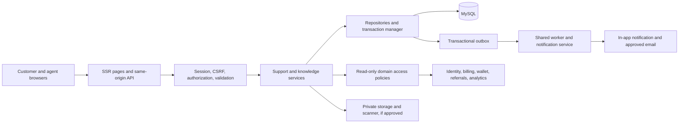
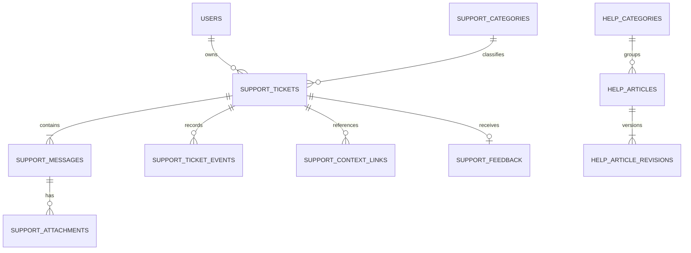

# Support module architecture and implementation blueprint

Status: **implementation started**. The user authorized implementation; the current release is a local help preview. The production ticketing design below remains dependent on the stated identity, operational and policy prerequisites; proposed defaults are not established product promises. See [implementation plan](implementation-plan.md), [billing](plans-billing.md), [wallet](wallet.md), [referrals](referrals.md), [community chat](community-chat.md), [data contract](data-contract.md), and [platform board](platform-board.md); their domain-specific decisions govern their respective modules.

## Current Support preview

`/support` follows the Platforms workspace with compact, legible KPI cards, a searchable help center, topic selection, contextual quick links and a compact support-request table. Phone layouts stack panels and turn request rows into labeled cards. All tickets and conversations are fictional, and live submission/support is explicitly unavailable; no service hours or response-time promises are shown.

`SupportPreviewService` receives `database/fixtures/support.php`: eight help articles across six topics and five example requests. All-time counters derive from ticket states: three active, one waiting for a customer reply (a subset of active), and two resolved/closed. Help search matches question, answer and category labels, is capped at 100 bytes, and combines with an allowlisted topic. Ticket status filtering preserves help filters; help searches preserve ticket status. Requests sort by latest update with stable ID ordering. Detail links select only known fixture IDs and render the corresponding conversation. All text is escaped; Lagos timestamps are labeled WAT.

Native GET forms, details disclosures and request-detail links work without JavaScript. `support.js` adds automatic ticket-status submission and loading states; search submits explicitly. All query processing and data access were removed from the view.

Validation: `node tests/support-page.cjs` covers counts, search, topics, status filters, empty search, FAQ expansion, selected conversations, responsive desktop/tablet/phone layouts and no-JavaScript fallback. PHP checks cover malformed input, unknown requests and empty data. No live ticket API, message delivery or customer communication is enabled.

## 1. Existing system assessment

| Classification | Evidence and implications |
| --- | --- |
| Existing | `public/index.php` wires fixture repositories and routes the prediction API. `DashboardController` maps `/support` to `views/support.php`, a fixture-driven searchable help center and ticket-conversation preview; no live ticket service exists. `views/layout.php` supplies the shared dashboard shell and navigation. |
| Existing | PHP 8.1+, manually loaded `App` classes, constructor-injected services and repository contracts, server-rendered templates, compiled Tailwind and small JavaScript. Prediction JSON uses `{data,error,meta}` with string errors; preserve it. |
| Existing | Account and notification indicators are fixtures. Plans, wallet, referrals and reviews are previews; community chat is non-persistent. Platform results and predictions are synthetic. These are not authenticated identities, authoritative financial records or live communication services. |
| Existing | `database/schema.sql` is an unapplied MySQL prediction reference, not a migration or user database. No separate SRS, ADR directory, production identity/session/CSRF/RBAC, CMS, SMTP/queue, audit service or migration framework was found. |
| Project direction | The roadmap proposes PHP MVC, PSR-4/12, DI, services and repositories, MySQL/InnoDB, sessions/CSRF, UTC, background jobs and a JSON envelope. These are not yet implemented foundations. The reference analysis establishes a Support link, not its behavior. |
| Proposed | Authenticated asynchronous tickets and curated help articles, using shared foundations when built. No external messaging, live support chat or AI automation is assumed. |

Assessment is limited to repository code and documentation; external infrastructure was not verified. Do not import demo identities or records into production. Older generic roadmap sketches are subordinate to more specific blueprints and confirmed decisions.

## 2. Scope and decision gates

Recommend an in-app ticket conversation and searchable help center. Reuse a shared email service for notifications only when it exists and is approved; inbound email is not automatically ingested. Show contact details and hours only after verification. No contractual SLA, premium support entitlement, public contact form or unauthenticated recovery ticket is assumed. An approved account recovery path is a prerequisite for helping locked-out customers; when identity is unavailable, show honest unavailability.

Customers find published help, create and track their own tickets, reply, close or reopen where policy permits, and optionally rate a resolution. Agents triage, assign, reply, add private notes, resolve and escalate within permissions. Content managers publish articles. Proposed configurable categories: account/authentication; plans/subscriptions; billing/payments; wallet/credits; referrals/rewards; platforms; predictions/analytics; technical issues; general; privacy/security. Stable category codes preserve history. Restricted security cases need a separately approved access policy.

**Decisions needed:** support owner, staffing, availability, holidays and timezone; locked-out user recovery; role scopes and separation of duties; privacy/security routing; retention, deletion, legal holds and jurisdictional review; attachment types, limits, scanning and storage; channel/address and notification preferences; severity/escalation criteria; customer closure, reopening and feedback eligibility; automatic closure; article audience and publishing authority; internal targets, calendar and pause rules; contextual record access; RPO/RTO and rollout ownership. Tier benefits or guaranteed times need separate approval. Disable dependent features until decisions and infrastructure exist.

## 3. Ticket lifecycle and service levels

Use five proposed canonical states. Assignment, escalation and priority are independent attributes, not statuses: `open` (new), `waiting_support` (agent action due), `waiting_customer` (customer information needed), `resolved` (agent recorded resolution), and `closed`. In-progress remains `waiting_support`; reopening records an event and returns to `waiting_support`.

| From | Authorized action | To and effects |
| --- | --- | --- |
| none | Owner submits valid request | `open`; create ticket, initial public message, audit and event atomically; default normal priority. |
| open | Agent triages | `waiting_support`; record classification and optional assignment; unassigned work remains visible. |
| open, waiting_support | Agent requests information with public reply | `waiting_customer`; notify owner. |
| waiting_customer | Owner replies | `waiting_support`; notify queue; preserve assignment. |
| open, waiting_support, waiting_customer | Agent supplies public resolution | `resolved`; record reason/time and notify owner; feedback eligible if enabled. |
| active or resolved | Owner closes if policy permits; agent closes resolved with reason | `closed`; record actor/time. No implied satisfaction. |
| resolved, closed | Eligible owner requests reopen, or authorized agent reopens with reason | `waiting_support`; record event and notify queue. If ineligible, offer a new linked ticket. |

Agent replies without transition are allowed in `open`/`waiting_support`; in `waiting_customer` the agent explicitly chooses whether to keep waiting. Customer reply in resolved/closed requires an eligible explicit reopen. All other transitions fail with 409. Assignment and escalation on active tickets record actor, destination and reason; escalation never silently changes priority. Internal notes are not customer responses. Lock the row, check expected version, authority and transition, and commit message/state/audit/outbox together. Deactivated categories remain on existing tickets.

Priority is agent-controlled: normal by default, low for nonblocking guidance, high for verified significant impairment, critical for an approved security or widespread outage incident. These examples require operational approval; customer urgency is a signal, not an override. Supervisor changes require reason and audit. Internal first-response and resolution targets, if approved, use versioned policies, business calendar and explicit `waiting_customer` pause rules; they are not contractual guarantees. Alert thresholds and escalation owners must be agreed. Missing policy is reported as unavailable, not compliant.

## 4. Architecture and integration

Thin controllers validate and map safe DTOs; ticket command/query services own workflow and scoped reads, knowledge service owns publishing/search, policy enforces role and state, repositories isolate PDO. Inject clock, transaction manager, audit, event publisher and optional storage/scanner. Reuse shared infrastructure once built, not a separate support mailer or identity system. Transactionally write state, audit and outbox; after commit workers use stable event IDs, idempotent consumer receipts, bounded retries, dead-letter alerting and reconciliation. Delivery failure never rolls back a ticket.

Identity supplies principal and permissions; fixtures never do. Billing, wallet, referral and analytics adapters check ownership and authorization on association and retrieval. Store minimal opaque references; display only safe live summaries. Support cannot change source records; correction uses each domain's own authorized workflow. Do not disclose card data, fraud flags, hidden predictions or a referred person's identity. Missing/deleted sources are handled safely. Disable a context type until its authoritative domain exists. Sensitive administrative context reads are audited.

Proposed notifications: creation receipt, public agent reply, resolution and eligible reopen to the owner; customer replies alert the queue. Assignment/escalation are internal by default. Feedback requests and other state notices require policy approval. Payloads contain opaque IDs and event type, never message body, financial information or internal notes. Links require authentication. Respect approved preferences and transactional exceptions; track delivery by event/recipient/channel. The fixture notification bell is not a service.

## 5. Data model and migration

Proposed MySQL 8/InnoDB, internal BIGINT keys, unique opaque public IDs, UTC `DATETIME(6)`, utf8mb4, foreign keys and application-enforced allowlists. Mutable entities have timestamps and a version. Final key types depend on the future identity/domain schemas. Never expose storage keys or rely on IDs for authorization.

| Table | Fields and constraints / indexes |
| --- | --- |
| `support_categories` | Unique stable code, label, active, order, optional routing policy; restrict deletion while referenced. |
| `support_tickets` | Unique public ID/reference, owner and category FKs, subject, status, priority, optional assigned agent FK, escalation flag, timestamps, version. Index `(owner_id,last_activity_at,id)`, `(status,priority,last_activity_at,id)`, `(assigned_agent_id,status,last_activity_at,id)`, `(category_id,status,created_at,id)`. |
| `support_messages` | Unique public ID, ticket and author FKs, public/internal visibility, plain body, creation time; index `(ticket_id,created_at,id)`. Initial description is the first public message. Customer SQL and DTO always filter visibility. |
| `support_attachments` | Unique public ID/private object key, message and owner FKs, display filename, detected MIME, byte count, hash, scan state, creation time; index message and scan state. Serve only clean objects. |
| `support_ticket_events` | Ticket/actor FKs, action, safe old/new values, reason, correlation ID, UTC time; index `(ticket_id,created_at,id)`. Append-only restricted audit, without message bodies. Assignment and escalation history use these events. |
| `support_context_links` | Ticket FK, allowlisted type and source opaque ID, actor/time; unique `(ticket_id,type,source_id)`. A per-type adapter validates ownership; the link itself never authorizes access. Use actual FKs only where schemas permit. |
| `support_feedback` | Unique ticket FK, owner FK, rating 1–5, optional bounded comment, created time. Enforce owner and resolved/closed state; one response per ticket unless another policy is approved. |
| `help_categories` | Unique slug, name, order, active. |
| `help_articles` | Unique public ID/slug, category FK, visibility, draft/published/archived state, published revision pointer, order, published time, version; index visibility/state/category/order. FAQs are short articles, not a duplicate store. |
| `help_article_revisions` | Article FK, unique revision number per article, title, sanitized structured body, summary, SEO metadata, editor FK, created time. Published revisions are immutable; rollback publishes a new revision. |
| Optional article feedback | Article/revision FK, approved identity or privacy-preserving session identifier, helpful boolean, time; unique per identity/revision. Omit until privacy and abuse policy is approved. |
| Shared foundations | Reuse shared RBAC, audit, idempotency, outbox and delivery records; optional versioned SLA policies/calendars use ticket events. |

Generate references as `SUP-` plus a cryptographically random uppercase base32 token with at least 80 bits of entropy; enforce uniqueness and retry collisions. Stage uploads under independent generated keys; associate only authorized clean objects and expire orphans. Attachments are disabled until limits and scanning are approved. Introduce identity, migrations, RBAC, audit and outbox first; then additive versioned migrations behind disabled flags and reviewed category seeds. No fixture backfill. Test fresh install, upgrade, constraints and restore. After real data exists, disable writes and use forward correction rather than destructive rollback; preserve records according to approved retention and legal holds.

## 6. REST contract

All routes are **proposed, not implemented**. Same-origin HTTPS session authentication; CSRF and origin checks on mutations. Public help depends on audience approval. Private responses use `Cache-Control: private, no-store`. IDs are opaque strings; timestamps are ISO 8601 UTC. Success: `{ "data": ..., "error": null, "meta": { "request_id": "...", "next_cursor": null } }`; errors: `{ "data": null, "error": { "code": "...", "message": "...", "details": {} }, "meta": { "request_id": "..." } }`. This structured error does not change the prediction API. Details contain safe field errors only. Infer owner from session. Inaccessible and nonexistent customer tickets return indistinguishable 404.

All mutations require a bounded `Idempotency-Key`, scoped to principal and operation and stored with canonical request hash and result atomically: same request returns original response, changed payload or in-flight key returns 409. Retain keys for an approved retry window. Each mutation audits actor, action, target and correlation ID without sensitive body; audit sensitive administrative reads. Lists use limit 20 by default, maximum 50, and signed opaque cursors bound to allowlisted filters/sort and stable `(last_activity_at,id)` or `(created_at,id)` tie-breakers. Ticket order is newest activity first; message order is oldest first. Clients deduplicate after refresh. Search is 2–100 characters and customer ticket search covers reference/subject only.

| Method and route | Authorization, input and success |
| --- | --- |
| GET `/api/support/overview` | Session; 200 active categories, owner counts/recent tickets and approved availability. |
| GET `/api/support/categories` | Session; 200 active codes/labels and permitted context types. |
| GET `/api/help/categories` | Approved audience; 200 visible categories. |
| GET `/api/help/articles` | Approved audience; `q`, category, cursor, limit; 200 permitted published summaries and next cursor. |
| GET `/api/help/articles/{slug}` | Approved audience; 200 published revision, related articles and breadcrumbs; otherwise 404. |
| POST `/api/help/articles/{slug}/feedback` | If approved, session and CSRF/key; `{helpful:boolean}`; 201 receipt; one per approved identity/revision. |
| POST `/api/support/tickets` | Session, CSRF/key; `{category,subject,description,context:[{type,id}],attachment_ids:[]}`; 201 ticket and `Location`; verify every source and upload. |
| GET `/api/support/tickets` | Owner; allowlisted status, category, q, sort, cursor, limit; 200 summaries. |
| GET `/api/support/tickets/{id}` | Owner; 200 safe detail, version and allowed actions. |
| GET `/api/support/tickets/{id}/messages` | Owner; cursor/limit; 200 public messages and clean attachment metadata. |
| POST `/api/support/tickets/{id}/messages` | Owner, CSRF/key; `{body,attachment_ids,version}`; 201 message and updated ticket; active states only. |
| POST `/api/support/tickets/{id}/close` or `/reopen` | Owner, CSRF/key; `{version,reason?}`; 200 when policy/state permits. |
| POST `/api/support/tickets/{id}/feedback` | Owner, CSRF/key; `{rating,comment?}`; 201 after resolution if enabled; unique ticket. |
| POST `/api/support/uploads` | Owner, CSRF/key, multipart `file`; 202 staged ID and scan state if enabled; no attach/download until clean. |
| GET `/api/support/attachments/{id}` | Owner of associated ticket or authorized agent; 200 clean download only; attachment disposition, `nosniff`, no-store; otherwise 404. |
| GET `/api/admin/support/tickets` and `/tickets/{id}` | `support.queue.read`; allowlisted status, category, priority, assignee, escalation, dates, reference, cursor/limit; 200 scoped queue/detail. |
| GET `/api/admin/support/tickets/{id}/messages` | Queue read; internal notes additionally require `support.notes.read`. |
| POST `/api/admin/support/tickets/{id}/messages` | `support.reply` or `support.notes.write`; `{visibility,body,attachment_ids,version}`; 201; internal notes generate no customer notice. |
| POST `/api/admin/support/tickets/{id}/assignment` | `support.assign`; `{agent_id:null\| string,reason,version}`; 200; eligible active assignee only. |
| POST `/api/admin/support/tickets/{id}/priority` | `support.priority`; `{priority,reason,version}`; 200; validate policy. |
| POST `/api/admin/support/tickets/{id}/transition` | `support.transition`; `{action,reason,public_resolution?,version}`; 200; apply matrix. |
| POST `/api/admin/support/tickets/{id}/escalations` | `support.escalate`; `{destination,reason,version}`; 201; configured authorized destination. |
| GET `/api/admin/support/tickets/{id}/events` | `support.audit.read`; cursor/limit; 200 restricted events. |
| GET/POST `/api/admin/support/categories`; PATCH `/api/admin/support/categories/{code}` | `support.config`; bounded `{code,label,active,order,version}` as applicable; 200/201. Preserve history on deactivation. |
| GET/POST `/api/admin/help/articles`; PATCH `/api/admin/help/articles/{id}` | `help.edit`; draft metadata/content, expected version for PATCH; 200/201. |
| POST `/api/admin/help/articles/{id}/publish` or `/archive` | `help.publish`; `{version,reason}`; 200 after review and visibility checks. |
| GET `/api/admin/support/metrics` | `support.metrics`; bounded UTC date range and permitted filters; 200 definitions, values, sample size and as-of. |

Proposed validation: active category code; subject 5–160 Unicode characters; description/body 10–10,000; optional feedback comment at most 2,000; reason 3–500; reject control characters except newline/tab; max five unique allowlisted context links. Version is positive integer. Article slug lowercase ASCII 3–100, title 5–160, body at most 50,000 characters. Reject unknown fields. Upload count, size and MIME limits remain policy gates and must be enforced by proxy and server; never trust extension or browser MIME. Shared rate limits by account and IP cover search, writes, uploads and admin; numeric thresholds require load testing. 429 returns `Retry-After`.

Errors: 400 malformed JSON/cursor, 401 no session, 403 CSRF/permission, 404 inaccessible, 405 with `Allow`, 409 stale version/invalid transition/key conflict, 413 size, 415 media, 422 validation, 429 throttled, 503 unavailable. Never expose SQL, ownership or internal notes. Upload retries use a streaming request hash and staged association; cleanup expires rejected and orphaned blobs. Customer DTOs never contain internal notes, operational metadata, raw source IDs outside entitlement, SLA internals or storage keys.

Example creation input: `{ "category":"billing", "subject":"Payment still pending", "description":"My subscription has not activated.", "context":[{"type":"payment","id":"opaque-id"}], "attachment_ids":[] }`. A 201 response contains `{ "data":{"id":"opaque-id","reference":"SUP-example","status":"open","priority":"normal","version":1,"created_at":"2026-11-03T10:00:00Z"},"error":null,"meta":{"request_id":"opaque-id"} }`; the reference is illustrative. List data is an array with `meta.next_cursor`; detail includes category, status, timestamps, version and `allowed_actions`. Message DTO includes ID, author role, body, timestamp and safe attachment metadata.

## 7. UI and knowledge design

Reuse the dashboard shell, dark green surfaces, muted borders, bright green actions, icons, typography, responsive navigation and accessible dialogs. Proposed `/support` has a compact heading and description, labelled help search, topic cards, common FAQ accordions, recent-ticket panel, “View all” and “New request”. Desktop uses a main column and smaller ticket panel; mobile stacks them. Do not imply an unapproved contact channel or response promise.

Help list provides category filters, GET search and breadcrumbs; detail shows revision date, readable headings, related articles and optional helpfulness. Use server-rendered links/forms as a progressive enhancement baseline. Ticket list uses a semantic desktop table and labelled mobile cards: reference, subject, category, status, creation and last activity; priority/team only if approved. Provide search, status/category filters, sort and cursor pagination. Status has text as well as color. Submission has category, subject, description, optional eligible record selector and approved attachments; server validates ownership even for preselected context. Inline labels, limits, errors and preserved input make recovery easy. Ticket detail shows original request, chronological public conversation, local display timestamps with machine-readable UTC, safe attachments, status, resolution and server-authorized actions. Feedback appears only after resolution if enabled.

All controls have meaningful states: accessible busy indicator while loading; empty tickets explain how to submit; empty search offers clear filters and an approved contact action; submission in progress prevents accidental duplicate clicks; success shows reference and detail link; network errors retain draft and retry with the same key; permission errors are safe and actionable; rejected/quarantined files are not linked; closed tickets explain available actions; outage shows truthful unavailability and only a verified alternate channel. Announce updates, provide visible focus, keyboard accordions/dialogs and focus return, semantic landmarks, labels, error summaries, sufficient contrast, touch targets and reduced motion. Test WCAG 2.2 AA as a proposed target and reflow at 320 CSS pixels.

Seed only approved facts. Named owners draft, reviewers check accuracy/accessibility, publishers publish immutable revisions and periodically review/archive obsolete content. Audience, localization, public SEO and review cadence need approval. Search only authorized published revisions; begin with bounded indexed MySQL full-text search and category filters, verify query plans and relevance, and add separate indexing only on measured need. Public content may have bounded cache TTL and publish/archive invalidation; private content is never shared-cached. Never promise prediction accuracy or betting outcomes.

## 8. Administrative operations

Provide a scoped queue with filters, assignment, response, internal notes, transition, priority, escalation, history and metrics. Proposed permission groups: agents have `support.queue.read`, `support.reply`, `support.notes.read/write`, `support.transition`; supervisors additionally have `support.assign`, `support.priority`, `support.escalate`, `support.metrics`; editors have `help.edit`, publishers `help.publish`; restricted administrators manage config and audit. Identity grants explicit permissions, not inferred role names; privacy/security cases need additional approved scopes and access auditing. Support personnel get minimal read-only financial context, not authority to adjust credits, payments, referrals or account access. Bulk actions are deferred until per-item authorization, concurrency, partial failures and audit are specified.

## 9. Security, privacy and reliability

Use HTTPS, secure HttpOnly SameSite sessions and rotation, CSRF/origin verification, prepared PDO statements, server-side ownership and scoped permissions on every read/write/download. Plain text is escaped on output; approved rich content needs maintained allowlist sanitization and CSP defense in depth. Never log message bodies, secrets, session identifiers, files or payment credentials. Tell users not to provide passwords, card data or identity documents; approved redaction and incident handling cannot promise perfect detection. Rate-limit account and IP, monitor abuse, and provide operational review and an accessible appeal.

Attachments are disabled by default. If approved, enforce configured detected MIME, extension and byte limits, generated keys, private storage outside web root, quarantine and malware scan before delivery, safe download headers and authorization on every request. Do not execute or inline active content; address archive bombs and parser risks. Encrypt storage/backups and define orphan/quarantine retention. Agree privacy notice, lawful basis, access/export, correction, deletion, legal holds and cross-border processing with counsel; no retention period is assumed. Separate audit retention from message retention and test deletion propagation into backups.

Bound queries and page sizes, monitor query plans and queue saturation. Use row locks plus expected version for concurrent changes. Transactional outbox, idempotent consumers, bounded retries and dead-letter alerts prevent lost logical events; email remains at-least-once and does not guarantee inbox receipt. Monitor queue age, failures, scans, errors, unauthorized access and overdue tickets when policies exist; assign thresholds and responders. Encrypt backups, rehearse database/object restore and reconciliation, and agree RPO/RTO. Archive only under approved retention without breaking ownership or audit.

## 10. Analytics

Ticket records and immutable events are authoritative; public agent messages are distinguished from internal notes. Use UTC `[start,end)` periods, display reporting timezone, filters, sample size and as-of. Volume counts tickets created in period. Open/pending are state snapshots; historical snapshots need replay or a projection. Resolved is distinct tickets first resolved in period, with subsequent resolutions separate. First response is creation to first public agent message, excluding unanswered tickets and showing their count. Resolution time is creation to first resolution; state whether approved business-time pauses apply. Category/priority volume uses value at creation unless labelled current. Reopen rate is distinct reopened tickets divided by distinct resolved tickets in a stated cohort/observation window. Satisfaction shows rating distribution, mean, response count and eligible count; silence is not satisfaction. Workload is currently assigned active tickets; escalation rate uses distinct escalated tickets over created cohort with observation window. SLA compliance requires approved versioned policy/calendar and explicit numerator, denominator, exclusions and pause rules. Restrict metrics by permission and privacy policy; never report fixtures as real statistics.

## 11. Testing and acceptance

Unit tests cover every transition, authorization, priority, reference collision, validation, business clock and metric definition. MySQL integration tests verify owner B cannot read/reply/close/link/download owner A's data; private notes cannot appear in customer DTOs, HTML, search, notices or downloads; staff scopes and restricted cases hold. Test atomic audit/outbox rollback, idempotency replay and changed-payload conflict, stale versions, assignment races, retries, out-of-order events and dead letters. If enabled, test MIME spoofing, size, malware/quarantine, orphan cleanup and direct object access. Verify publishing/visibility, revision rollback, search, cursor tie-breakers and cache invalidation. Security tests include stored XSS, injection, CSRF, IDOR, rate limiting and sensitive logs. End-to-end customer and staff workflows cover errors, empty states, contextual records, reopening, feedback and delivery failure. Test responsive keyboard, screen reader, reflow and contrast. Run existing PHP/Node regression tests and production build; assess query plans, load and restore before launch.

Acceptance: (1) help exposes only authorized published revisions and supports search and empty state; (2) retries create exactly one owned ticket, initial message, audit and event; (3) every permitted transition succeeds and forbidden/stale transitions fail without side effects; (4) conversation order and internal-note confidentiality hold across all surfaces; (5) context checks ownership and never changes source records; (6) admin actions require explicit scoped permission and are audited; (7) failed notification delivery is recoverable without losing ticket data; (8) feedback and metrics match known event fixtures and denominators; (9) attachments cannot be served before a clean scan or to unauthorized users; (10) agreed accessibility, responsive, performance and privacy checks pass. Feature Done means reviewed requirements/policy, safe migrations and restore, tested code, API/UI documentation, monitoring and operational ownership, security/privacy review, accessible states, no critical defects and release approval. Disabled optional capabilities have explicit UI and tests.

## 12. Phased roadmap

All phases are future work, gated by blueprint approval and missing foundation decisions. DB/API changes below are planned, not performed; no delivery dates are implied. Every phase closes with reviewed deliverables and relevant passing tests.

| Phase | Objective and deliverables | Dependencies, DB/API and security | Acceptance / Done |
| --- | --- | --- | --- |
| 1 Discovery | Validate support model, audience, staffing, policies and flows; deliver decision register and requirements. No application code. | Product, operations, identity and domain owners, security/legal; no DB/API change. | Stakeholders approve scope; every open decision has an owner and dependent feature is disabled. |
| 2 Domain/data | Finalize state matrix, permissions, schema, indexes, migration and retention design; document backend/UI contracts. | User schema, RBAC, migration, audit/outbox foundations; additive tables specified above. | Review ownership, races and restore; rehearse fresh/upgrade migration when implemented. |
| 3 Backend workflows | Implement approved creation, transitions, messages, assignment, notes and audit behind feature flags. | Data phase and shared transaction/outbox; service contracts; no unapproved attachment support. | Unit/integration access, transition, idempotency and concurrency tests pass; writes atomic and observable. |
| 4 API/integration | Implement approved routes, contextual adapters and shared notifications. | Session/CSRF, domain APIs, queue and notifications; proposed endpoints; disable absent adapters. | Contract, IDOR, CSRF, retry, outbox and integration tests pass; no live fixture references. |
| 5 Customer UI | Build SSR overview, help, ticket form/list/detail and progressive enhancement. | API, approved content, authenticated shell; no new tables beyond prior phases. | Customer E2E, loading/error/empty, mobile and accessibility checks pass. |
| 6 Admin/content | Build permission-scoped queue, assignment, notes, escalation, publishing and reporting; feedback if approved. | RBAC, article schema and approved operations; admin endpoints. | Isolation, leakage, content visibility, metrics and audit tests pass; operators trained. |
| 7 Readiness | Security/privacy review, load and restore exercises, runbooks, monitoring and staged rollout. | Prior phases, staffing, retention, alert thresholds and RPO/RTO decisions. | Acceptance and Done met; existing regression suite passes; release owner approves and rollback plan verified. |

## 13. Architectural decisions and risks

- **ADR-01, proposed:** asynchronous in-app tickets plus help, rather than live chat, external desk or AI. Supports traceable work with realistic staffing; requires an account-recovery path and operational capacity.
- **ADR-02, proposed:** five states with independent assignment/escalation. Avoids conflating work and routing, at the cost of event-based reporting and explicit policy.
- **ADR-03, proposed:** shared identity, notification, audit and transactional outbox, rather than duplicate support infrastructure or synchronous email. The missing foundations are release blockers.
- **ADR-04, proposed:** public/private messages in one table with scoped SQL and explicit DTOs. Separate stores offer stronger physical isolation; cross-surface leakage tests and restricted-case review are mandatory.
- **ADR-05, proposed:** staged private attachments disabled until scanning and policy exist. Adds operations but prevents unsafe delivery.
- **ADR-06, proposed:** FAQ as a versioned article with database search. Separate CMS/search is deferred until measured need and approved infrastructure justify it.
- **ADR-07, proposed:** read-only contextual links resolved through domain authorization adapters. Free text alone loses traceability; direct unrestricted access creates coupling and leaks.

Principal risks are absent production identity/recovery, staffing, authoritative financial records, durable delivery, migrations/RBAC/audit, and approved privacy, severity and retention policies. Do not launch until each dependency has an owner and is satisfied. Production release remains gated on the stated prerequisites and operational decisions.

## 14. Contract and workflow clarifications for implementation review

These proposed details supplement §§3–13; if an earlier summary is ambiguous, this section governs the proposed Support contract. They do not approve implementation or settle the business decisions in §2.

### State and concurrency rules

All commands first check the authenticated actor, ticket scope and expected `version`, then lock and recheck the ticket within the transaction. An accepted mutation increments the version once, writes the activity event and any outbox event in the same transaction, and returns the resulting version. A rejected command has no side effects. `last_activity_at` changes for public messages and customer-visible transitions; internal notes, assignment and priority changes do not reveal staff activity to customers. Maintain a separate internal `updated_at` for queue ordering if needed.

| Current state | Customer public reply | Agent public reply | Agent request information | Agent resolve | Customer close | Agent close | Reopen |
| --- | --- | --- | --- | --- | --- | --- | --- |
| `open` | Stay `open` | Stay `open` | `waiting_customer` | `resolved` | `closed` if enabled | No | No |
| `waiting_support` | Stay `waiting_support` | Stay `waiting_support` | `waiting_customer` | `resolved` | `closed` if enabled | No | No |
| `waiting_customer` | `waiting_support` | Stay `waiting_customer` | Stay `waiting_customer` | `resolved` | `closed` if enabled | No | No |
| `resolved` | Explicit reopen first | Explicit reopen first | No | No | `closed` if enabled | `closed`, reason required | `waiting_support`, if eligible |
| `closed` | Explicit reopen first | Explicit reopen first | No | No | No | No | `waiting_support`, if eligible |

Agent triage moves `open` to `waiting_support`; it need not assign an agent. Request-information and resolve commands include the public message in the same transaction, so a status cannot be changed without its explanation. The agent transition payload uses `action` of `triage`, `request_information`, `resolve`, `close`, or `reopen`, with `body` required for request-information and resolution, and `reason` for close/reopen. Assignment, priority and escalation changes are available only for active states; agents may add internal notes to resolved or closed tickets without reopening, subject to permission. Customer close from an active state is a proposed option pending policy. There is no automatic closure until approved. Reopen eligibility and its time window must be configured from an approved policy; absent one, hide the action and reject the command. Resolving again creates another resolution event. A previous feedback response remains tied to its original resolution; the proposed one-per-ticket rule prevents another until changed by approved policy.

### Entity relationships and constraints

`USERS` represents the future authoritative identity schema, not an existing table. Author and assignee also reference that schema. A staged upload may initially have a null message FK, with an uploader FK and expiry; attaching it atomically sets the message FK once, only for its uploader and a clean, unexpired object. Restrict deletions of referenced categories/users until the approved retention policy defines anonymization or deletion. The article published-revision pointer must reference a revision belonging to that same article, enforced by a composite FK or a transactionally checked invariant. A database uniqueness constraint backs public IDs, reference tokens, article slugs, revision numbers, and feedback cardinality. Enforce valid state/priority/visibility values and non-null ownership; a ticket and its first message are inserted in one transaction. Context links deliberately have no generic foreign key to heterogeneous domain tables: each adapter validates its own source and ownership, including on subsequent reads.

### API completion and payload rules

The route families and common authorization/error/idempotency rules in §6 apply here. Empty optional arrays default to `[]`; clients cannot set owner, assignee, priority, timestamps or internal visibility in customer requests. Every response uses the §6 envelope. A `version` conflict returns `409` with code `version_conflict` and no current private data; refresh before retrying with a new key. The original idempotency key is retained only for retrying the unchanged original request. Filter values, date ranges and cursor signatures are validated; unknown filters return `422`, malformed cursors `400`. All admin ticket reads require queue scope as well as the named operation permission, and restricted-case scope where applicable.

| Additional proposed operation | Contract |
| --- | --- |
| GET `/api/support/uploads/{id}` | Uploader session; 200 `{id,state}` where state is `pending`, `clean`, `rejected` or `expired`; 404 for another uploader. Poll with bounded backoff. A clean upload is still private and is not downloadable before association. |
| GET `/api/admin/help/categories` | `help.edit`; 200 category list including inactive entries. |
| POST `/api/admin/help/categories` | `help.edit`, CSRF/key; `{slug,name,order}`; 201 category; unique slug, name 2–100 characters, integer order. |
| PATCH `/api/admin/help/categories/{id}` | `help.edit`, CSRF/key; `{name?,order?,active?,version}`; 200 updated category; retain historical references. |
| GET `/api/admin/help/articles/{id}` | `help.edit`; 200 draft metadata, revisions and version, scoped to permitted audience. |
| GET `/api/admin/support/categories` | `support.config`; 200 active and inactive categories. POST and PATCH follow §6; GET requires neither CSRF nor idempotency key. |

For article creation, require `{category_id,slug,title,summary,body,visibility}`; PATCH accepts those editable fields plus `version`. The body format and sanitizer must be selected and security-reviewed before rich editing is enabled; until then use plain text. Creation makes a draft revision, editing makes a new revision, and publishing selects an approved immutable revision after review. Archive removes public visibility and invalidates cached representations. Drafts and restricted categories never appear in public search or related links. An article-detail 200 includes `{id,slug,title,summary,body,category,published_at,revision,related}`; a list item omits body. Review ownership and publish separation are approval decisions.

The message response contains `{id,author_role,body,created_at,attachments}` and the command response also returns `{ticket:{id,status,version,last_activity_at}}`. List entries contain `{id,reference,subject,category,status,created_at,last_activity_at}`; authorized detail additionally contains `version` and `allowed_actions`. Administrative detail may include assignment, escalation and priority only under its scope, and retrieves notes through the separately authorized message query. Agent assignment, priority and escalation requests require a 3–500 character reason. `GET /api/admin/support/metrics` requires `from` and `to` UTC instants with `from < to`, approved maximum range, and returns the reporting timezone, cohort, sample counts and `as_of`; historical snapshot requests are unavailable until replay/projection exists. Rate-limit configuration and idempotency retention are deployment gates, not unspecified claims of protection.

### Event delivery and operational handoff

Use stable events `ticket.created`, `ticket.customer_replied`, `ticket.agent_replied`, `ticket.resolved`, `ticket.closed`, `ticket.reopened`, `ticket.assigned`, and `ticket.escalated`, each with event ID, ticket ID, version, occurrence time and correlation ID. Consumers fetch authorized minimal data and deduplicate by event ID and recipient/channel. Agent replies send only for public messages; internal notes never produce customer events. Assignment/escalation are staff-only; closure notifications and feedback requests remain policy-gated. Claim/retry outbox rows safely across workers, alert on exhausted retries, and reconcile committed events against delivery records. Ordering is per-ticket version; consumers must tolerate delayed or duplicate events without applying stale state. Notification delivery does not change ticket state.

### Review checklist and feature-specific completion

- **Help:** approved audience, content owner, review and publishing rules; authorized published search and revision visibility; keyboard, cache invalidation and no-results tests pass.
- **Ticket intake and conversation:** identity and recovery operational; input, owner, idempotency, version and transition tests pass; failures preserve the draft and show a safe retry path.
- **Operations:** explicit staff scopes and restricted-case policy approved; assignment, escalation, internal note isolation and audit tests pass; queue staffing and handoff are documented.
- **Integrations and delivery:** each enabled context adapter has authoritative ownership checks; outbox replay and delivery failure tests pass; no fixture records are treated as live.
- **Optional capabilities:** attachments, feedback, SLAs and public help remain disabled until their respective policies and infrastructure are approved and their security/acceptance tests pass.
- **Release:** deployment and rollback plan, privacy and retention review, monitoring ownership, backup/restore exercise, accessibility assessment and existing regression checks completed; an authorized owner records launch approval.
