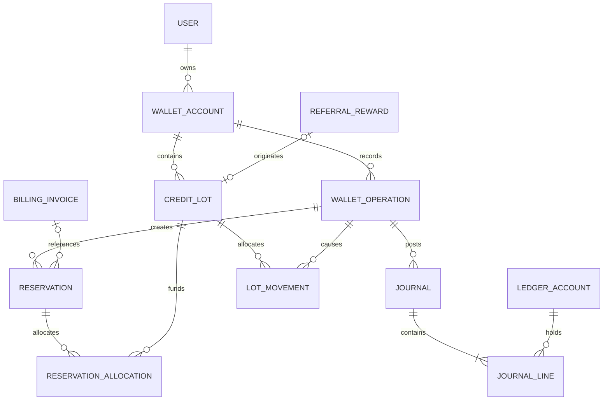

# Wallet module architecture and implementation blueprint

## Current wallet preview

`/wallet` follows the `/platforms` workspace: shared header and notice styles, three summary cards, a full-width activity table, and contextual referral/billing links. At 700px and below, activity becomes labeled two-column cards.

`database/fixtures/wallet.php` supplies illustrative activity in integer kobo. `WalletPreviewService` derives available, pending, reserved, earned and used amounts before applying allowlisted type/status filters. Completed rewards total NGN 2,500; completed subscription usage totals NGN 1,000; NGN 250 is reserved, leaving NGN 1,250 available. Pending rewards of NGN 500 are excluded. Records are sorted newest first. These are preview examples, not live balances or approved reward terms.

GET forms work without JavaScript; `wallet.js` adds automatic submission, a loading state and back-navigation recovery. Run `node tests/wallet-page.cjs` to verify reconciliation, desktop and 320/390px layouts, combined filters, empty results and the no-JavaScript fallback.

Status: **a non-interactive wallet page preview is implemented; live credit operations remain subject to policy approval and the foundations below**. The architecture has been approved for implementation; outstanding business and operational decisions remain release gates. This blueprint supersedes the generic wallet/payout sketches in [implementation-plan.md](implementation-plan.md), and complements [Referrals](referrals.md), [Plans & Billing](plans-billing.md), [data contract](data-contract.md), and [reference analysis](reference-analysis.md). Proposed decisions, policies, routes and schemas below are not approved functionality.

## 1. Existing system assessment

| Area | Evidence and dependency |
| --- | --- |
| Wallet | `DashboardController` routes `/wallet` to `views/wallet.php`, an unconnected preview. `database/fixtures/account.json` supplies `wallet_minor: 0`; this is demo data, not a customer balance. No wallet ledger, funding, redemption or transactions exist. |
| Referral | `/referrals` is a non-interactive preview. [Referrals](referrals.md) proposes 20% of the first qualifying payment, capped at ₦2,000 and released after 14 days, subject to approval and margin validation. There is no live reward or settlement infrastructure. |
| Billing | `/plans` displays confirmed plan names and prices, but no live subscriptions, payments or entitlements. [Plans & Billing](plans-billing.md) proposes quotes, invoices, provider adapter and verification; no provider is approved or connected. Its introductory description of a generic plans placeholder is stale relative to the current preview. |
| Architecture | PHP 8.1+, manual autoloading, front controller, constructor-injected services and repository interfaces, server-rendered views, Tailwind and small JS. Reuse the shared shell, breadcrumb, dialogs, responsive navigation and icons. Existing prediction API has `{data,error,meta}` with string errors; do not change it. |
| Foundations | No real authentication, session/CSRF, RBAC, user persistence, durable queue/outbox, live notification service, payment provider, audit service or migration system found. `database/schema.sql` is an unapplied prediction reference. No separate SRS or ADR directory found. The roadmap's services and schema are proposals. |
| Evidence | Reference navigation revealed a Wallet link, not its content or behavior. Demo NGN and Africa/Lagos settings do not establish production currency or jurisdiction. Never migrate fixture balances as financial records. |

## 2. Scope, rules and decisions

**Recommended model:** a restricted, non-transferable subscription-credit account per owner and approved currency, initially for approved referral rewards. Multiple lots within the account preserve source, policy, restrictions and expiry. Promotions, incentives and controlled administrative grants require separate approval. Credits are a service entitlement, not a cash balance. Deposits, withdrawals, transfers, betting balances, prepaid funds and cash redemption are out of scope. Whether credits are liabilities, discounts or deferred revenue is a finance decision; the operational ledger is not automatically the general ledger.

**Release decisions:** product and finance must approve referral terms and margin, eligible plans/invoices, currency, tax/fee treatment, rounding, settlement boundary, partial use and mixed payments, lot consumption priority, expiry and expiry during reservation, campaign overlap, refund/dispute and post-release recovery including already-spent credits, suspension/closure and disclosures. Finance must approve accounting mappings. Billing must approve invoice ownership and settlement. Security and operations must approve roles, approval thresholds, retention and incident SLAs. Legal/privacy should assess the actual business model and applicable obligations, including the [Nigeria Data Protection Act](https://www.ndpc.gov.ng/ndp-act-2023/) and relevant [CBN payment-system resources](https://www.cbn.gov.ng/PaymentsSystem/PSPs.html); neither establishes a licensing conclusion for this product. Unresolved features remain disabled.

### Functional lifecycle

1. An authenticated owner sees authoritative available subscription credit, pending conditional rewards, reserved credit and activity separately. Pending is not spendable and is not necessarily an accounting liability. Issued, used, expired and reversed totals are historical activity, not extra balances. Unknown is not zero.
2. Referral service creates one uniquely identified obligation from a trusted verified qualification and immutable policy snapshot. On or after the approved release instant, recheck eligibility, review and authoritative payment, then atomically post a credit and mark settled. Pending rewards may be held or cancelled according to approved policy. Post-release recovery stays disabled until approved; flag for review without silently creating debt or a negative balance.
3. Billing creates a server quote with eligible credit, any external remainder, policy and expiry. Upon explicit confirmation, revalidate owner, invoice, quote, wallet version and eligible lots; reserve credit under lock. If approved, partial credit can be combined with an existing payment provider. A verified matching successful payment captures the reservation and settles the invoice atomically; a verified terminal failure releases it. Unknown outcomes remain reserved for reconciliation. Zero external remainder requires an approved billing settlement path. Browser return is not proof of payment.
4. Approved refunds, adjustments and reversals create linked compensating entries. Never overwrite original entries, reverse beyond the unreversed source, or create negative spendable balances. Restoration of consumed lots and their expiry requires approved rules. Expiration acts on eligible unreserved amounts; a late expiry worker must not make expired credit spendable. Administrative adjustments require a reason, bounded authority, approval and audit.
5. Activity exposes an opaque reference, timestamps, type, signed amount and currency, status, posted balance impact, description, authorized related invoice/referral reference, expiry and reversal links. Pending and failed items do not imply a posted balance change. Support bounded filtering, reference search, stable pagination and details, with ownership checks throughout; avoid disclosure of a referred person's identity or fraud signals.

## 3. Ledger and consistency

Propose a **double-entry operational journal** in the application database, subject to finance approval of polarity and general-ledger mapping. A posted journal has at least two positive integer lines, one currency, debit/credit direction, and equal debit and credit sums. Illustrative accounts: issuance clearing, customer available, customer reserved, consumed and expired/reversed clearing. For a customer credit-positive convention: issuance debits clearing and credits available 900; reservation debits available and credits reserved 400; capture debits reserved and credits consumed 400; release debits reserved and credits available 400. Reverse with opposite lines in a new linked journal. These are operational movements, not a claim about statutory accounting classification.

A credit lot retains source, versioned restrictions and expiry. Append-only lot movements allocate journal changes. Under transaction lock enforce `issued = available + reserved + consumed + expired + reversed` for each lot, with nonnegative categories; an approved restoration is an opposite movement to consumption. Lot category totals must match customer journal accounts. A lockable wallet projection holds available/reserved and version and is updated atomically with journal and lot movements. Eligibility is recalculated from lots and invoice rules; no browser or cached balance authorizes a debit. Pending is derived separately from referral obligations. Rebuild projections from immutable movements, compare with journal, and quarantine mutations on mismatch.

For every mutation: claim idempotency and source uniqueness; lock source reward/invoice, wallet and lots in a globally agreed order (source, wallet ID, lot ID ascending); recheck status, eligibility and versions; insert operation, balanced journal and lot movements; update projection and source; append audit/outbox; commit. Use a single InnoDB transaction and shared connection; no external calls inside it. Cross-row sums require posting-service validation and reconciliation, not SQL CHECK alone. Restrict UPDATE/DELETE on posted records. Retry deadlocks with bounded backoff and the same key. Unique source and operation keys prevent duplicates even if a caller changes its idempotency key.

Proposed states: reward `pending` → `settled`, `cancelled` or `held`; reservation `active` → `captured` or `released`, with `review` for unknown outcomes. Terminal transitions happen once on authoritative evidence. Activity may show pending, posted, failed or reversed, but posted journals remain immutable. Timeouts do not imply failure. Reversal, expiry and restoration are new operations with source links and recorded policy/actor/reason.

## 4. Database design and migration

Proposed MySQL/InnoDB: internal BIGINT keys, opaque public IDs, UTC `DATETIME(6)`, FKs with RESTRICT for financial history, integer minor units with checked arithmetic, currency and approved exponent; no floats. NGN is illustrative until approved. Validate limits and use parameterized queries. Finalize against the actual user and billing schemas and query plans.

| Entity | Core fields, constraints and indexes |
| --- | --- |
| `wallet_accounts` | owner FK, currency, status, available/reserved projection and version; unique `(owner_id,currency)`; nonnegative totals. Create on first approved issuance under unique constraint. |
| `credit_lots` | wallet FK, source type/id/line, policy version, original amount, issue and nullable expiry time, restriction snapshot; unique source identity; index `(wallet_id,expires_at,id)`. |
| `wallet_operations` | public ID, wallet, type, status, amount/currency, source identity, correlation, effective/recorded time, reversal-of; unique business operation key; indexes `(wallet_id,recorded_at,id)` and `(wallet_id,type,recorded_at,id)`. Source references are validated server-side. |
| `ledger_accounts` | unique account code/currency; customer accounts linked to wallet and category, system-owned clearing accounts; unique wallet/category/currency. |
| `journals`, `journal_lines` | operation FK, unique posting key, currency, posted time, reversal-of; line journal/account FKs, direction and positive amount; index journal and account/time/id. Validate one currency and equal sums at posting. |
| `lot_movements` | lot, operation and journal FKs, category, signed delta, time; unique operation/lot/category/sequence; index lot/id. Net movements reconcile to lot and journal categories. |
| `reservations`, `reservation_allocations` | wallet/invoice/quote, amount/currency, status, expiry and version; allocation lot and positive amount; unique invoice attempt and reservation/lot, index status/expiry. Enforce one active reservation per attempt under the billing guard; allocations equal held movements. |
| `idempotency_records` | unique principal/scope/key, canonical request hash, operation, result/status, timestamps. Retention covers approved retry windows; permanent business-source uniqueness survives key expiry. |
| Shared `audit_events`, `outbox`, `inbox` | actor/action/target/reason/correlation and event ID/schema/version, minimum payload, timestamps; unique consumer/event and delivery state/time indexes. Referral rewards and billing invoices remain their owning modules' authoritative records. |

Migration order: approve platform and shared user/migration foundations; create schema behind disabled flags, provision system accounts through versioned migration, test fresh install and upgrade, and seed only approved configuration. Do not import fixture values. Backfill only verified obligations with finance-approved mapping, source IDs, dry-run totals and reconciliation; otherwise start empty. Test backup and restoration. After financial writes, preserve history and use forward corrections instead of destructive down migrations. Reconcile before cutover.

## 5. Backend, integrations and operations

Thin authenticated controllers validate syntax and delegate. A wallet application service orchestrates issuance, reservation, capture, release, expiry and compensation; a ledger posting component checks journals and lot allocations; balance/query service reads projections and eligibility; repositories own PDO persistence and locks; reconciliation compares journals, lots, projections, referral obligations and billing settlements. Use injected transaction manager, clock and policy resolver. Entities/value objects include Money, Wallet, CreditLot, Journal, Reservation and PolicyVersion. Introduce separate classes only where useful. Reuse shared audit/outbox/inbox and queue once built. Stable event IDs and versions for `CreditIssued`, `ReservationCreated`, `CreditApplied`, `CreditReleased`, `CreditExpired` and `CreditReversed` let consumers deduplicate and re-read source state after reordered delivery.

Referrals owns qualification and reward policy; wallet owns credit posting. Billing owns quotes, invoices and payment status; wallet owns reservation and consumption. With one database, coordinate source state and posting in one transaction through module contracts. A future distributed split needs an explicit saga and reconciliation protocol, not presumed cross-service atomicity. Payments owns provider verification; wallet neither adds a gateway nor stores card data. Billing validates signature, merchant reference, amount, currency and replay under the approved provider contract. Identity owns restrictions and account state. Notifications consume outbox events idempotently; credit issued, applied, reversed, approaching expiry and restriction notices are conditional on approved rules and preferences. Delivery failure never rolls back financial state.

Use at-least-once jobs, durable checkpoints, bounded exponential backoff, dead-letter alerts and idempotent consumers. Settlement/expiry workers process indexed batches, lock and recheck each item against UTC clock. Reconcile at least daily as a proposed baseline and after incidents: compare journal balance, lots, projections, source obligations, invoices and billing's provider reconciliation. Alert and quarantine affected operations on mismatches. Monitor aged holds, unknown payments, duplicate/rejected events, queue lag, deadlocks and discrepancies; operations must define thresholds and owners. Encrypt backups, test point-in-time restore and replay, and approve RPO/RTO and retention. Archive without breaking traceability. Optional private read cache requires short TTL/version invalidation; never use it for authorization. Financial API responses use `no-store`.

## 6. REST API contract

Proposed same-origin JSON `{data,error,meta}` with authenticated session, HTTPS and CSRF on mutations. New endpoints use `error: {code,message,details}` or null without changing existing prediction responses. `meta` includes `request_id` and list `next_cursor`. Infer owner from session; never trust client balance, currency, eligibility or payment state. Encode integer minor units as decimal strings to preserve JavaScript precision; ISO 8601 UTC timestamps. Opaque cursor encodes stable `(recorded_at,id)` and filters; default 25, maximum 100. Allowlist type/status/sort, bound dates and search length, and index accepted queries.

| Method and route | Request / response and controls |
| --- | --- |
| GET `/api/wallet` | Owner; 200 with currency, available, reserved, pending, status, version, `as_of` and separately labeled activity totals. Pending excluded from available; consistent snapshot or unavailable. |
| GET `/api/wallet/balances` | Owner; 200 categories and expiry summaries; no cross-currency aggregation. |
| GET `/api/wallet/transactions` | Owner; `cursor`, `limit`, `type`, `status`, `from`, `to`, `q`, `sort`; 200 entries and cursor. Search only exact/indexed prefix of authorized references. |
| GET `/api/wallet/transactions/{id}` | Owner; 200 authorized detail with source, timestamps, impact and reversal; 404 if inaccessible or absent. |
| GET `/api/wallet/credits` | Owner; `state` may be `pending`, `available`, `reserved` or `expired`; cursor/limit; 200 source labels, amounts, restrictions and dates; pending from referrals, other categories from lots. |
| GET `/api/wallet/rules` | Owner; 200 published policy version, uses, restrictions and effective dates; unavailable if no approved policy. |
| POST `/api/billing/quotes/{id}/wallet-reservation` | Owner + CSRF + `Idempotency-Key`; `{amount_minor,expected_wallet_version}`. Validate quote/invoice/owner, positive amount, policy and eligible balance; 201 reservation, 409 stale/key conflict, 422 ineligible/insufficient. Billing controls capture/release; no public capture endpoint. Enable only after policy approval. |
| GET `/api/admin/wallets`, `/api/admin/wallets/{id}`, `/api/admin/wallets/{id}/transactions`, `/api/admin/wallets/{id}/ledger`, `/api/admin/wallet/reconciliation` | Separate wallet-view, ledger-view and reconciliation permissions; bounded filters/cursor, 200 or 403/404. Audit sensitive access under policy. |
| POST `/api/admin/wallets/{id}/adjustments` | Adjustment permission, CSRF and key; `{kind,amount_minor,reason,expected_version}`; currency inherited; validate bounded amount and approved policy. 202 pending approval, 409 conflict, 422 invalid. No direct edits. |
| POST `/api/admin/wallet/adjustments/{id}/approve` | Separate approval permission, CSRF and key; different actor where required; recheck evidence, limits, version and policy. 200 posted or 409 stale. Audit rejection and correction as well. Approval threshold is a gate. |

Example: `{ "data": { "currency": "NGN", "available_minor": "90000", "reserved_minor": "0", "pending_minor": "0", "version": 4, "as_of": "2026-11-03T12:00:00Z" }, "error": null, "meta": { "request_id": "opaque" } }`. This is illustrative. A bounded opaque idempotency key is unique per principal/operation, stored with canonical payload hash and result in the same transaction: same key/payload returns the prior result; changed payload is 409; in-progress returns 409 with retry guidance. Version protects distinct concurrent commands. Errors: 400 malformed, 401 unauthenticated, 403 forbidden/CSRF, 404 inaccessible, 409 stale/idempotency/state, 422 ineligible/insufficient, 429 with Retry-After, 503 unavailable. Stable codes include `WALLET_STALE`, `INSUFFICIENT_ELIGIBLE_CREDIT`, `QUOTE_EXPIRED`, `OPERATION_PENDING` and `WALLET_UNAVAILABLE`. Rate-limit by principal with shared storage; do not expose database or fraud details.

## 7. Wallet page UX

Reuse `views/layout.php`, shared page container, breadcrumb, dark/green theme, typography, compact buttons, dialogs and mobile navigation. Hierarchy: Wallet page → breadcrumb/header and status notice → compact summary (available subscription credit primary; pending and reserved secondary with explanations) → activity heading and filters → desktop semantic table / mobile stacked rows → contextual usage and credit-source explanations → pending/expiring list only when enabled and useful → support link only when real support is available. Referral and plan links are contextual. No funding, withdrawal, transfer or cash indicators. All figures and eligibility come from backend; frontend only formats them.

Use compact summary and full-width table on desktop, stack balances and readable activity rows on phones, with no page overflow. GET filter forms provide server-rendered fallback; progressive enhancement preserves filters and shows loading. Details open an accessible focus-trapped dialog with close/Escape, focus return and full-page fallback, showing reference, dates, source, status, amount and authorized related record. Redemption belongs in billing checkout, with server quote, credit, external remainder, restrictions and explicit confirmation. Prevent duplicate submission and recover by operation status; show pending until verified.

Skeletons must not resemble zero. Empty history explains approved earning rules without promising a program. Explain pending and expiry using published terms. Errors retain filters and offer retry; announce changes politely. Provide keyboard access, visible focus, semantic headings/table, contrast, text alongside icons/color, screen-reader labels, responsive zoom and reduced motion. No fictitious amounts or success notices.

## 8. Security, administration and recovery

Authorize each record against authenticated owner; use opaque IDs and 404 for inaccessible resources. Secure session lifecycle, HttpOnly/Secure/SameSite cookies, CSRF, HTTPS and server validation are prerequisites. Audit actor, target, action, source, before/after references, reason, approval, correlation and UTC time. Restrict and monitor access; exclude secrets, card data and unnecessary personal data. Separate permissions for view, ledger investigation, adjustment request, approval and reconciliation; approve limits and separation of duties before enabling adjustments. Rate-limit and monitor abnormal referral patterns, route suspected abuse to review with appeal and minimal signals; do not treat one signal as proof.

On crash before commit, rollback leaves no partial journal; after commit, outbox replay resumes safely. Duplicate requests/events resolve through unique constraints and inbox/idempotency. Provider timeout keeps reservation until billing obtains authoritative status by stable reference; do not retry a charge or release on assumption. For mismatch, freeze affected mutations, preserve evidence, compare source/journal/lots, record an incident, approve a compensating journal and re-run reconciliation. Late success, reversal and chargeback are new events. Reconcile source/provider records after restore before reopening writes. Account closure, suspension, retention and deletion require approved policy; financial history must not cascade-delete.

## 9. Testing and acceptance

Use disposable MySQL/InnoDB with independent connections and injected clocks, plus unit tests. CI should run PHP standards/static analysis, tests and frontend build once foundations exist. Each feature is done only when its policy and invariants have signed examples, automated tests pass, observability and runbooks are exercised, accessibility checked, and product, finance and security approve release.

| Feature | Measurable acceptance |
| --- | --- |
| Identity/overview | Owner sees only own records; inaccessible IDs return 404, unauthenticated 401, missing CSRF 403. Zero, unknown and unavailable differ. Read totals match journal/lot snapshot. |
| Issuance/settlement | Duplicate and concurrent qualification/release produce exactly one lot and balanced journal. Pending is nonspendable; cancellation/release races cannot issue invalid credit. Boundary and rounding match approved examples. |
| Reservation/redemption | Parallel attempts cannot reserve beyond eligible balance; lot and journal invariants hold. Partial/full/zero-external cases match approved quotes; stale and insufficient requests change nothing. Verified success captures once, terminal failure releases once, unknown stays reserved. |
| Reversal/expiry | Original remains immutable; compensation cannot exceed original unreversed amount. Expiry boundary and reservation races follow policy. Spent-credit and post-settlement dispute cases remain disabled until policy examples are approved. |
| Admin/security | Cross-user access, privilege escalation, CSRF, replay, changed payload/key, forged events, duplicate webhooks and invalid amounts cannot post; adjustments require approved role, reason and audit. |
| Recovery/operations | Inject crash before/after commit, duplicate/out-of-order events, deadlock and provider timeout; recover without duplicate money. Rebuild projections and reconcile to zero differences; test backup restore and alert on injected mismatch and aged holds. |
| UI | Verify desktop/phone, keyboard/screen reader, zoom, contrast, empty/loading/error and pagination; no checkout success before settlement. Regression-test existing prediction API and preview routes. |

## 10. Dependency-aware roadmap

The architecture has been approved for implementation. Each live capability requires the applicable policy approvals and foundations before work begins; the page preview does not enable live operations. Each phase is complete only with its listed deliverables, security controls and acceptance checks.

| Phase | Objective and deliverables | Dependencies and Definition of Done |
| --- | --- | --- |
| 1 Discovery | Confirm scope, rules, accounting, legal and risk register; signed examples and ownership. No DB/API change. | Product, finance, legal, security and billing/referral owners sign decisions; unresolved flows disabled. |
| 2 Domain/ledger | Finalize journal polarity, invariants, locks, ERD, migrations, threat model and reconciliation. | Shared users, MySQL, migration, audit/outbox foundation; finance approves mapping; fresh-install/upgrade and invariant tests pass. |
| 3 Backend | Repositories, transaction management, posting, projections and approved reserve/capture/release/compensation. | Phase 2, identity and transaction infrastructure; wallet schema and internal contracts; race, crash, replay and balancing tests pass. |
| 4 API/integrations | Owner APIs, referral consumers, billing quote/settlement adapter, outbox notifications. | Approved referral/billing policy, verified payment pipeline, CSRF/RBAC and jobs; §6 endpoints; end-to-end duplicate, partial, timeout and ownership tests pass. |
| 5 UI | Responsive page and billing quote interaction using authoritative contracts. | Phase 4 and published terms; views/CSS/progressive JS; accessibility, mobile, loading/error and end-to-end checks pass. |
| 6 Admin | Least-privilege investigation, adjustment approval, audit and reconciliation. | Approved roles/thresholds and finance operations; admin APIs and shared audit; separation-of-duties and correction tests pass. |
| 7 Readiness | Security review, load and restore drills, runbooks, alerts, reconciliation and staged flag-controlled release. | Enabled phases, legal/finance sign-off and support owners; reconciliation clean, approved RPO/RTO and alert thresholds, explicit launch authorization. |

## 11. Architectural decision records

| ID / status | Proposed decision and alternative | Consequence / gate |
| --- | --- | --- |
| W-01 proposed | Restricted subscription credits; general cash wallet requires separate requirements and regulatory design. | Matches proposed referrals; product/legal approval needed. |
| W-02 proposed | Balanced operational journal, per-lot allocations and rebuildable projection; mutable balance alone lacks adequate audit. | Additional storage and reconciliation; finance approves mapping/polarity. |
| W-03 proposed | Pending obligations outside spendable ledger until settlement; immediate availability risks unqualified rewards. | Separate display and source reconciliation; policy needed. |
| W-04 proposed | Billing owns quote, invoice and provider verification; wallet reserves/captures; wallet-owned gateway would duplicate billing. | Shared transaction required locally; distributed operation requires a designed saga. |
| W-05 proposed | Immutable compensations and controlled approvals rather than direct balance edits. | Exception workflow required, especially for spent-credit reversals. |
| W-06 proposed | Backend-authoritative balances, session/CSRF and idempotency rather than client calculations. | Real identity and transactional foundations required before launch. |
